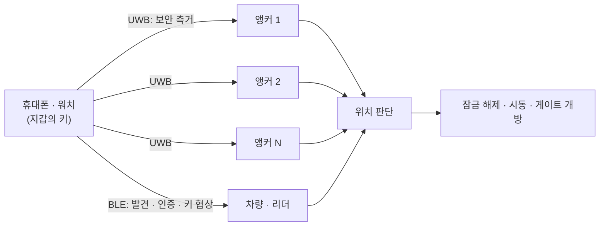

# 디지털 키와 핸즈프리 출입

!!! spec "규격 · 개정판"
    CCC Digital Key Release 3 · CSA Aliro · FiRa 핸즈프리 출입 사용 사례 · IEEE 802.15.4z HRP + STS, DS-TWR

!!! basic "한눈에 보기"
    디지털 키는 UWB가 대중화된 가장 큰 이유입니다. 휴대폰을 **꺼내지 않고** 차 문을 열고, 사무실 게이트를 통과하고, 집 도어락을 여는 것이 목표입니다.

    이를 위해 시스템은 세 가지를 동시에 판단해야 합니다.

    1. **누구인가** — 등록된 키인가 (BLE·보안 요소 인증)
    2. **어디 있나** — 문 앞 몇 m 안인가, 안쪽인가 바깥쪽인가 (UWB 측거)
    3. **진짜 거리인가** — 릴레이 공격으로 꾸며진 거리가 아닌가 (STS 보안 측거)

    표준은 차량용 [CCC Digital Key 3.0](../ecosystem/ccc-digital-key.md), 건물·도어락용 [CSA Aliro](../ecosystem/aliro.md)가 있고, 둘 다 FiRa·802.15.4z 위에 서 있습니다.

## 시스템 구조 { .l2 }

## 차량과 출입문의 차이 { .l2 }

| 항목 | 차량 | 건물 출입문·도어락 |
|---|---|---|
| 앵커 수 | 여러 개 (차체 둘레, 실내) | 보통 하나 (리더). AoA로 방향 보완 |
| 판단 영역 | 차 주변 접근 구역, 차 안 (시동) | 문 앞 접근 구역, 문 안·밖 |
| 핵심 난제 | 몸·가방에 가려진 휴대폰, 차체 금속 | 문 앞을 지나가는 사람과 들어가려는 사람 구분 |
| 전력 | 차량 배터리 (대기 전력 제한) | 도어락은 건전지 → 매우 엄격 |
| 동작 | 접근 시 웰컴 라이트·잠금 해제, 이탈 시 잠금 | 접근 시 개방, 통과 후 잠금 |

## 위치 판단 방법 { .l2 }

| 방법 | 내용 | 장단점 |
|---|---|---|
| 거리 임계값 | 가장 가까운 앵커 거리 < 기준 | 단순. NLoS에서 오판 |
| 다변 측위 | 여러 앵커 거리로 2·3차원 위치 계산 ([위치 추정 알고리즘](../ranging/positioning.md)) | 정확. 앵커 배치·보정 필요 |
| 영역 분류 | 앵커별 거리 패턴을 학습해 "문 앞·실내·멀리" 분류 | 차체 영향에 강함. 학습 데이터 필요 |
| 궤적·의도 | 거리 변화율, 방향, 머문 시간 | 지나가는 사람 오작동 감소 |

실제 제품은 이 방법들을 조합하고, 경계에서는 **히스테리시스**(열리는 기준과 닫히는 기준을 다르게)를 둬서 문이 열렸다 잠겼다 반복하지 않게 합니다.

## 전력 관리 { .l2 }

- 휴대폰과 리더 모두 UWB를 상시 켜 두지 않습니다. **BLE로 먼저 근접을 감지**한 뒤 UWB 측거를 시작합니다.
- 측거 주기는 멀리 있을 때 길게, 가까워지면 짧게 바꿉니다.
- 건전지 도어락은 BLE 광고 주기, UWB 세션 길이, 수신 대기 시간이 배터리 수명을 결정합니다([저전력 동작](../mac/low-power.md)).

??? expert "전문가 노트 — 오작동 유형과 시험"
    현장에서 자주 문제가 되는 상황과 대응은 다음과 같습니다.

    | 상황 | 증상 | 대응 |
    |---|---|---|
    | 뒷주머니·가방 속 휴대폰 | 거리가 길게 나와 늦게 열림 | 앵커 여러 개 결합, NLoS 판정 결과 반영 |
    | 차 안에 휴대폰을 두고 내림 | 잠금 안 됨 또는 경고 필요 | 실내 앵커로 차 안 판정, 경고 |
    | 집 안 현관 근처 휴대폰 | 밖의 사람이 문 열 수 있음 | 문 안·밖 판정(AoA, 앵커 배치), 의도 판단 |
    | 많은 사람이 동시에 접근 | 측거 슬롯 부족, 반응 지연 | 다중 노드 스케줄링, 우선순위 ([다중 노드 측거](../mac/multi-node.md)) |
    | 릴레이·거리 축소 시도 | 먼 키로 문 열림 | STS 보안 측거, 이상 거리 감지 ([공격 연구와 대응](../security/attacks.md)) |

    시험은 보통 **사람이 휴대폰을 여러 자세로 들고** 정해진 경로를 걷는 방식으로 하며, 경로별 개방 거리 분포와 오개방률을 봅니다. 차량은 차종마다 금속 구조가 달라 앵커 배치와 판정 영역을 차종별로 조정합니다.
