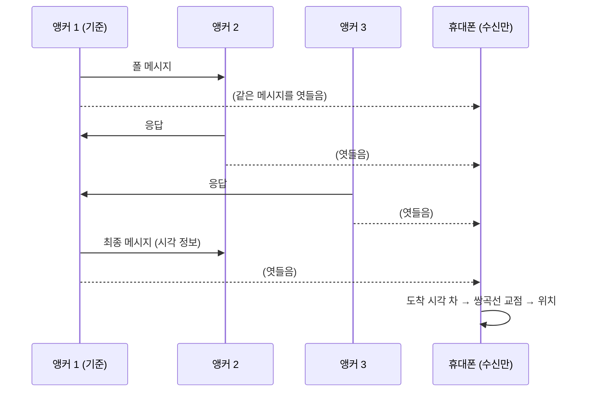

# 실내 측위와 내비게이션

!!! spec "규격 · 개정판"
    FiRa 위치 기반 서비스 사용 사례 (DL-TDoA) · IEEE 802.15.4z 일방향 측거(OWR) · 측위 알고리즘 일반 (다변 측위, 칼만 필터)

!!! basic "한눈에 보기"
    GPS는 실내에서 거의 동작하지 않습니다. 공항, 쇼핑몰, 병원, 지하 주차장에서 "지금 어디 있고, 목적지까지 어떻게 가나"를 알려 주려면 실내 측위 인프라가 필요합니다.

    UWB 실내 측위는 천장·벽에 **앵커**를 설치하고, 휴대폰이 앵커 신호로 자기 위치를 계산하는 방식입니다. 정확도가 수십 cm 수준이라 "이 매장 앞", "이 주차 칸", "이 선반"까지 구분할 수 있습니다. BLE 비콘(수 m)이나 Wi-Fi 측위보다 한 단계 정밀합니다.

    휴대폰 수가 많은 공공장소에서는 **DL-TDoA**가 핵심입니다. 앵커만 송신하고 휴대폰은 **듣기만** 하므로, GPS처럼 사용자 수에 제한이 없고 위치가 휴대폰 안에서만 계산됩니다.

## DL-TDoA 동작 { .l2 }

앵커끼리 측거 메시지를 주고받으면, 휴대폰은 그 메시지들의 **도착 시각 차이**와 메시지에 담긴 앵커 측 시각 정보로 각 앵커까지의 거리 **차**를 구합니다. 거리 차가 일정한 점들은 쌍곡선을 이루고, 여러 쌍곡선의 교점이 위치입니다([TDoA](../ranging/tdoa.md)).

## 방식 비교 { .l2 }

| 방식 | 휴대폰 동작 | 사용자 수 | 위치 계산 위치 | 쓰임 |
|---|---|---|---|---|
| DL-TDoA | 수신만 | 무제한 | 휴대폰 | 공항·쇼핑몰 내비게이션 |
| TWR (앵커와 왕복) | 송수신 | 슬롯 수만큼 제한 | 양쪽 | 소규모, 고정밀 |
| UL-TDoA | 송신만 | 많음 | 인프라 | 자산·인원 추적 ([산업 RTLS](industrial-rtls.md)) |

## 설치 설계 { .l2 }

| 항목 | 고려 사항 |
|---|---|
| 앵커 밀도 | 어느 지점에서든 3–4개 이상 앵커가 LoS로 보이게. 복도·기둥이 많으면 촘촘히 |
| 앵커 기하 | 앵커가 한쪽에 몰리면 위치 오차가 커짐 (GDOP). 둘러싸도록 배치 |
| 앵커 위치 측량 | 앵커 좌표 오차가 그대로 위치 오차가 됨. cm 단위 측량 |
| 앵커 동기 | DL-TDoA는 앵커 간 메시지로 상대 시각을 맞춤. 앵커 클럭 품질 중요 |
| 지도 연동 | 층 판별, 실내 지도 좌표계, 길 찾기 그래프 |

## 센서 융합 { .l2 }

UWB만으로는 앵커가 가려지는 구간에서 위치가 튑니다. 실제 내비게이션은 휴대폰의 **가속도·자이로(보행자 추측 항법, PDR)**, 기압계(층 판별), 지도 제약(벽을 통과할 수 없음)을 칼만 필터·파티클 필터로 결합합니다. UWB가 있으면 PDR의 누적 오차를 주기적으로 바로잡을 수 있습니다.

??? expert "전문가 노트 — 오차 요인과 확장성"
    DL-TDoA 위치 오차는 대략 다음의 합입니다.

    - **도착 시각 측정 오차**: NLoS 편향, 다중 경로 ([오차 요인과 보정](../ranging/errors-calibration.md))
    - **앵커 시각 동기 오차**: 앵커 클럭 드리프트를 메시지 교환으로 추정하는 과정의 오차
    - **기하학적 증폭(GDOP)**: 같은 거리 오차라도 앵커 배치가 나쁘면 위치 오차가 커짐
    - **휴대폰 클럭 드리프트**: 측정 구간 동안의 드리프트. 짧은 라운드로 영향 축소

    DL-TDoA는 사용자 수에는 제한이 없지만, 앵커 수가 많아지면 **앵커들의 송신 스케줄**이 겹치지 않게 셀(클러스터)로 나눠 운영해야 합니다. 이웃 셀의 앵커가 같은 채널·시간에 송신하면 간섭이 생기므로, 시간 슬롯과 프리앰블 코드를 셀별로 다르게 배정합니다.

    프라이버시 측면의 장점은 [프라이버시](../security/privacy.md)에서 다뤘습니다.
