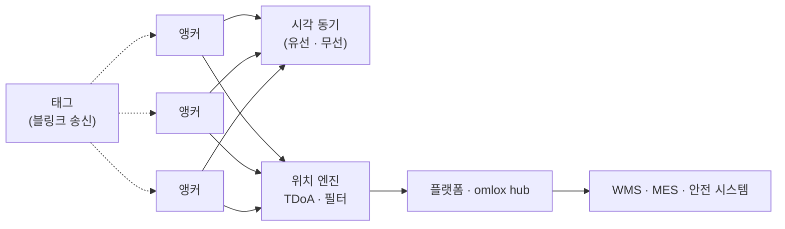

# 산업 RTLS

!!! spec "규격 · 개정판"
    IEEE 802.15.4a·4z HRP UWB PHY (블링크, TDoA) · ISO/IEC 24730-62 · omlox (PI) · 산업 안전 관련 응용 가이드

!!! basic "한눈에 보기"
    **RTLS(Real-Time Locating System)**는 사람·차량·물건의 위치를 실시간으로 추적하는 시스템입니다. UWB는 스마트폰보다 먼저 이 시장에서 자리 잡았습니다. 2010년대 802.15.4a 기반 칩이 나오면서 공장, 물류 창고, 병원, 광산, 스포츠 경기장에 보급됐습니다.

    산업 현장이 UWB를 고르는 이유는 세 가지입니다.

    1. **정확도** — 수십 cm. 어느 선반, 어느 작업 칸인지 구분
    2. **실시간성** — 초당 여러 번 갱신. 움직이는 지게차도 추적
    3. **금속 환경 견딤** — 짧은 펄스라 반사파와 직접파를 구분하기 쉬움 ([UWB 채널과 다중 경로](../basics/channel-multipath.md))

## 대표 사용 사례 { .l2 }

| 사례 | 추적 대상 | 요구 사항 |
|---|---|---|
| 물류 창고 | 지게차, 팔레트 | 적재 위치 자동 기록, 경로 최적화 |
| 제조 공정 | 공구, 부품 카트, 작업물 | 공정 단계 자동 확인, 공구 토크 설정 자동 전환 |
| 작업자 안전 | 작업자, 중장비 | 근접 경고, 위험 구역 진입 감지 |
| 병원 | 의료 장비, 환자, 직원 | 장비 찾기, 동선 분석 |
| 스포츠 | 선수, 공 | 초당 수십 회 갱신, 경기 분석 |
| 광산·터널 | 작업자, 차량 | 비상 시 위치 파악 |

## 시스템 구성 { .l2 }

대부분 **UL-TDoA**를 씁니다. 태그는 주기적으로 짧은 블링크만 보내고, 시각이 맞춰진 앵커들이 도착 시각을 서버로 보내면 위치 엔진이 위치를 계산합니다([TDoA](../ranging/tdoa.md)). 태그가 송신만 하므로 배터리가 수년 가고, 태그 수천 개를 감당할 수 있습니다.

## 설계 변수 { .l2 }

| 변수 | 영향 |
|---|---|
| 블링크 주기 | 짧을수록 실시간성 ↑, 배터리 수명·용량 ↓. 움직임 센서로 정지 시 주기를 늘림 |
| 앵커 간격 | 넓을수록 비용 ↓, 정확도·커버리지 ↓. 랙·기계가 많으면 촘촘히 |
| 앵커 동기 방식 | 유선(케이블로 클럭 분배)은 정밀·설치비 큼, 무선(동기 메시지)은 유연 |
| 태그 용량 | 같은 영역에서 동시에 처리할 수 있는 블링크 수 (충돌 확률) |
| 정확도 목표 | 구역 판별(수 m)인가, 위치 좌표(수십 cm)인가 |

## 블링크 충돌과 용량 { .l2 }

UL-TDoA 태그는 서로 조율 없이 송신(ALOHA형)하는 경우가 많아, 태그가 많으면 블링크가 겹칩니다. 블링크 하나의 공중 시간이 짧을수록, 태그별 송신 시각에 무작위 지터를 넣을수록 충돌이 줄어듭니다. 높은 갱신률이 필요한 소수 태그(지게차)와 낮은 갱신률의 다수 태그(팔레트)를 섞어 운영하는 것이 일반적입니다.

??? expert "전문가 노트 — 금속 환경과 안전 응용"
    산업 현장은 금속 랙, 기계, 컨테이너가 많아 **NLoS와 강한 반사**가 일상입니다. 대응은 다음과 같습니다.

    - 앵커를 높게 설치해 랙 위로 LoS를 확보
    - 앵커 수를 늘려, 가려진 앵커를 위치 계산에서 빼도 충분한 수가 남게 함
    - 위치 엔진에서 NLoS 판정 결과나 잔차가 큰 측정을 제외 ([오차 요인과 보정](../ranging/errors-calibration.md))
    - 지게차처럼 움직임 모델이 분명한 대상은 운동 모델 필터 적용

    **작업자 안전**(지게차–사람 충돌 경고)처럼 위치가 안전과 직결되면, 시스템 가용성과 지연, 오경보·미경보 비율을 별도로 평가해야 합니다. 이 경우 인프라 없이 **태그끼리 직접 TWR**로 거리를 재는 근접 경고 장치가 많이 쓰입니다. 인프라 측위는 위치 기록용, 직접 TWR은 즉시 경고용으로 역할을 나누는 구성도 흔합니다.

    상호운용 표준은 [omlox와 RTLS](../ecosystem/omlox.md)에서 다룹니다.
