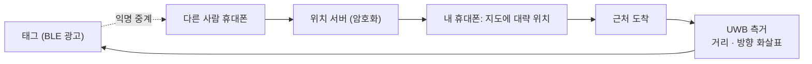

# 근접 공유와 분실물 찾기

!!! spec "규격 · 개정판"
    Apple Nearby Interaction · Android UWB API · IEEE 802.15.4z DS-TWR, AoA · BLE (발견, 크라우드 위치 네트워크)

!!! basic "한눈에 보기"
    휴대폰 UWB의 가장 친숙한 기능은 두 가지입니다.

    1. **분실물 찾기** — 소파 밑 열쇠에 붙은 태그를 화면의 **화살표와 거리**로 찾아가는 기능
    2. **근접 공유** — 휴대폰을 상대 쪽으로 **가리키면** 그 사람이 공유 대상 맨 앞에 뜨는 기능

    둘 다 UWB가 **거리와 방향**을 함께 준다는 점을 이용합니다. BLE 신호 세기로는 "근처에 있다"까지만 알 수 있지만, UWB는 "왼쪽으로 30°, 2.4 m"를 알려 줍니다.

## 분실물 태그의 두 단계 { .l2 }

| 단계 | 기술 | 하는 일 |
|---|---|---|
| 멀리 있을 때 | BLE + 크라우드 네트워크 | 주변을 지나는 다른 사람의 휴대폰이 태그 BLE 신호를 익명으로 중계 → 대략 위치를 지도에 표시 |
| 근처에 왔을 때 | BLE → **UWB** | 태그와 내 휴대폰이 UWB 측거 → 거리·방향 화살표로 안내 (정밀 찾기) |

## 방향은 어떻게 알까 { .l2 }

휴대폰 안의 UWB 안테나 2–3개가 같은 펄스를 받을 때 생기는 **위상 차**로 도착 각도를 계산합니다(PDoA). 안테나 두 개면 좌우 방향 하나, 세 개면 좌우와 위아래를 알 수 있습니다([AoA와 PDoA](../ranging/aoa-pdoa.md)).

| 상황 | 방향 정확도 |
|---|---|
| 휴대폰 정면, 세로로 듦, LoS | 좋음 (수 도 단위) |
| 휴대폰 옆·뒤쪽 | 나쁨. 앱이 "휴대폰을 돌려 보세요"라고 안내 |
| 가방·쿠션 안 태그 (NLoS) | 거리 편향, 방향 흔들림 |

그래서 정밀 찾기 화면은 방향이 불확실하면 화살표 대신 "더 가까이 / 멀어짐" 같은 거리 안내만 보여 줍니다. 일부 구현은 휴대폰을 움직일 때의 **카메라·관성 센서**를 결합해 방향을 보완합니다.

## 태그 설계 { .l2 }

| 항목 | 고려 사항 |
|---|---|
| 배터리 | 코인 전지로 1년 내외. UWB는 정밀 찾기 중에만 켬 |
| 안테나 | 태그는 보통 안테나 하나 (방향은 휴대폰이 계산) |
| 크기·방수 | 열쇠고리·지갑 카드 형태 |
| 플랫폼 지원 | iOS·Android 각각의 위치 네트워크와 UWB 액세서리 사양 ([스마트폰 API](../ecosystem/smartphone-api.md)) |

??? expert "전문가 노트 — 스토킹 방지와 상호운용"
    분실물 태그는 다른 사람을 몰래 추적하는 데 악용될 수 있습니다. 그래서 플랫폼 회사들은 **모르는 태그가 나와 함께 이동하면 알려 주는** 기능을 넣었고, 서로 다른 플랫폼의 태그도 감지하도록 업계 공통 규격(원치 않는 추적 감지)을 만들고 있습니다. 경고를 받은 사용자는 UWB 정밀 찾기나 태그 소리로 태그를 찾을 수 있습니다.

    근접 공유(가리켜서 공유)는 기기 간 **DS-TWR + AoA**를 짧게 수행합니다. 두 휴대폰 모두 송신하므로, 측거 세션은 공유 화면을 열었을 때만 잠깐 유지합니다. 이웃 기기들과의 세션이 많아지면 슬롯 스케줄링이 필요합니다([다중 노드 측거](../mac/multi-node.md)).

    태그 거리 정확도는 태그 안테나 지연 보정에 크게 좌우됩니다. 대량 생산 태그는 기기별 보정 대신 대표값을 쓰는 경우가 많아, 수–십수 cm 편향이 남을 수 있습니다([안테나와 그룹 지연](../basics/antenna-delay.md)).
