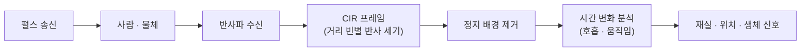

# UWB 레이더와 센싱

!!! spec "규격 · 개정판"
    UWB 임펄스 레이더 일반 원리 · IEEE 802.15.4ab 센싱 관련 논의 (초안 기준, 논의 중) · 차량 실내 아동 감지(CPD) 관련 안전 평가 동향

!!! basic "한눈에 보기"
    UWB 측거는 상대 기기가 신호를 **되돌려 보내야** 합니다. 반면 UWB **레이더**는 기기 하나가 펄스를 쏘고, 사람·물체에 **반사돼 돌아온** 신호를 분석합니다. 상대에게 기기가 없어도 됩니다.

    짧은 펄스 덕분에 반사체까지의 거리를 cm 단위로 나눠 볼 수 있고, 시간에 따른 미세한 변화로 **숨 쉬는 가슴의 움직임**(수 mm)까지 잡을 수 있습니다.

    대표 응용은 다음과 같습니다.

    - **차량 실내 아동·동물 감지** — 잠긴 차 안에 남은 아이를 숨 쉬는 움직임으로 감지
    - **재실 감지** — 사람이 있는지, 몇 명인지 (조명·공조 제어)
    - **생체 신호** — 호흡·심박 비접촉 측정 (수면 모니터링)
    - **동작 인식** — 손짓, 접근 감지 (기기 깨우기)

## 원리 { .l2 }

| 처리 단계 | 내용 |
|---|---|
| CIR 수집 | 펄스를 반복 송신하고 수신 채널 임펄스 응답(CIR)을 프레임으로 쌓음. 각 시간 빈은 특정 거리의 반사에 해당 ([UWB 채널과 다중 경로](../basics/channel-multipath.md)) |
| 배경 제거 | 벽·좌석처럼 변하지 않는 반사를 평균으로 빼냄 |
| 움직임 검출 | 남은 신호의 시간 변화. 큰 움직임(걷기)과 미세 움직임(호흡) 구분 |
| 주파수 분석 | 호흡(분당 십수 회), 심박(분당 수십 회) 대역의 주기 성분 추출 |
| 위치 추정 | 거리 빈 + 다중 안테나 각도로 사람 위치 |

## 측거 칩으로 레이더를 하는 이유 { .l2 }

차량에는 이미 Digital Key용 UWB 앵커가 여러 개 있습니다. 같은 하드웨어로 **차가 잠긴 뒤 레이더 모드**로 바꾸면 별도 센서 없이 실내 감지를 할 수 있습니다. 앵커 하나가 송신하고 다른 앵커가 수신하는 **바이스태틱** 구성도 쓸 수 있습니다.

| 방식 | 장점 | 단점 |
|---|---|---|
| 전용 UWB 레이더 센서 | 레이더에 최적화된 펄스 반복률·감도 | 부품 추가 |
| 측거 칩 겸용 (모노스태틱) | 부품 공유 | 송수신 격리, 근거리 맹점 |
| 측거 칩 겸용 (바이스태틱, 앵커 간) | 기존 앵커 활용, 넓은 영역 | 앵커 간 동기, 기하 의존 |

## 다른 센싱 기술과 비교 { .l2 }

| 기술 | 장점 | 한계 |
|---|---|---|
| UWB 임펄스 레이더 | 시트·담요 투과, 거리 분해능, 낮은 전력 밀도 | 각도 분해능은 안테나 수에 제한 |
| 60 GHz FMCW 레이더 | 높은 각도·거리 분해능 | 투과력 낮음, 별도 모듈 |
| 카메라 | 풍부한 정보 | 프라이버시, 가림·조명에 약함 |
| 무게·압력 센서 | 단순 | 좌석 위만, 아기 바구니 등에 약함 |

??? expert "전문가 노트 — 규제와 표준화 동향"
    UWB 레이더는 같은 주파수 대역을 쓰지만 **규제 조건**이 통신·측거와 다를 수 있습니다. 차량 탑재, 실내·실외, 펄스 반복률과 듀티 사이클에 따라 지역별 규정 해석이 달라지므로, 제품화 전에 해당 지역 규제를 확인해야 합니다([주파수 규제](../basics/regulation.md)).

    IEEE 802.15.4ab에서는 센싱을 표준 기능으로 다루는 방안이 **논의 중**입니다. 측거 칩 간 센싱 신호 형식, 센싱 측정 보고 방식 등이 후보이며, 확정 내용은 표준 승인 후 확인해야 합니다([센싱과 레이더 표준화](../next/sensing.md)).

    차량 실내 아동 감지는 자동차 안전 평가 프로그램에서 직접 감지 방식을 요구하는 흐름이 생기면서 UWB·60 GHz 레이더 탑재가 늘고 있습니다. 평가 기준의 세부 요구(감지 시간, 대상 연령, 경고 방식)는 평가 기관의 최신 프로토콜을 확인해야 합니다.
