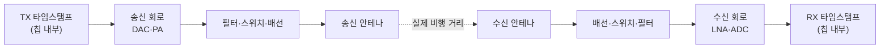

# 안테나와 그룹 지연

!!! spec "규격 · 개정판"
    IEEE 802.15.4-2020 측거 기능 (RMARKER 기준 타임스탬프, 측거 보정 관련 정보) · 802.15.4z-2020 (AoA 측정 보고) · 칩 제조사 안테나 지연·위상 보정 앱 노트

!!! basic "한눈에 보기"
    UWB 칩이 타임스탬프를 찍는 곳은 **칩 안쪽**이지만, 거리는 **안테나와 안테나 사이**의 거리입니다. 그 사이의 회로(필터, 스위치, 배선, 안테나 자체)를 신호가 지나가는 데도 시간이 걸립니다. 이것을 **안테나 지연(그룹 지연)**이라고 합니다.

    1 ns를 모르고 지나치면 거리가 **30 cm** 틀립니다. 그래서 UWB 제품은 출고 전에 이 지연을 재서 칩에 **보정값**으로 넣습니다.

    - 보정하지 않으면: 모든 측거값이 일정한 값만큼 길거나 짧게 나옴 (오프셋)
    - 보정이 기기마다 다르면: 같은 모델이라도 개체마다 수–수십 cm 차이

## 지연이 생기는 곳 { .l2 }

측정되는 시간은 "실제 비행 시간 + 송신 쪽 지연 + 수신 쪽 지연"입니다. TWR에서는 양쪽 기기의 송신·수신 지연이 모두 왕복 시간에 더해지므로, 각 기기는 자기 송신·수신 지연을 빼 줘야 합니다.

| 지연 원인 | 특징 |
|---|---|
| 칩 내부 송수신 경로 | 크지만 같은 칩끼리는 비슷함. 온도에 따라 조금 변함 |
| 보드 배선·필터·스위치 | 설계마다 다름 → 제품별 보정 필요 |
| 안테나 그룹 지연 | **방향(각도)에 따라 달라짐** → 보정이 어려운 부분 |
| 수신 신호 세기 | 강한 신호와 약한 신호에서 첫 경로 판정 위치가 달라짐 (거리 의존 편향) |

## 보정 방법 { .l2 }

| 방법 | 절차 | 장단점 |
|---|---|---|
| 기준 거리 보정 | 정확히 아는 거리(예: 1–5 m)에서 측거해 오프셋 계산 | 간단, 기준 기기 필요 |
| 3기기 상호 보정 | 세 기기가 서로 측거해 각자의 지연을 연립방정식으로 풂 | 기준 기기 없이 가능 |
| 온도 보상 | 온도별 지연 표를 두고 보정 | 산업용·차량용에서 중요 |
| 신호 세기 편향 보정 | 수신 세기별 편향 표 적용 | 근거리 정확도 개선 |

## 안테나가 측거에 미치는 영향 { .l2 }

UWB 안테나는 **넓은 대역 전체에서** 모양과 지연이 일정해야 합니다. 협대역 안테나는 중심 주파수에서만 잘 동작하면 되지만, UWB 안테나는 500 MHz 폭 전체에서 위상이 고르게 변해야 펄스 모양이 일그러지지 않습니다.

| 안테나 특성 | 측거에 미치는 영향 |
|---|---|
| 방향별 이득 차이 | 특정 방향에서 감도 저하 → 거리·NLoS 판정 영향 |
| 방향별 그룹 지연 차이 | 기기를 돌리면 측거값이 수 cm 변함 |
| 펄스 일그러짐 (분산) | 첫 경로가 무뎌져 정확도 저하 |
| 안테나 간 위상 중심 | AoA(PDoA) 정확도의 핵심 → 별도 위상 보정 필요 |

??? expert "전문가 노트 — 보정 수식과 AoA 위상 보정"
    **TWR 보정.** 장치 A와 B의 송신·수신 안테나 지연을 \(d_{A}^{tx}, d_{A}^{rx}, d_{B}^{tx}, d_{B}^{rx}\)라 하면, 보정 없이 계산한 왕복 시간에는 \(d_{A}^{tx} + d_{B}^{rx} + d_{B}^{tx} + d_{A}^{rx}\)가 더해집니다. 많은 칩은 송신·수신 지연을 하나의 "안테나 지연" 값(송신 타임스탬프에 더하고 수신 타임스탬프에서 빼는 방식)으로 다루며, 같은 기기의 두 값을 같다고 가정하고 합의 절반씩 배분합니다.

    **3기기 보정.** 세 기기 i, j, k가 정확한 상호 거리에서 측거하면, 각 쌍의 측정 오차 \(e_{ij} = (d_i + d_j)\cdot c/2\)로부터 세 개의 미지수 \(d_i, d_j, d_k\)를 풀 수 있습니다. 기기가 많으면 최소자승으로 풉니다.

    **AoA 위상 보정.** PDoA 방식의 각도 추정은 두 안테나 사이 위상차를 씁니다. 수신 경로마다 고정된 위상 오프셋이 있고, 안테나 패턴 때문에 위상차–각도 관계가 이론식(\(\Delta\phi = 2\pi d \sin\theta / \lambda\))에서 벗어납니다. 그래서 제품마다 회전대에서 각도별 위상차를 측정해 **보정 표(lookup table)**를 만들어 넣는 것이 일반적입니다([AoA와 PDoA](../ranging/aoa-pdoa.md)).
