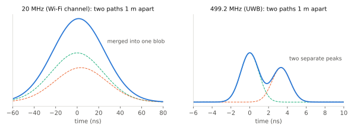

# 대역폭과 시간 분해능

!!! spec "규격 · 개정판"
    IEEE 802.15.4-2020 HRP UWB PHY 절 (칩 레이트 499.2 MHz, 측거 타임스탬프 정밀도) · 802.15.4z-2020 (RMARKER, 측거 카운터) · 계산: `tools/uwb_numbers.py`

!!! basic "한눈에 보기"
    전파는 **1 ns에 약 30 cm**를 갑니다. 그래서 거리를 cm 단위로 재려면 시간을 수십–수백 ps 단위로 재야 합니다.

    대역폭이 넓을수록 신호의 "모서리"가 날카로워져서 도착 시각을 정확히 짚을 수 있습니다. 대략 **시간 분해능 ≈ 1 / 대역폭**입니다.

    | 대역폭 | 시간 분해능 | 편도 거리 |
    |---|---|---|
    | 20 MHz (Wi-Fi 한 채널) | 50 ns | 15 m |
    | 160 MHz (Wi-Fi 6) | 6.25 ns | 1.9 m |
    | **499.2 MHz (UWB)** | **2.0 ns** | **0.6 m** |

    여기에 수신기가 신호를 여러 번 모으고 보간하면 실제 측거 정확도는 이보다 훨씬 좋은 **수 cm**까지 내려갑니다.

## 분해능: 두 경로를 구분하는 능력 { .l2 }

다중 경로 환경에서 직선 경로와 반사 경로가 **경로 길이 차 \(\Delta d\)**를 두고 도착한다고 합시다. 두 펄스가 따로 보이려면 도착 시간 차가 펄스 폭(≈ 1/B)보다 커야 합니다.

\[
\Delta d_{\min} \approx \frac{c}{B}, \qquad \frac{c}{499.2\ \text{MHz}} \approx 0.60\ \text{m}
\]

<figure markdown>

<figcaption>경로 길이가 1 m 다른 두 경로(점선)와 수신 신호(실선). 20 MHz에서는 한 덩어리로 합쳐지지만, 499.2 MHz에서는 두 봉우리로 갈라집니다.</figcaption>
</figure>

이것이 UWB 측거의 핵심입니다. 협대역에서는 직선 경로와 반사 경로가 섞여 도착 시각이 뭉개지지만, UWB에서는 **첫 번째 봉우리(첫 경로)**를 골라낼 수 있습니다.

레이더처럼 신호가 왕복하는 경우에는 거리 차가 두 번 반영되므로 분해능이 \(c/2B \approx 0.30\) m가 됩니다. 이 핸드북의 [파라미터 표](../reference/parameter-table.md)는 두 값을 모두 적습니다.

## 정확도: 한 경로의 시각을 얼마나 정밀하게 아는가 { .l2 }

분해능과 정확도는 다릅니다. 경로가 하나뿐이라면, 봉우리의 위치는 펄스 폭보다 훨씬 정밀하게 추정할 수 있습니다. 정밀도를 결정하는 것은 **SNR**과 **대역폭**입니다.

| 요소 | 정확도에 미치는 영향 |
|---|---|
| 대역폭 ↑ | 펄스 모서리가 날카로워져 오차 감소 |
| SNR ↑ (거리 가까움, 펄스 많이 모음) | 잡음에 의한 흔들림 감소 |
| 타임스탬프 단위 | 칩의 1/128 = **15.65 ps (4.69 mm)** — 양자화 오차는 무시할 수준 |
| 다중 경로·NLoS | 첫 경로를 잘못 고르면 수십 cm–수 m 편향 ([LoS/NLoS](los-nlos.md)) |
| 클럭 오차 | 측거 방식으로 상쇄해야 함 ([SS-TWR](../ranging/ss-twr.md), [DS-TWR](../ranging/ds-twr.md)) |

그래서 실무에서 UWB 측거 오차는 LoS에서 **표준편차 수 cm, 편향 10 cm 이내**를 목표로 하고, 실제 큰 오차는 대부분 NLoS와 첫 경로 검출 실패에서 나옵니다.

??? expert "전문가 노트 — 크라메르-라오 하한과 유효 대역폭"
    가산 백색 잡음 채널에서 도착 시간 추정의 분산 하한(CRLB)은 다음과 같습니다.

    \[
    \sigma_\tau \geq \frac{1}{2\pi \beta \sqrt{2\,\text{SNR}}}, \qquad
    \beta^2 = \frac{\int f^2 |P(f)|^2 df}{\int |P(f)|^2 df}
    \]

    여기서 \(\beta\)는 신호의 **RMS(유효) 대역폭**, SNR은 상관 후 에너지 대 잡음 밀도 비(\(E/N_0\))입니다. 거리로는 \(\sigma_d = c\,\sigma_\tau\)입니다. 대역폭을 두 배로 늘리면 하한이 절반이 되고, 같은 효과를 SNR로 얻으려면 6 dB가 필요합니다.

    이 하한은 **단일 경로**를 가정합니다. 실제 실내에서는 첫 경로 근처에 반사파가 붙어 있어(펄스 폭 안의 경로 차 < 0.6 m), 추정값이 CRLB보다 크게 나쁘고 편향이 생깁니다. 대역폭을 넓히는 1 GHz급 채널(Ch4, 7, 11, 15)이나 802.15.4ab의 논의는 이 근접 다중 경로 문제를 줄이려는 방향과도 관련이 있습니다.

    **RMARKER.** 802.15.4 UWB에서 프레임의 타임스탬프 기준점은 **RMARKER**(SFD 끝 다음 첫 PHR 칩의 첫 펄스 피크)로 정의됩니다. 송신·수신 양쪽이 같은 기준점을 쓰므로 프레임 길이와 무관하게 비행 시간을 계산할 수 있습니다.
