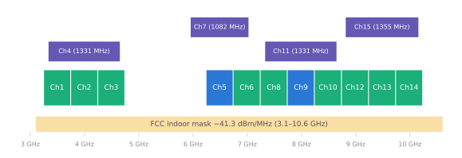

# 주파수 규제

!!! spec "규격 · 개정판"
    미국 FCC 47 CFR Part 15 Subpart F (15.501–15.525) · 유럽 ECC Decision (06)04, EC Decision 2007/131/EC (개정 포함), ETSI EN 302 065-1/-2/-3 · 일본 총무성 기술기준 (ARIB STD-T91) · 국내 과학기술정보통신부 고시 (무선설비 기술기준)

!!! basic "한눈에 보기"
    UWB는 다른 무선 시스템(위성, 레이더, 이동통신, Wi-Fi)이 이미 쓰고 있는 대역 위에 **아주 낮은 전력으로 겹쳐서** 쓰는 기술입니다. 그래서 면허 없이 쓸 수 있는 대신 조건이 까다롭고, **나라마다 허용 대역이 다릅니다.**

    - 미국은 3.1–10.6 GHz를 넓게 허용
    - 유럽은 6–8.5 GHz가 중심이고, 저대역(3.1–4.8 GHz)은 간섭 회피 기법이 필요
    - 일본·한국 등도 각자 대역과 조건을 정함

    그래서 전 세계에서 팔리는 휴대폰과 차는 **여러 나라가 공통으로 허용하는 채널**을 고릅니다. 대표가 **Ch9(7.9872 GHz)**, 그다음이 **Ch5(6.4896 GHz)**입니다.

<figure markdown>

<figcaption>HRP UWB 채널과 FCC 실내 허용 대역. 파란색 Ch5·Ch9가 스마트폰과 디지털 키에서 주로 쓰는 채널입니다.</figcaption>
</figure>

## 지역별 개요 { .l2 }

| 지역 | 주요 허용 대역 | 조건 (요약) |
|---|---|---|
| 미국 (FCC) | 3.1–10.6 GHz | 평균 −41.3 dBm/MHz EIRP, 피크 50 MHz당 0 dBm. 실내 기기·휴대 기기 조건 별도, 대역 밖 방사 마스크 |
| 유럽 (CEPT/EC) | 6.0–8.5 GHz | −41.3 dBm/MHz. 3.1–4.8 GHz와 8.5–9 GHz는 **LDC**(저 듀티 사이클) 또는 **DAA** 같은 간섭 완화 기법 필요. 차량·고정 실외 설비에 추가 조건 |
| 일본 | 3.4–4.8 GHz, 7.25–10.25 GHz | 저대역은 간섭 회피 기법 필요, 실내 중심 |
| 한국 | 과기정통부 고시로 대역과 완화 조건 지정 | 고시가 개정되어 왔으므로 최신 고시 확인 필요 |

이 표는 개요입니다. 실외 사용, 차량 장착, 고정 설비, 항공기 내 사용 같은 조건은 지역마다 따로 규정되며, 제품 인증 시에는 해당 국가의 최신 원문과 시험 규격을 확인해야 합니다.

## 왜 Ch9, 그리고 Ch5인가 { .l2 }

| 채널 | 범위 | 장점 | 단점 |
|---|---|---|---|
| **Ch9** | 7737.6–8236.8 MHz | 미국·유럽·일본 등 주요 시장 공통 허용, 차량 키 표준의 기본 | 주파수가 높아 경로 손실 약 1.8 dB 불리 |
| **Ch5** | 6240.0–6739.2 MHz | 경로 손실 유리, 유럽·미국 허용 | 일부 국가 제한, **Wi-Fi 6E/7의 6 GHz 대역과 겹침** |
| 저대역 (Ch1–4) | 3.2–4.7 GHz | 전파 특성 좋음 | 5G n77/n78 등과 겹쳐 많은 나라에서 제한·완화 조건 |

Ch5와 6 GHz Wi-Fi의 공존 문제는 [다른 기술과의 공존](../next/coexistence.md)에서 다룹니다.

## 간섭 완화 기법 { .l2 }

| 기법 | 뜻 | 쓰이는 곳 |
|---|---|---|
| **DAA** (Detect and Avoid) | 해당 대역에 다른 시스템(예: 이동통신)이 있으면 감지하고 송신을 줄이거나 멈춤 | 유럽·일본 저대역 등 |
| **LDC** (Low Duty Cycle) | 송신 시간 비율을 제한 (예: 일정 시간당 총 송신 시간 상한) | 유럽 저대역 등 |
| 실내 한정 | 실외 고정 설비 금지 등 | 여러 나라 |
| TPC (송신 전력 제어) | 필요 이상으로 세게 쏘지 않음 | 차량 등 |

??? expert "전문가 노트 — 실무에서 자주 걸리는 규제 포인트"
    **측정 방식 차이.** 같은 −41.3 dBm/MHz라도 측정 시간 창, 검파 방식(RMS 평균, 피크), 분해능 대역폭이 지역마다 달라 같은 송신 설정이 한 나라에선 통과하고 다른 나라에선 마진이 부족할 수 있습니다. 칩 제조사의 국가별 송신 전력 프리셋은 이 차이를 반영한 것입니다.

    **차량.** 유럽은 차량 장착 UWB에 송신 전력 제어나 듀티 사이클 같은 추가 조건을 두는 등 차량을 별도로 다룹니다. 디지털 키처럼 차 밖으로 신호를 내보내는 용도는 이 조건을 확인해야 합니다.

    **휴대폰의 국가별 제어.** 스마트폰은 위치(국가 코드)에 따라 UWB를 끄거나 채널을 제한합니다. 앱 개발자 입장에서는 "특정 국가에서는 UWB API가 사용 불가로 보일 수 있다"는 뜻입니다([스마트폰 API](../ecosystem/smartphone-api.md)).

    **국내.** 국내 UWB 기술기준은 과학기술정보통신부 고시(신고하지 아니하고 개설할 수 있는 무선국용 무선기기 관련 기술기준)에 있으며 개정 이력이 있습니다. 인증(KC 적합성 평가)은 국립전파연구원 기준을 따르므로, 제품 출시 전에 최신 고시와 시험 방법을 직접 확인하세요.
