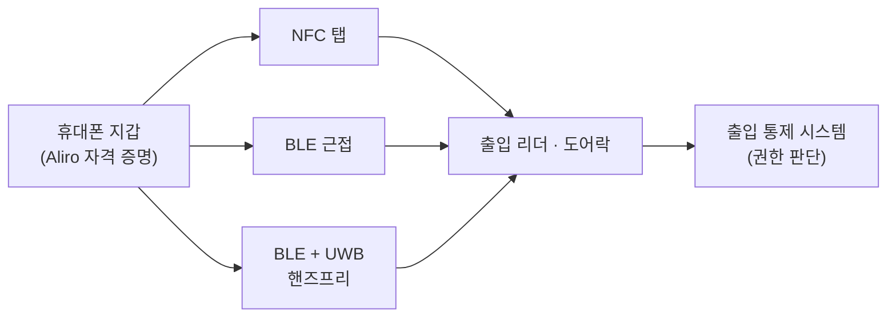

# CSA Aliro

!!! spec "규격 · 개정판"
    Connectivity Standards Alliance (CSA) Aliro 공개 자료 · NFC · Bluetooth LE · IEEE 802.15.4z HRP + STS (FiRa 기반)

!!! basic "한눈에 보기"
    **Aliro**는 휴대폰·스마트워치를 **출입 카드 대신** 쓰기 위한 표준입니다. 사무실 출입문, 호텔 객실, 아파트 공동 현관, 집 도어락이 대상입니다. Matter 스마트 홈 표준을 만든 **CSA(Connectivity Standards Alliance)**가 주관하고, 휴대폰 회사와 출입 통제·도어락 회사들이 함께 만들고 있습니다.

    지금은 출입 리더마다 회사별 앱과 카드 방식이 달라서, 건물이 바뀌면 다른 앱을 깔아야 합니다. Aliro는 **휴대폰 지갑에 들어간 출입 자격 증명**이 어느 회사 리더에서든 동작하게 하는 것이 목표입니다.

    CCC Digital Key가 "차 키"를 표준화했다면, Aliro는 "문 열쇠"를 표준화하는 셈입니다.

## 세 가지 동작 방식 { .l2 }

| 방식 | 기술 | 사용자 동작 | 특징 |
|---|---|---|---|
| 탭 | NFC | 리더에 휴대폰을 댐 | 가장 널리 호환, 전원 꺼진 휴대폰 지원 가능 |
| 근접 | BLE | 리더 앞에서 앱·알림으로 확인 | 거리 판단이 거침 |
| 핸즈프리 | BLE + **UWB** | 주머니에 넣은 채 문에 다가가면 열림 | 정밀 보안 측거, 방향 판단 |

## UWB 핸즈프리에서 중요한 것 { .l2 }

- **의도 판단**: 문 앞을 **지나가는** 사람과 **들어가려는** 사람을 구분해야 합니다. 거리뿐 아니라 접근 방향과 속도, 문 안쪽·바깥쪽 판단이 필요합니다. AoA를 지원하는 리더는 방향 정보를 쓸 수 있습니다([AoA와 PDoA](../ranging/aoa-pdoa.md)).
- **보안 측거**: 문 열림은 물리적 접근 권한이므로 릴레이 공격을 막는 STS 기반 측거가 필수입니다([왜 보안 측거인가](../security/why-secure-ranging.md)).
- **다수 사용자**: 출근 시간 게이트처럼 여러 사람이 동시에 다가오는 상황에서 리더가 여러 휴대폰과 측거해야 합니다([다중 노드 측거](../mac/multi-node.md)).
- **배터리**: 휴대폰이 모든 리더와 계속 측거하면 전력 소모가 큽니다. BLE로 먼저 근접을 감지하고 짧게 UWB 측거합니다.

## CCC Digital Key와 비교 { .l2 }

| 항목 | CCC Digital Key 3.0 | CSA Aliro |
|---|---|---|
| 대상 | 자동차 | 건물 출입, 도어락 |
| 앵커 | 차량에 여러 개 | 보통 문마다 리더 하나 (AoA로 보완) |
| 판단 영역 | 차 밖 근접, 차 안 | 문 안·밖, 접근 의도 |
| 자격 증명 발급 | 차량 제조사 서버 | 건물·출입 통제 운영자 |
| UWB 기반 | 802.15.4z + STS | 802.15.4z + STS, FiRa 기반 |

??? expert "전문가 노트 — 표준화 현황과 기존 출입 시스템"
    Aliro는 2023년에 작업이 공개됐고, 규격 1.0과 인증 프로그램이 순차적으로 진행되고 있습니다. 정확한 버전·일정과 UWB 핸즈프리의 세부 요구 사항은 CSA 공지와 회원 문서를 확인해야 합니다. 이 페이지는 공개 개요 수준만 다룹니다.

    기존 출입 시스템과의 관계도 중요합니다. 대형 건물은 이미 카드 리더와 출입 통제 서버(PACS)가 깔려 있으므로, Aliro 리더는 **기존 출입 통제 서버와 연동**하는 형태로 도입되는 경우가 많습니다. 자격 증명 발급과 폐기는 출입 통제 운영자의 시스템에서 관리하고, 리더는 휴대폰과의 인증·측거만 맡는 구조입니다.

    UWB 핸즈프리 리더는 NFC 리더보다 부품 원가와 설치 조건(문 프레임 금속, 안테나 배치)이 까다롭습니다. 그래서 초기에는 NFC·BLE가 먼저 보급되고, UWB 핸즈프리는 고급 도어락·차량형 출입 게이트부터 들어갈 것으로 보는 시각이 많습니다.
