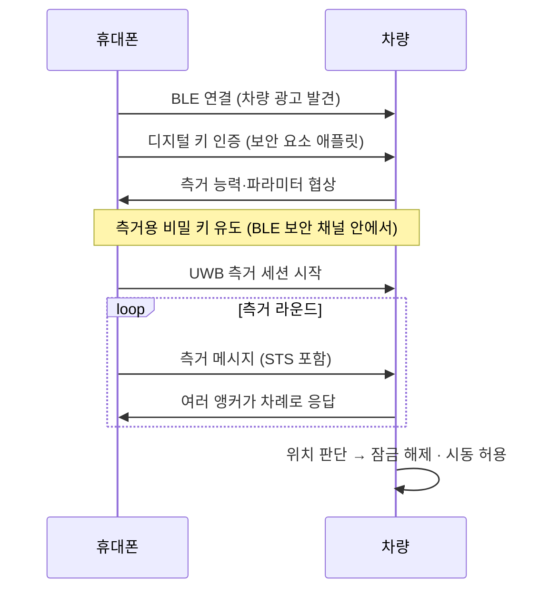

# CCC Digital Key 3.0

!!! spec "규격 · 개정판"
    Car Connectivity Consortium Digital Key Release 3 (공개 개요·발표 자료 기준) · Bluetooth LE · NFC · IEEE 802.15.4z HRP + STS

!!! basic "한눈에 보기"
    **CCC Digital Key**는 휴대폰을 자동차 키로 쓰기 위한 업계 표준입니다. 자동차 회사와 휴대폰 회사가 함께 만들었기 때문에, 표준을 따르면 **어느 회사 휴대폰이든 어느 회사 차든** 같은 방식으로 키가 동작합니다.

    세대별로 쓸 수 있는 동작이 늘었습니다.

    | 릴리스 | 기술 | 사용자 경험 |
    |---|---|---|
    | Release 1·2 | NFC | 휴대폰을 문 손잡이에 **대야** 열림 |
    | **Release 3** | NFC + **BLE + UWB** | 휴대폰을 **주머니에 둔 채** 다가가면 열림 (핸즈프리) |

    Release 3의 핵심은 UWB **보안 측거**로 릴레이 공격을 막으면서 핸즈프리를 구현한 것입니다([왜 보안 측거인가](../security/why-secure-ranging.md)).

## 기술 역할 분담 { .l2 }

| 기술 | 역할 |
|---|---|
| NFC | 배터리가 없을 때 비상 사용, 키 등록(소유자 페어링) 등 |
| BLE | 차량 발견, 보안 채널 수립, 키 인증, UWB 측거 파라미터·키 협상 |
| UWB | 보안 측거 (차량에 달린 여러 앵커와 거리 측정) |
| 서버 | 차량 제조사 서버와 단말 제조사 서버 사이 키 발급·공유·폐기 |

## 차량 쪽 구성 { .l2 }

- 차량에는 보통 **여러 개의 UWB 앵커**(차체 모서리, 실내 등)가 있습니다. 한 번의 측거 라운드에서 휴대폰과 여러 앵커가 **일대다 DS-TWR**을 수행합니다([DS-TWR](../ranging/ds-twr.md), [다중 노드 측거](../mac/multi-node.md)).
- 차량은 앵커별 거리로 휴대폰이 **차 밖 어느 쪽에 있는지, 차 안에 있는지**를 판단합니다. 문 열림은 차 밖 근접, 시동은 **차 안**이 조건입니다.
- 측거 프레임은 데이터 없이 STS만 싣는 **SP3** 구성을 주로 쓰고, 타임스탬프 같은 측거 결과 데이터는 별도 메시지로 교환합니다([STS와 보안 측거](../security/sts-secure-ranging.md)).
- 채널은 Ch5·Ch9를 지원하며, 간섭을 피하기 위해 라운드마다 측거 시점을 바꾸는 **호핑**을 씁니다.

## 키 공유와 수명 주기 { .l2 }

| 단계 | 내용 |
|---|---|
| 소유자 페어링 | 차 주인이 처음 휴대폰에 키를 등록. 차량과 휴대폰이 직접 인증 |
| 키 공유 | 가족·친구에게 메시지로 키를 보냄. 권한(문 열기만, 운전 가능, 기간) 지정 |
| 폐기 | 휴대폰 분실 시 서버·차량에서 키 무효화 |
| 배터리 부족 | NFC는 휴대폰 전원이 꺼진 뒤에도 일정 시간 동작하도록 설계된 단말이 많음 |

??? expert "전문가 노트 — 위치 판단과 실제 설계 난제"
    **위치 판단 알고리즘**은 표준이 아니라 차량 제조사 몫입니다. 앵커 수와 배치, 측거 주기, 판정 영역(문 앞 몇 m, 실내 경계)이 제조사마다 다릅니다. 일반적인 설계 고려 사항은 다음과 같습니다.

    - **몸에 가려진 휴대폰**: 뒷주머니·가방 속 휴대폰은 NLoS가 심해 거리가 길게 나옵니다. 앵커 여러 개의 결과를 결합하고, 접근 궤적(거리가 줄어드는 추세)을 함께 봅니다([전파 지연과 LoS/NLoS](../basics/los-nlos.md)).
    - **실내·실외 경계**: 문 바로 밖과 운전석은 수십 cm 차이입니다. 실내 앵커와 차체 금속의 차폐 특성을 이용해 판정합니다.
    - **전력**: 휴대폰은 차에 다가가는 동안만 측거해야 배터리를 아낍니다. BLE로 먼저 근접을 감지하고 UWB 측거를 시작하는 것이 일반적입니다.
    - **보안 판정**: 측거 결과가 갑자기 짧아지거나 앵커 간 기하학적으로 맞지 않으면 의심하고 재측거합니다([공격 연구와 대응](../security/attacks.md)).

    CCC 규격 본문은 회원 전용이라, 메시지 이름이나 필드 정의는 이 페이지에서 다루지 않습니다. 실제 구현은 회원 문서와 단말 제조사 가이드(예: Apple·Samsung·Google의 차량 키 프로그램)를 확인해야 합니다.
