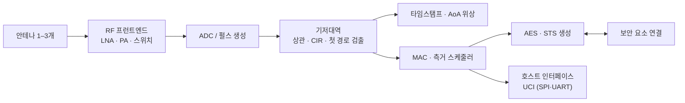

# 칩셋 지형

!!! spec "규격 · 개정판"
    IEEE 802.15.4a·4z HRP UWB PHY · FiRa 인증 제품 목록 · Apple Nearby Interaction 액세서리 사양 · CCC Digital Key (차량용 칩 요구) · 각 칩 제조사 공개 제품 자료

!!! basic "한눈에 보기"
    UWB 칩 시장은 쓰임새에 따라 크게 네 갈래로 나뉩니다.

    1. **휴대폰용** — 작은 크기, AoA용 다중 안테나, 보안 요소 연동
    2. **차량용** — 차량 부품 신뢰성 기준, 여러 앵커, Digital Key 지원
    3. **IoT·태그용** — 아주 낮은 전력, 작은 패키지, 저가
    4. **산업 RTLS·앵커용** — 정확한 타임스탬프, 앵커 동기, 긴 거리

    한 회사가 여러 갈래에 제품을 내는 경우가 많고, 휴대폰 회사가 **자체 칩**을 만드는 경우도 있습니다. 칩을 고를 때는 성능 표보다 **생태계 지원**(FiRa 인증, iOS·Android 액세서리 SDK, 차량 인증)이 더 중요한 경우가 많습니다.

## 주요 공급자 { .l2 }

| 공급자 | 주요 분야 | 공개 자료로 알려진 특징 |
|---|---|---|
| Qorvo (구 Decawave) | 산업 RTLS, IoT, 모듈 | 802.15.4a 시대 DW1000으로 UWB RTLS 대중화, 802.15.4z 지원 DW3000 계열 |
| NXP | 휴대폰, 차량, IoT | Trimension 브랜드. 휴대폰·IoT용 칩과 차량용 칩 라인업, 보안 요소와 결합 |
| Apple | 자사 기기 | 자체 U1(2019), 이후 2세대 UWB 칩 |
| Samsung | 휴대폰, 태그 | 자체 Exynos Connect UWB 칩 |
| STMicroelectronics | 차량, 산업 | 차량용 UWB 칩 발표 |
| Infineon | 차량, 보안 | 측거 보안 기술 회사 3db Access 인수 (LRP 계열 기술) |
| 기타 | 저전력 데이터, 레이더, IP | 저전력 UWB 데이터 전송 칩, UWB 레이더 센서, 라이선스용 UWB IP 등 |

시장이 빠르게 바뀌므로 표는 대표적인 예이며, 최신 제품과 인증 현황은 각 회사와 FiRa 인증 목록을 확인해야 합니다.

## 칩 블록 구조 { .l2 }

## 고를 때 보는 항목 { .l2 }

| 항목 | 왜 중요한가 |
|---|---|
| 지원 채널 | Ch5·Ch9 동시 지원 여부. 지역에 따라 Ch5를 못 쓰는 경우 있음 ([주파수 규제](../basics/regulation.md)) |
| 수신 감도·송신 출력 | 도달 거리 ([링크 버짓](../basics/link-budget.md)) |
| 안테나 포트 수 | AoA 지원(2개 이상), 3차원 방향(3개) |
| 소비 전력 | 측거 1회당 에너지, 대기 전류. 태그 배터리 수명 결정 |
| STS·보안 | 동적 STS, 보안 요소 연동, 공격 대응 펌웨어 |
| 인증·SDK | FiRa 인증, Apple 액세서리 지원, Android UCI 호환, 차량 등급 |
| 호스트 인터페이스 | UCI 지원 여부, 펌웨어 업데이트 방식 |

??? expert "전문가 노트 — 칩 간 차이가 드러나는 곳"
    같은 802.15.4z를 구현해도 실제 성능 차이는 다음에서 납니다.

    - **첫 경로 검출 알고리즘**: NLoS에서의 거리 편향, 보안 공격 저항성이 여기서 갈립니다. 표준이 정하지 않는 영역입니다([수신기 구조와 첫 경로 검출](../phy/receiver.md)).
    - **타임스탬프 정밀도와 보정**: 안테나 지연, 온도에 따른 그룹 지연 변화 보정. 제조 공정에서 기기별 보정이 필요한 경우가 많습니다([안테나와 그룹 지연](../basics/antenna-delay.md)).
    - **AoA 위상 보정**: 안테나 간 위상 오프셋은 기구(케이스, 금속 프레임)에 따라 달라 제품마다 보정합니다.
    - **클럭 품질**: 크리스털 오차가 SS-TWR 오차로 바로 이어집니다([SS-TWR](../ranging/ss-twr.md)).

    802.15.4ab 기능(MMS, NBA 등)은 표준이 확정된 뒤 새 세대 칩에 들어갈 것으로 예상되며, 칩 제조사들이 표준화 과정에 활발히 참여하고 있습니다([802.15.4ab 개요](../next/4ab-overview.md)).
