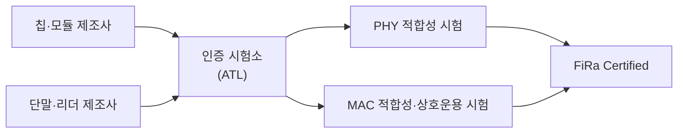

# FiRa Consortium

!!! spec "규격 · 개정판"
    FiRa Consortium 공개 자료 — MAC/PHY 기술 규격(802.15.4z 프로파일), UCI 규격, Common Service & Management Layer, 인증 프로그램 · IEEE 802.15.4z-2020

!!! basic "한눈에 보기"
    **FiRa**는 "Fine Ranging"의 줄임말로, UWB 기기들이 **회사가 달라도 서로 측거할 수 있게** 만드는 업계 단체입니다. 2019년에 출범했고 칩·휴대폰·자동차·출입 통제 회사들이 참여합니다.

    Wi-Fi Alliance가 IEEE 802.11 위에서 "이 조합으로 쓰고, 이 시험을 통과하면 Wi-Fi CERTIFIED"를 정하듯, FiRa는 IEEE 802.15.4z 위에서 같은 일을 합니다.

    FiRa가 정하는 것은 크게 네 가지입니다.

    1. **프로파일** — 802.15.4z의 선택지 중 무엇을 필수로 쓰나
    2. **UCI** — 호스트(휴대폰 OS)와 UWB 칩이 대화하는 명령 형식
    3. **보안 구조** — 세션 키를 누가 어떻게 만들고 전달하나
    4. **인증** — 상호운용 시험과 인증 로고

## FiRa가 802.15.4z 위에 더한 것 { .l2 }

| 영역 | IEEE 802.15.4z | FiRa |
|---|---|---|
| PHY | HRP·LRP, 여러 PRF, 채널 0–15 | HRP 중심, 주요 채널(Ch5·Ch9) 프로파일, 필수 지원 범위 |
| MAC | 측거 라운드, 측거 IE, 여러 측거 방식 | 측거 세션 구조(블록·라운드·슬롯), 일대일·일대다, 경합 기반 측거, TDoA 세션 유형 |
| 제어 | 범위 밖 | UCI 명령·응답·알림, 세션 상태 기계 |
| 보안 | STS 생성 방법 | 정적·동적·프로비저닝 STS, 보안 요소·보안 채널 구조 |
| 서비스 | 범위 밖 | 발견·OOB 파라미터 교환을 묶는 서비스 계층 |

## 사용 사례 분류 { .l2 }

FiRa는 응용을 크게 세 가지 묶음으로 설명합니다.

| 사용 사례 | 예 | 주로 쓰는 측거 |
|---|---|---|
| 핸즈프리 출입 | 도어락, 차량, 사무실 게이트 | DS-TWR, 일대다 (리더 여러 개) |
| 위치 기반 서비스 | 실내 내비게이션, 매장 안내, 자산 추적 | DL-TDoA (기기가 듣기만), UL-TDoA (태그가 송신) |
| 기기 간 서비스 | 휴대폰 ↔ 휴대폰, 휴대폰 ↔ 태그, 스마트 홈 지시 | DS-TWR + AoA |

측거 방식별 원리는 [측거와 측위](../ranging/index.md), 세션 구조는 [측거 라운드 구조](../mac/ranging-rounds.md)와 [다중 노드 측거](../mac/multi-node.md)에서 다룹니다.

## 인증 프로그램 { .l2 }

- 인증은 2021년 무렵 시작됐고, 칩·모듈부터 휴대폰·리더·태그까지 인증 제품 목록이 FiRa 웹 사이트에 공개됩니다.
- 시험은 **PHY 적합성**(송신 스펙트럼, 펄스, 타이밍 정확도 등)과 **MAC 적합성·상호운용**(세션 수립, 측거 메시지 교환) 중심입니다.
- CCC Digital Key나 Aliro 같은 응용 표준은 FiRa 프로파일을 기반으로 하면서 자체 요구 사항과 인증을 더합니다.

??? expert "전문가 노트 — 버전과 공개 범위"
    FiRa 규격은 버전이 올라가며 범위가 넓어졌습니다. 초기 버전은 일대일·일대다 DS-TWR과 보안 측거가 중심이었고, 이후 **TDoA(UL·DL)**, 경합 기반 측거, 데이터 전송, 추가 보안 기능 등이 들어왔습니다. 버전별 정확한 기능 목록은 FiRa의 공개 발표와 회원 문서를 확인해야 합니다.

    상세 규격은 대부분 **회원 전용**입니다. 실무에서 공개적으로 참고할 수 있는 자료는 다음과 같습니다.

    - FiRa 백서와 기술 개요 발표
    - 인증 제품 목록
    - **Android 오픈소스 UWB 스택**: UCI 메시지 처리, 세션 파라미터 이름 등이 코드로 공개돼 있어 UCI 구조를 이해하는 데 유용합니다([UCI](uci.md))

    802.15.4ab가 완성되면 FiRa도 새 기능(MMS, NBA 등)을 프로파일에 넣을 것으로 예상되지만, 이는 아직 **논의 중**입니다([802.15.4ab 개요](../next/4ab-overview.md)).
