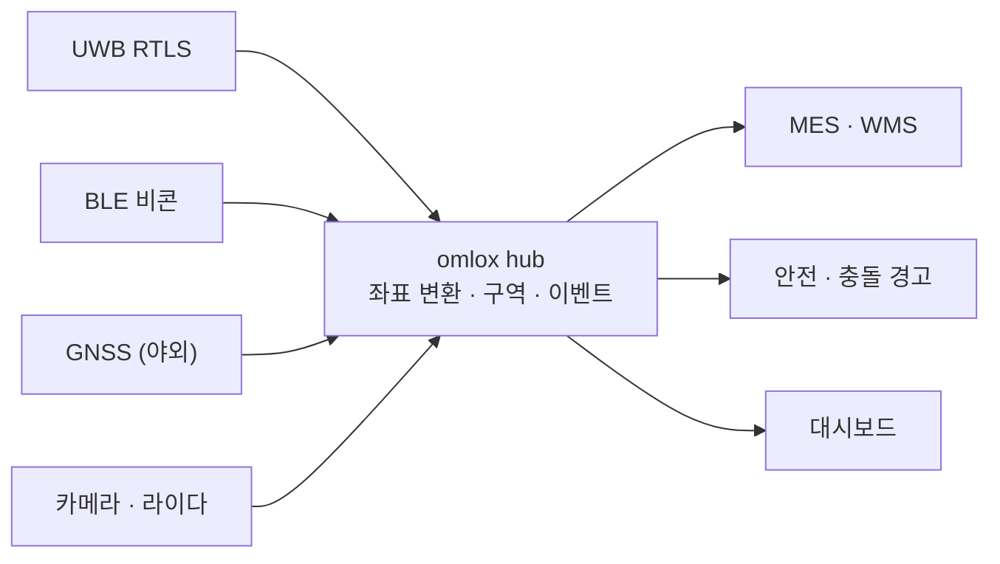

# omlox와 RTLS

!!! spec "규격 · 개정판"
    omlox (PI — PROFIBUS & PROFINET International) 공개 자료: omlox hub, omlox air interface · ISO/IEC 24730-62 (802.15.4 UWB 기반 RTLS 공중 인터페이스) · IEEE 802.15.4z TDoA

!!! basic "한눈에 보기"
    공장과 물류 창고에서는 지게차, 팔레트, 공구, 작업자의 위치를 실시간으로 추적합니다. 이를 **RTLS(Real-Time Locating System)**라고 합니다. UWB는 수십 cm 정확도로 이 일을 가장 잘하는 기술 중 하나입니다.

    문제는 RTLS가 오랫동안 **회사별 폐쇄 시스템**이었다는 점입니다. A사 앵커에는 A사 태그만 붙고, 위치 데이터도 A사 소프트웨어에서만 봅니다. 공장에 UWB, BLE, GPS, 카메라 시스템이 섞이면 위치 정보가 따로 놉니다.

    **omlox**는 산업 자동화 단체인 PI가 주도하는 개방형 위치 표준으로, 두 부분으로 이뤄집니다.

    1. **omlox hub** — 여러 위치 기술의 결과를 하나의 좌표계로 모으는 **소프트웨어 인터페이스**
    2. **omlox air interface** — 서로 다른 회사의 UWB 앵커·태그가 함께 동작하게 하는 **무선 인터페이스**

## omlox hub { .l2 }

| 기능 | 내용 |
|---|---|
| 위치 공급자 통합 | 기술별 위치 결과를 표준 형식으로 수신 |
| 좌표계 관리 | 구역(zone)별 로컬 좌표를 공장 전체 좌표·지리 좌표로 변환 |
| 지오펜스·이벤트 | 특정 구역 진입·이탈, 근접 이벤트 생성 |
| 응용 인터페이스 | 웹 API(요청·구독)로 위치와 이벤트 제공 |

hub 덕분에 응용 소프트웨어는 "이 태그가 어느 기술로 측위됐는지" 몰라도 같은 방식으로 위치를 받습니다.

## omlox air interface { .l2 }

- 802.15.4 HRP UWB 기반이며, 주로 **UL-TDoA**를 씁니다. 태그가 짧은 **블링크**를 보내고, 시각 동기된 앵커들이 도착 시각 차이로 위치를 계산합니다([TDoA](../ranging/tdoa.md)).
- 태그는 블링크만 보내면 되므로 배터리 수명이 길고(수년), 태그 수가 많아도 감당할 수 있습니다.
- 앵커 간 **시각 동기**(유선 또는 무선 동기 메시지)와 **앵커 위치 측량**이 정확도를 결정합니다.

| 방식 | 태그 동작 | 장점 | 단점 |
|---|---|---|---|
| UL-TDoA | 송신만 (블링크) | 태그 전력·수 확장성 | 앵커 동기 인프라 필요, 태그는 자기 위치 모름 |
| TWR | 앵커와 왕복 | 앵커 동기 불필요 | 태그 전력·공중 시간 큼, 태그 수 제한 |
| DL-TDoA | 수신만 | 무제한 기기, 프라이버시 | 기기가 상시 수신 → 전력, 산업 태그에는 덜 쓰임 |

??? expert "전문가 노트 — ISO/IEC 24730-62와 산업 현실"
    산업용 UWB RTLS에는 **ISO/IEC 24730-62**(802.15.4 UWB 기반 RTLS 공중 인터페이스)도 있습니다. 태그 블링크 형식 등을 정해 태그 상호운용을 노린 표준입니다. omlox air interface도 이와 같은 방향으로, 서로 다른 회사의 인프라와 태그를 섞어 쓰는 것을 목표로 합니다.

    현실에서는 다음 이유로 단일 업체 시스템이 여전히 많습니다.

    - **시각 동기 방식**이 업체마다 다르고, 정확도의 핵심 노하우입니다.
    - 위치 엔진(필터, NLoS 처리, 맵 매칭)이 제품 경쟁력입니다.
    - 금속이 많은 공장 환경에서 성능을 보장하려면 설치·보정 서비스가 함께 필요합니다.

    그래서 omlox의 **hub(소프트웨어 통합)** 쪽이 먼저 실용적으로 쓰이고, air interface 상호운용은 인증 제품이 늘어나며 점진적으로 확산되는 흐름입니다. 산업 RTLS의 설계 관점은 [산업 RTLS](../apps/industrial-rtls.md)에서 다룹니다.
