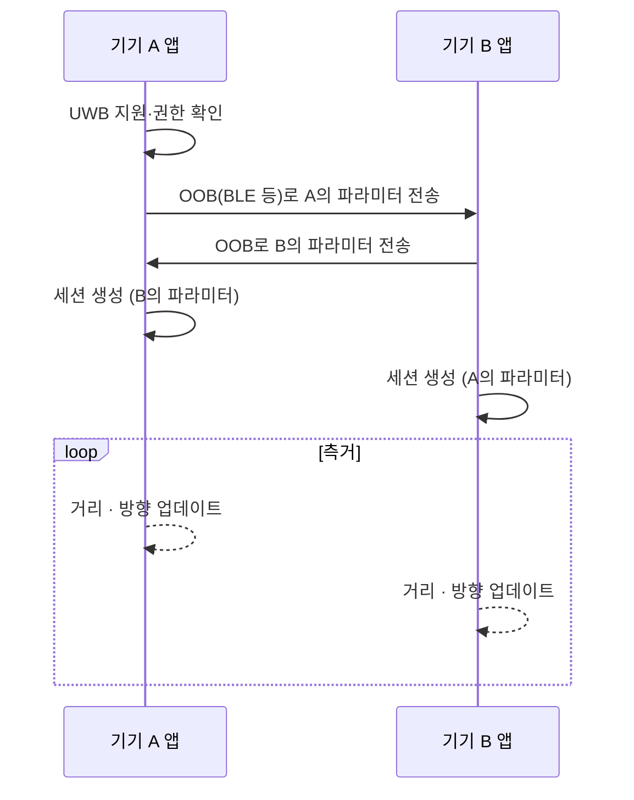

# 스마트폰 API (Android·iOS)

!!! spec "규격 · 개정판"
    Apple Nearby Interaction 프레임워크 (iOS 14 이후) · Android UWB 플랫폼 스택과 Jetpack UWB 라이브러리(`androidx.core.uwb`) · FiRa UCI · OOB 파라미터 교환 (BLE 등)

!!! basic "한눈에 보기"
    앱 개발자는 UWB 칩에 직접 명령하지 않습니다. 운영체제가 제공하는 API로 "이 상대와 측거 세션을 열어 줘"라고 요청하면, OS가 칩을 설정하고 **거리와 방향**을 돌려줍니다.

    두 플랫폼 모두 공통으로 지켜야 할 규칙이 하나 있습니다.

    > **측거를 시작하기 전에, 두 기기는 다른 통신 수단(OOB)으로 측거 파라미터를 미리 교환해야 한다.**

    UWB 자체에는 "상대를 찾고 연결하는" 기능이 사실상 없기 때문입니다. 보통 BLE를 쓰고, 같은 앱끼리면 인터넷·Wi-Fi로 교환해도 됩니다.

## 공통 흐름 { .l2 }

## iOS — Nearby Interaction { .l2 }

| 항목 | 내용 |
|---|---|
| 지원 기기 | U1 칩 이후 iPhone(2019년 iPhone 11부터), Apple Watch 일부, AirTag. 이후 2세대 UWB 칩으로 교체 |
| 핵심 객체 | `NISession`(세션), `NIDiscoveryToken`(상대에게 보낼 토큰), `NINearbyObject`(거리·방향 결과) |
| 기기 간 | 두 iPhone이 토큰을 OOB로 교환 → `NINearbyPeerConfiguration`으로 실행 |
| 액세서리 | 서드파티 UWB 액세서리와 측거 (`NINearbyAccessoryConfiguration`). 액세서리는 Apple 사양에 맞는 칩·펌웨어 필요 |
| 결과 | 거리(m), 방향(3차원 벡터, 시야 범위 안에서), 일부 버전에서 카메라 보조 방향 |
| 권한 | 세션마다 사용자 허가, 앱이 포그라운드일 때가 기본. 액세서리는 일부 백그라운드 지원 |

## Android — UWB 스택 { .l2 }

| 항목 | 내용 |
|---|---|
| 지원 기기 | 2020년 Galaxy Note20 Ultra 이후 일부 Galaxy, Pixel Pro 계열 등 (기기별 확인 필요) |
| 앱 API | Jetpack `androidx.core.uwb`: `UwbManager` → 컨트롤러/컨트롤리 세션 범위 생성 → 측거 결과 흐름(Flow) 수신 |
| 파라미터 | 자기 주소, 채널·프리앰블(복합 채널), 세션 ID, 세션 키 등을 앱이 OOB로 교환 |
| 하부 구조 | 시스템 UWB 서비스 → HAL → UCI → 칩 ([UCI](uci.md)) |
| 결과 | 거리, 방위각·고도각(AoA 지원 기기), 측정 상태 |
| 권한 | 근처 기기(`UWB_RANGING`) 권한 |

최근 Android는 UWB뿐 아니라 BLE Channel Sounding, Wi-Fi RTT까지 묶는 **범용 측거 API**를 도입하는 방향으로 가고 있습니다. 버전별 제공 범위는 Android 개발자 문서를 확인해야 합니다.

## 개발 시 주의할 점 { .l2 }

| 주제 | 주의 |
|---|---|
| 방향 정보 | AoA는 안테나가 2–3개 있는 기기·방향에서만 나옴. 휴대폰을 세로로 들고 화면을 상대 쪽으로 향해야 정확 |
| 시야 범위 | 휴대폰 뒤쪽·옆쪽은 방향 정확도가 크게 떨어짐 ([AoA와 PDoA](../ranging/aoa-pdoa.md)) |
| 배터리 | 측거 주기를 짧게 하면 반응은 좋지만 전력이 큼. 화면 표시용이면 수백 ms면 충분한 경우가 많음 |
| 교차 플랫폼 | iPhone ↔ Android 측거는 양쪽이 같은 FiRa 호환 설정을 쓸 때만 가능. 앱 수준에서 지원 여부를 확인해야 함 |
| 지역 규제 | 일부 국가·조건에서 OS가 UWB를 끔 (예: 비행기 모드, 특정 국가) ([주파수 규제](../basics/regulation.md)) |

??? expert "전문가 노트 — 액세서리 개발과 상호운용"
    서드파티 UWB 액세서리(태그, 스마트 홈 기기)를 iPhone과 Android 모두에서 쓰려면 다음을 맞춰야 합니다.

    1. **칩·펌웨어**: Apple 액세서리 사양을 지원하는 칩 SDK와, FiRa 호환 세션을 지원하는 펌웨어. 주요 칩 회사는 두 플랫폼용 예제를 함께 제공합니다([칩셋 지형](chipsets.md)).
    2. **OOB 프로토콜**: 액세서리가 BLE GATT로 측거 파라미터를 교환하는 방식. Apple은 액세서리용 데이터 형식을 따로 정했고, Android는 앱이 자유롭게 정합니다.
    3. **역할**: 휴대폰과 액세서리 중 누가 컨트롤러·개시자인지, 측거 주기와 슬롯 길이를 어떻게 정할지.

    Android Jetpack UWB API는 FiRa 파라미터의 일부만 앱에 노출하고, 나머지는 시스템 기본값을 씁니다. 세밀한 설정(STS 모드, 다중 노드, TDoA)이 필요하면 OEM 시스템 API나 칩 벤더 SDK를 써야 하는 경우가 많습니다.

    두 플랫폼 모두 API가 버전마다 바뀌어 왔으므로, 이 페이지의 클래스 이름은 구조를 이해하는 출발점으로만 쓰고 실제 구현은 최신 공식 문서를 기준으로 해야 합니다.
