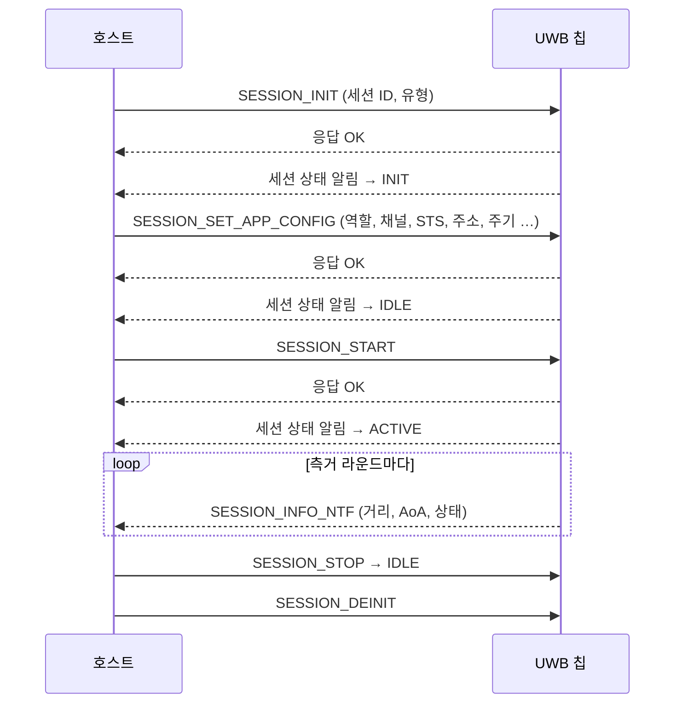

# UCI (UWB Command Interface)

!!! spec "규격 · 개정판"
    FiRa UCI 규격 (Generic Technical Specification) · Android 오픈소스 UWB 스택 (UCI HAL, 메시지 처리 코드) · IEEE 802.15.4z 측거 기능

!!! basic "한눈에 보기"
    휴대폰 안에는 **호스트**(AP의 운영체제)와 **UWB 칩(UWBS, UWB Subsystem)**이 따로 있습니다. 호스트가 "측거 시작해", 칩이 "거리는 1.23 m야"라고 말하는 **약속된 문장 형식**이 UCI입니다.

    UCI 이전에는 칩마다 명령 형식이 달라서, 휴대폰 회사가 칩을 바꾸면 드라이버와 상위 코드를 크게 고쳐야 했습니다. UCI 덕분에 OS는 **어느 회사 칩이든 같은 명령**으로 다룰 수 있습니다. Android의 UWB 스택은 UCI를 기본 인터페이스로 씁니다.

## 메시지 종류 { .l2 }

| 종류 | 방향 | 예 |
|---|---|---|
| 명령 (Command) | 호스트 → 칩 | 장치 초기화, 세션 생성, 파라미터 설정, 측거 시작·중지 |
| 응답 (Response) | 칩 → 호스트 | 명령마다 하나. 성공·실패 상태 |
| 알림 (Notification) | 칩 → 호스트 | 비동기 이벤트. 측거 결과, 세션 상태 변화, 오류 |
| 데이터 (Data) | 양방향 | 측거 세션 위로 애플리케이션 데이터 송수신 |

UCI 패킷은 짧은 헤더와 페이로드로 이뤄집니다. 헤더에는 **메시지 종류**, 큰 메시지를 나눠 보낼 때 쓰는 **분할 표시**, 기능 묶음을 나타내는 **그룹 ID(GID)**, 그룹 안의 명령을 나타내는 **오피코드 ID(OID)**, **페이로드 길이**가 들어갑니다.

## 기능 그룹과 대표 명령 { .l2 }

| 그룹 | 대표 메시지 | 하는 일 |
|---|---|---|
| Core | `CORE_DEVICE_RESET`, `CORE_GET_DEVICE_INFO`, `CORE_GET_CAPS_INFO`, `CORE_SET_CONFIG` | 칩 초기화, 버전·능력 조회, 장치 전역 설정 |
| Session Config | `SESSION_INIT`, `SESSION_SET_APP_CONFIG`, `SESSION_DEINIT` | 측거 세션 생성·설정·삭제 |
| Session Control | `SESSION_START`, `SESSION_STOP`, `SESSION_INFO_NTF` | 측거 시작·중지, 측거 결과 알림 |
| 벤더 그룹 | 칩·OS별 확장 | 보정 값, 시험 모드, 플랫폼 기능 |

메시지 이름은 Android 오픈소스 UWB 스택과 FiRa 공개 자료에서 쓰는 이름입니다. UCI 버전에 따라 이름이 조금 다릅니다(예: 초기 버전의 측거 시작 명령은 이름이 달랐음).

## 세션 수명 주기 { .l2 }

## 대표 앱 설정 파라미터 { .l2 }

`SESSION_SET_APP_CONFIG`로 세션마다 설정하는 값들입니다. 이름은 공개 구현 기준입니다.

| 파라미터 | 의미 |
|---|---|
| `DEVICE_TYPE`, `DEVICE_ROLE` | 컨트롤러·컨트롤리, 개시자(initiator)·응답자(responder) |
| `RANGING_ROUND_USAGE` | 측거 방식 (SS-TWR, DS-TWR, TDoA 등) |
| `MULTI_NODE_MODE` | 일대일·일대다·다대다 |
| `CHANNEL_NUMBER`, `PREAMBLE_CODE_INDEX`, `SFD_ID` | PHY 설정 ([채널 번호와 대역](../phy/channels.md), [프리앰블 코드](../phy/preamble-codes.md)) |
| `RFRAME_CONFIG` | STS 패킷 구성 (SP0–SP3) |
| `STS_CONFIG` | 정적·동적·프로비저닝 STS ([STS와 보안 측거](../security/sts-secure-ranging.md)) |
| `DEVICE_MAC_ADDRESS`, `DST_MAC_ADDRESS` | 자기·상대 짧은 주소 |
| `SLOT_DURATION`, `RANGING_DURATION` | 슬롯 길이, 측거 주기 ([측거 라운드 구조](../mac/ranging-rounds.md)) |
| `AOA_RESULT_REQ` | AoA 결과 요청 여부 |

??? expert "전문가 노트 — UCI 위의 OS 스택과 디버깅"
    **Android**에서는 앱 → Jetpack UWB 라이브러리 → 시스템 UWB 서비스 → UWB HAL → UCI → 칩 순서로 내려갑니다. HAL은 UCI 패킷을 칩 드라이버에 그대로 넘기는 얇은 계층이고, 세션 관리·파라미터 조합·결과 가공은 시스템 서비스가 맡습니다. 오픈소스 코드에서 UCI 메시지 정의와 파라미터 이름을 직접 확인할 수 있습니다.

    **디버깅 요령**

    - 측거가 안 될 때 가장 흔한 원인은 **양쪽 파라미터 불일치**(채널, 프리앰블 코드, STS 설정, 주소, 슬롯 길이)입니다. 양쪽 기기의 `SESSION_SET_APP_CONFIG` 로그를 나란히 비교하면 대부분 찾을 수 있습니다.
    - `SESSION_INFO_NTF`에는 측거 성공 여부를 나타내는 상태 값이 측정마다 들어 있습니다. 거리 값만 보지 말고 **상태 코드와 NLoS 표시, 신뢰도**를 함께 보는 것이 좋습니다.
    - OOB(BLE)로 교환한 파라미터가 UCI 설정으로 정확히 옮겨졌는지 확인합니다. 바이트 순서(엔디안) 실수가 흔합니다.

    UCI는 칩 내부의 보정 값(안테나 지연, AoA 위상 보정 등)을 벤더 명령으로 다루는 경우가 많으므로, 칩을 바꾸면 이 부분은 다시 맞춰야 합니다([안테나와 그룹 지연](../basics/antenna-delay.md)).
