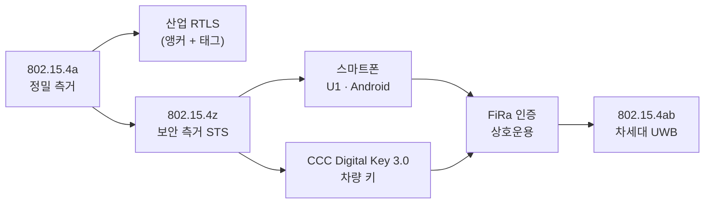

# UWB의 역사

!!! spec "규격 · 개정판"
    FCC First Report and Order (ET Docket 98-153, 2002) · IEEE 802.15.3a (해산, 2006) · ECMA-368 (WiMedia MB-OFDM) · IEEE 802.15.4a-2007 · IEEE 802.15.4z-2020 · IEEE 802.15.4ab (작업 중)

!!! basic "한눈에 보기"
    UWB는 새 기술처럼 보이지만 뿌리는 1960년대 레이더 연구까지 올라갑니다. 흐름은 크게 네 단계입니다.

    1. **레이더 시절** — 짧은 펄스로 물체를 보는 군용·연구용 기술
    2. **개방과 좌절** — 2002년 미국이 민간에 대역을 열었지만, 고속 데이터용 UWB(WiMedia)는 표준 싸움과 Wi-Fi에 밀려 사라짐
    3. **측거로 재출발** — 2007년 IEEE 802.15.4a가 "저속 + 정밀 측거" UWB를 표준화
    4. **스마트폰과 자동차** — 2019년 아이폰 U1 칩 이후, 보안 측거(802.15.4z)와 FiRa·CCC 생태계로 대중화

## 연표 { .l2 }

| 연도 | 사건 | 의미 |
|---|---|---|
| 1960–80년대 | 시간 영역 전자기학, 임펄스 레이더 연구 | "반송파 없는(carrier-free)" 무선의 원리 확립 |
| 1989 | 미 국방부 보고서에서 "ultra-wideband"라는 용어 사용 | 이름이 정착 |
| 2002 | FCC First Report and Order — 3.1–10.6 GHz, −41.3 dBm/MHz로 민간 UWB 허용 | 상용화의 출발점 |
| 2003–2006 | IEEE 802.15.3a: MB-OFDM과 DS-UWB 진영의 대립, 합의 실패로 2006년 작업 그룹 해산 | 고속 데이터 UWB 표준 무산 |
| 2005–2009 | WiMedia MB-OFDM(ECMA-368)으로 Wireless USB 등 출시, 시장 확보 실패 | 고속 데이터 용도에서 퇴장 |
| 2007 | **IEEE 802.15.4a-2007** 승인 — HRP·CSS PHY, 측거 기능 | 지금 UWB의 직계 조상 |
| 2011 | 802.15.4-2011 통합본에 4a 편입 | |
| 2012 | IEEE 802.15.4f — RFID용 LRP UWB 등 | 저전력 UWB 갈래 |
| 2013년경 | 802.15.4a 호환 단일 칩 UWB 트랜시버 상용화 (DecaWave DW1000 등) | 산업용 RTLS 확산 |
| 2019 | 아이폰 11에 Apple U1 칩, **FiRa Consortium** 설립 | 스마트폰 UWB 시대 |
| 2020 | **IEEE 802.15.4z-2020** 승인 — STS 보안 측거, BPRF·HPRF, 측거 절차 정비 | 보안 측거 표준 |
| 2020–2021 | 안드로이드 플래그십에 UWB 탑재, Android 12에 UWB API | |
| 2021 | **CCC Digital Key 3.0** — BLE + UWB 차량 키 | 자동차 키 용도 확정 |
| 2022 | IEEE 802.15 **TG4ab** 활동 시작 — 차세대 UWB | |
| 2023 | Apple U2 칩 | 측거 거리·전력 개선 |
| 2020년대 중반 | CSA Aliro(출입 통제), omlox(산업 RTLS) 등 응용 표준 확산 | 생태계 다변화 |

세부 연도는 출처마다 조금씩 다르게 적히기도 합니다. 표준 승인 연도는 IEEE 표준 이름에 붙은 연도를 따랐습니다.

## 왜 고속 데이터 UWB는 실패했나 { .l2 }

2000년대 초 UWB는 "선 없는 USB 2.0"(480 Mbps)을 목표로 했습니다. 실패 이유는 지금의 UWB를 이해하는 데도 도움이 됩니다.

| 이유 | 설명 |
|---|---|
| 표준 분열 | 802.15.3a에서 MB-OFDM과 DS-UWB가 75 % 찬성 요건을 넘지 못해 3년간 교착 |
| 낮은 전력 한도 | −41.3 dBm/MHz로는 고속 전송 거리가 수 m에 그침 |
| 국가별 규제 차이 | 유럽·일본은 늦게, 더 좁은 대역으로 허용 |
| Wi-Fi의 추월 | 802.11n이 같은 시기에 수백 Mbps를 더 먼 거리에서 제공 |

반면 **측거**에서는 UWB의 약점(낮은 전력, 짧은 거리)이 문제가 되지 않고, 강점(넓은 대역 = 정밀한 시간)이 결정적입니다. 802.15.4a는 바로 이 방향으로 방향을 틀었습니다.

## 스마트폰 이후 바뀐 것 { .l2 }

스마트폰과 자동차가 들어오면서 요구 사항이 바뀌었습니다. 산업용 RTLS는 닫힌 시스템이라 한 회사 장비끼리만 맞으면 됐지만, 휴대폰과 차, 도어락은 **서로 다른 회사 제품끼리** 측거해야 합니다. 그래서 **보안**(802.15.4z STS)과 **상호운용 인증**(FiRa), **응용 프로파일**(CCC, Aliro)이 필요해졌습니다.

??? expert "전문가 노트 — 802.15.4a에서 4z로 바뀐 것"
    802.15.4a는 측거를 위한 PHY 기능(정밀 타임스탬프, 측거 프레임 표시)은 넣었지만, 측거 **절차와 보안**은 대부분 상위 계층에 맡겼습니다. 그래서 초기 RTLS 제품들은 업체별 독자 프로토콜을 썼습니다.

    802.15.4z(2020)는 다음을 추가했습니다.

    - **STS**: AES 기반으로 생성한 의사 난수 펄스 시퀀스. 측거 타임스탬프를 STS에 묶어 위조를 어렵게 함
    - **BPRF·HPRF 모드**: 평균 PRF 62.4 MHz(기본)와 124.8·249.6 MHz(고 PRF)
    - **측거 MAC 기능**: 측거 라운드 구조, 측거 관련 IE, SS-TWR·DS-TWR·OWR(TDoA) 절차, 측거 결과 보고

    802.15.4ab는 링크 버짓, 측거 거리·전력, 센싱, 협대역 보조(NBA) 등을 다루며, 이 핸드북은 진행 중인 내용은 "논의 중"으로 표시합니다([802.15.4ab 개요](../next/4ab-overview.md)).
