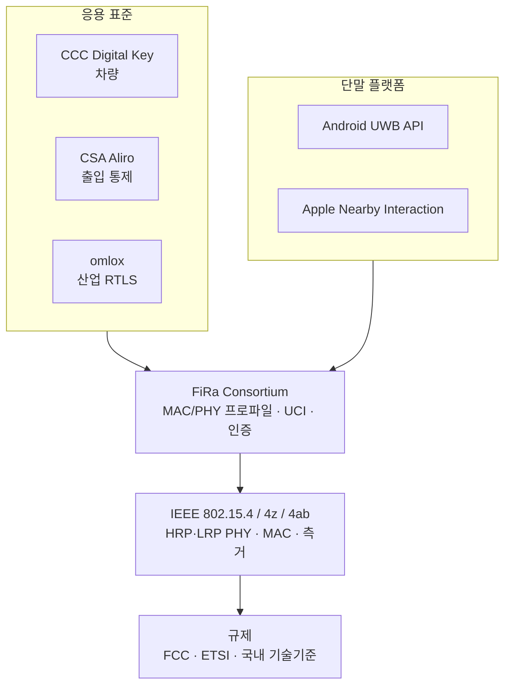

# 표준 지형도 (IEEE·FiRa·CCC)

!!! spec "규격 · 개정판"
    IEEE 802.15.4-2020, 802.15.4z-2020, 802.15.4ab (작업 중) · FiRa Consortium MAC/PHY 기술 규격, UCI 규격, 인증 프로그램 · CCC Digital Key Release 3 · CSA Aliro · omlox (PI Germany) · ISO/IEC 24730-62 · Android UWB API · Apple Nearby Interaction

!!! basic "한눈에 보기"
    Wi-Fi에서 IEEE 802.11이 표준을 만들고 Wi-Fi Alliance가 인증을 맡듯, UWB도 역할이 나뉩니다. 다만 UWB는 층이 하나 더 많습니다.

    1. **규제 기관** — 어느 주파수에서 얼마나 세게 쏠 수 있나 (FCC, ETSI/CEPT, 국내 과기정통부)
    2. **IEEE 802.15.4** — 신호 모양과 프레임, 측거 절차 (PHY·MAC)
    3. **FiRa Consortium** — 802.15.4z의 수많은 선택지 중 "이렇게 쓰자"를 정하고 인증
    4. **응용 표준** — 차 키(CCC), 출입(Aliro), 산업 위치 추적(omlox)
    5. **OS와 칩** — 앱 개발자가 실제로 쓰는 API와 칩셋

## 계층으로 보기 { .l2 }

| 조직 / 문서 | 정하는 것 | 이 핸드북 위치 |
|---|---|---|
| FCC Part 15 Subpart F, ETSI EN 302 065, 국내 기술기준 | 허용 대역, 전력 밀도, 실내·실외·차량 조건 | [주파수 규제](../basics/regulation.md) |
| **IEEE 802.15.4** (통합본 + 4z, 4ab) | 펄스, 채널, 프레임, STS, 측거 MAC 기능 | [PHY](../phy/index.md), [MAC](../mac/index.md) |
| **FiRa Consortium** | 802.15.4z 선택지의 프로파일, 측거 세션 파라미터, 호스트–칩 인터페이스(UCI), 보안 구조, 인증 시험 | [FiRa Consortium](../ecosystem/fira.md), [UCI](../ecosystem/uci.md) |
| **CCC** (Car Connectivity Consortium) | 휴대폰 ↔ 차량 Digital Key: BLE로 발견·인증, UWB로 보안 측거 | [CCC Digital Key 3.0](../ecosystem/ccc-digital-key.md) |
| **CSA Aliro** | 휴대폰·웨어러블 ↔ 출입 리더의 접근 자격 증명 (NFC, BLE, UWB) | [CSA Aliro](../ecosystem/aliro.md) |
| **omlox** | 산업용 위치 추적의 상호운용 (UWB TDoA 기반 등) | [omlox와 RTLS](../ecosystem/omlox.md) |
| ISO/IEC 24730-62 | 802.15.4 UWB 기반 RTLS 공중 인터페이스 | [산업 RTLS](../apps/industrial-rtls.md) |
| Android·iOS | 앱이 쓰는 UWB API, 측거 세션 시작 전 BLE 등으로 파라미터 교환(OOB) | [스마트폰 API](../ecosystem/smartphone-api.md) |

## 왜 IEEE만으로는 부족한가 { .l2 }

802.15.4z는 **도구 상자**입니다. 채널, PRF, 프리앰블 코드, STS 구성, 측거 방식, 라운드 길이, 보고 방식이 모두 선택지로 열려 있습니다. 두 회사 제품이 "둘 다 802.15.4z 준수"여도 고른 조합이 다르면 측거가 되지 않습니다.

| 질문 | IEEE 802.15.4z의 답 | FiRa·응용 표준이 정하는 것 |
|---|---|---|
| 어느 채널? | 0–15 중 선택 | 주로 Ch5·Ch9 (차량 키는 Ch9 중심) |
| 어떤 측거 방식? | SS-TWR, DS-TWR, OWR … | 세션 유형별 기본값과 필수 지원 범위 |
| 세션 키는 어디서? | STS 생성 방법만 정의 | 보안 요소(SE)·애플릿, BLE 핸드셰이크 등 키 공급 방법 |
| 칩과 호스트는 어떻게 대화? | 범위 밖 | UCI 명령·응답·알림 형식 |
| 상대방 파라미터는 어떻게 알아? | 범위 밖 | BLE 등 대역 외(OOB) 교환 |

그래서 UWB를 실무에 쓰려면 **IEEE로 원리를 배우고, FiRa·CCC로 실제 조합을 확인**하는 순서가 필요합니다.

??? expert "전문가 노트 — 공개 범위와 이 핸드북의 원칙"
    IEEE 802 표준은 발행 후 일정 기간이 지나면 IEEE GET Program에서 무료로 받을 수 있습니다. 반면 FiRa와 CCC 규격의 상세 문서는 대부분 **회원 전용**입니다. 공개된 것은 백서, 발표 자료, 인증 제품 목록, 일부 공개 규격과 오픈소스 구현(예: Android의 UCI 처리 코드) 정도입니다.

    이 핸드북은 FiRa·CCC 내용을 **공개 자료로 확인할 수 있는 범위**에서만 쓰고, 회원 문서의 필드 정의나 표를 옮기지 않습니다. 정확한 값이 필요한 실무자는 회원 문서를 직접 확인해야 합니다.

    Bluetooth의 **Channel Sounding**(Bluetooth Core 6.0)과 Wi-Fi **802.11az**도 정밀 측거를 노리는 경쟁·보완 기술입니다. 비교는 [UWB vs BLE CS vs Wi-Fi RTT vs 5G](../reference/positioning-comparison.md)에서 다룹니다.
