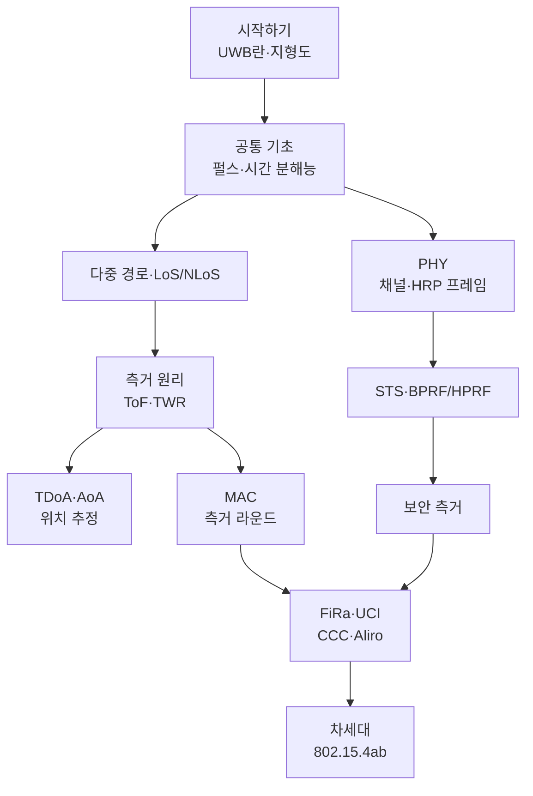

# 학습 로드맵

!!! basic "이 페이지의 용도"
    목적과 수준에 따라 어떤 순서로 읽으면 좋은지 정리했습니다. 각 페이지는 기초 → 중급 → 전문가 순서로 깊어지므로, 처음에는 기초 상자와 표만 읽고 넘어가도 됩니다.

## 수준별 경로 { .l2 }

### 입문 (비전공자, 처음 공부)

1. [UWB란 무엇인가](what-is-uwb.md) → [표준 지형도](landscape.md)
2. [임펄스 라디오와 펄스](../basics/impulse-radio.md) → [대역폭과 시간 분해능](../basics/bandwidth-resolution.md)
3. [ToF 측거 원리](../ranging/tof.md) → [SS-TWR](../ranging/ss-twr.md)
4. [왜 보안 측거인가](../security/why-secure-ranging.md)
5. [디지털 키와 핸즈프리 출입](../apps/digital-key.md)

각 페이지의 **기초 상자와 첫 표**까지만 읽어도 UWB가 어떻게 거리를 재고 왜 자동차 키에 쓰이는지 큰 그림이 잡힙니다.

### 중급 (전공자, 신입 엔지니어)

1. 입문 경로 전체를 중급 본문까지
2. 기초: [UWB 채널과 다중 경로](../basics/channel-multipath.md) → [LoS/NLoS](../basics/los-nlos.md) → [링크 버짓](../basics/link-budget.md)
3. PHY: [채널 번호와 대역](../phy/channels.md) → [HRP 프레임 구조](../phy/hrp-frame.md) → [BPRF와 HPRF](../phy/bprf-hprf.md) → [STS](../phy/sts.md)
4. 측거: [DS-TWR](../ranging/ds-twr.md) → [TDoA](../ranging/tdoa.md) → [AoA와 PDoA](../ranging/aoa-pdoa.md)
5. MAC: [측거 라운드 구조](../mac/ranging-rounds.md) → [다중 노드 측거](../mac/multi-node.md)

### 전문가 (PHY·MAC·펌웨어·측위 엔지니어)

- 각 페이지의 **전문가 노트**: 표준 수식, 필드 배치, 예외 처리
- [프리앰블 코드](../phy/preamble-codes.md), [수신기 구조와 첫 경로 검출](../phy/receiver.md), [오차 요인과 보정](../ranging/errors-calibration.md)
- [STS와 보안 측거](../security/sts-secure-ranging.md), [공격 연구와 대응](../security/attacks.md)
- [UCI](../ecosystem/uci.md), [802.15.4ab 개요](../next/4ab-overview.md)

## 목적별 경로 { .l2 }

| 목적 | 추천 순서 |
|---|---|
| 스마트폰 앱에 UWB 넣기 | [표준 지형도](landscape.md) → [스마트폰 API](../ecosystem/smartphone-api.md) → [FiRa](../ecosystem/fira.md) → [AoA와 PDoA](../ranging/aoa-pdoa.md) |
| 차량 디지털 키 개발 | [왜 보안 측거인가](../security/why-secure-ranging.md) → [STS](../phy/sts.md) → [DS-TWR](../ranging/ds-twr.md) → [CCC Digital Key 3.0](../ecosystem/ccc-digital-key.md) |
| 공장·물류 RTLS 구축 | [링크 버짓](../basics/link-budget.md) → [TDoA](../ranging/tdoa.md) → [위치 추정 알고리즘](../ranging/positioning.md) → [산업 RTLS](../apps/industrial-rtls.md) → [omlox](../ecosystem/omlox.md) |
| UWB 칩 펌웨어·드라이버 | [HRP 프레임 구조](../phy/hrp-frame.md) → [수신기 구조](../phy/receiver.md) → [안테나와 그룹 지연](../basics/antenna-delay.md) → [UCI](../ecosystem/uci.md) |
| Wi-Fi·셀룰러 엔지니어가 UWB로 | [UWB란 무엇인가](what-is-uwb.md) → [UWB vs BLE CS vs Wi-Fi RTT vs 5G](../reference/positioning-comparison.md) → [ToF 측거 원리](../ranging/tof.md) |

!!! tip "Wi-Fi·셀룰러를 아는 사람을 위한 한 줄 요약"
    UWB는 **OFDM이 없는 무선**입니다. 부반송파나 MCS 대신 펄스와 프리앰블 상관이 중심이고, 성능 지표도 처리량이 아니라 **거리 오차(cm)와 갱신 주기(ms)**입니다. Wi-Fi 802.11az나 5G 포지셔닝의 RTT 원리를 알고 있다면 측거 부분은 금방 익숙해집니다.
