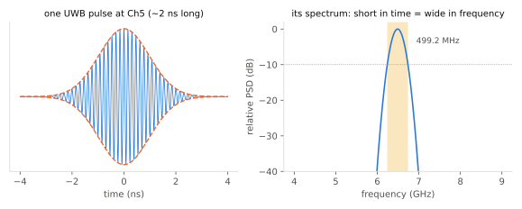

# UWB란 무엇인가

!!! spec "규격 · 개정판"
    FCC 47 CFR Part 15 Subpart F (UWB 정의와 허용 대역) · IEEE 802.15.4-2020 HRP/LRP UWB PHY · IEEE 802.15.4z-2020 (향상된 측거) · ITU-R SM.1755 (UWB 특성)

!!! basic "한눈에 보기"
    **UWB(Ultra-Wideband, 초광대역)**는 수 나노초(ns)짜리 아주 짧은 펄스를 보내는 무선 기술입니다. 펄스가 짧을수록 주파수 대역은 넓어집니다. UWB 한 채널의 폭은 **약 500 MHz**로, Wi-Fi 20 MHz 채널의 25배입니다.

    넓은 대역이 주는 가장 큰 선물은 **정밀한 시간**입니다. 전파는 1 ns에 약 30 cm를 가는데, UWB는 펄스의 도착 시각을 이보다 훨씬 잘게 잴 수 있어서 **수 cm–10 cm 수준**으로 거리를 잽니다. 그래서 오늘날 UWB의 주된 용도는 데이터 전송이 아니라 **"얼마나 떨어져 있는가, 어느 방향에 있는가"**를 재는 일입니다.

    - 스마트폰으로 차 문 열기(디지털 키), 분실물 태그 찾기
    - 공장·병원의 실시간 위치 추적(RTLS)
    - 문 앞에 다가가면 열리는 출입 통제

## UWB의 정의 { .l2 }

UWB는 변조 방식이 아니라 **대역폭으로 정의**됩니다. 미국 FCC 규정의 정의는 다음 둘 중 하나를 만족하는 신호입니다.

| 기준 | 조건 |
|---|---|
| 절대 대역폭 | −10 dB 대역폭 **500 MHz 이상** |
| 비대역폭 (fractional bandwidth) | \(B / f_c \geq 0.2\) (중심 주파수 대비 20 % 이상) |

대신 송신 전력은 매우 낮게 제한됩니다. 3.1–10.6 GHz에서 **−41.3 dBm/MHz** EIRP로, 500 MHz 전체를 채워도 총 약 **−14.3 dBm(약 37 µW)**입니다. Wi-Fi나 Bluetooth보다 수십 dB 낮아서 다른 무선 시스템에는 잡음처럼 보입니다. 국가별 규제는 [주파수 규제](../basics/regulation.md)에서 다룹니다.

## 협대역 무선과 무엇이 다른가 { .l2 }

<figure markdown>

<figcaption>Ch5(6.4896 GHz)의 UWB 펄스 하나. 시간 축에서 약 2 ns로 짧으니 주파수 축에서는 약 500 MHz로 넓게 퍼집니다.</figcaption>
</figure>

| 항목 | 협대역 (Wi-Fi·BLE·셀룰러) | UWB (IEEE 802.15.4 HRP) |
|---|---|---|
| 신호 | 연속 반송파 위에 심볼을 실음 | 짧은 펄스 열 (임펄스 라디오) |
| 채널 폭 | 1–320 MHz | 499.2 MHz (일부 채널 1 GHz 이상) |
| 송신 전력 | 0–30 dBm | 총 약 −14 dBm (−41.3 dBm/MHz) |
| 거리 측정 방식 | 신호 세기(RSSI) 또는 위상·RTT | 펄스 도착 시각(ToF) |
| 거리 정확도 | 수 m (RSSI), 1–2 m (Wi-Fi RTT) | 수 cm–10 cm (LoS) |
| 다중 경로 | 겹쳐서 페이딩 | 경로가 ns 단위로 분리됨 → 첫 경로를 골라낼 수 있음 |
| 데이터율 | 수 Mbps–수 Gbps | 0.11–27 Mbps 수준 (측거·제어용) |

핵심은 마지막 두 줄입니다. 대역이 넓으면 반사파들이 시간 축에서 따로따로 보여서, 수신기가 **가장 먼저 도착한 직선 경로**의 시각을 골라낼 수 있습니다. 이것이 UWB 측거가 정확한 이유이며, [대역폭과 시간 분해능](../basics/bandwidth-resolution.md)에서 자세히 다룹니다.

## UWB 하나로 하는 세 가지 일 { .l2 }

| 일 | 원리 | 이 핸드북 위치 |
|---|---|---|
| **측거(ranging)** — 거리 | 메시지를 주고받으며 왕복 시간 측정 (TWR) | [측거와 측위](../ranging/index.md) |
| **측위·방향** — 위치와 각도 | 여러 앵커의 도착 시간 차(TDoA), 안테나 간 위상차(PDoA) | [TDoA](../ranging/tdoa.md), [AoA와 PDoA](../ranging/aoa-pdoa.md) |
| **센싱(radar)** — 존재·움직임 | 반사된 펄스의 채널 응답(CIR) 변화 관찰 | [UWB 레이더와 센싱](../apps/radar-sensing.md) |

여기에 **보안**이 더해집니다. 802.15.4z는 측거 신호 자체에 암호학적 시퀀스(STS)를 넣어, 공격자가 거리를 속이기 어렵게 만들었습니다. 이 덕분에 UWB가 자동차 키와 출입 통제에 쓰이게 되었습니다([왜 보안 측거인가](../security/why-secure-ranging.md)).

??? expert "전문가 노트 — '임펄스 라디오'라는 말의 범위"
    오늘날 표준 UWB(IEEE 802.15.4 HRP)는 펄스 하나에 비트 하나를 싣는 순수 임펄스 라디오가 아니라, 칩 레이트 499.2 MHz의 펄스 **버스트**와 3진(+1/0/−1) 프리앰블 코드를 쓰는 구조입니다. 실제 펄스는 대역 제한된 기준 펄스 모양(표준이 정한 교차상관 조건을 만족해야 함)을 반송파에 올려 보내므로, 송신기 구현은 협대역 송신기와 비슷한 업컨버전 구조인 경우가 많습니다.

    2000년대 중반의 **MB-OFDM UWB**(WiMedia, ECMA-368)는 528 MHz 폭 OFDM으로 수백 Mbps를 노린 "고속 데이터 UWB"였고, 같은 UWB 규제 아래에 있었지만 임펄스 라디오가 아닙니다. 이 흐름은 상용화에 실패했고 지금의 UWB는 측거 중심의 802.15.4 계열입니다([UWB의 역사](history.md)).

    정확도 숫자를 볼 때는 **분해능(resolution)과 정확도(accuracy)**를 구분해야 합니다. 499.2 MHz의 시간 분해능은 약 2 ns(편도 60 cm)이지만, 측거 정확도는 SNR과 첫 경로 검출 알고리즘이 결정하며 LoS에서 cm 단위까지 내려갑니다.
