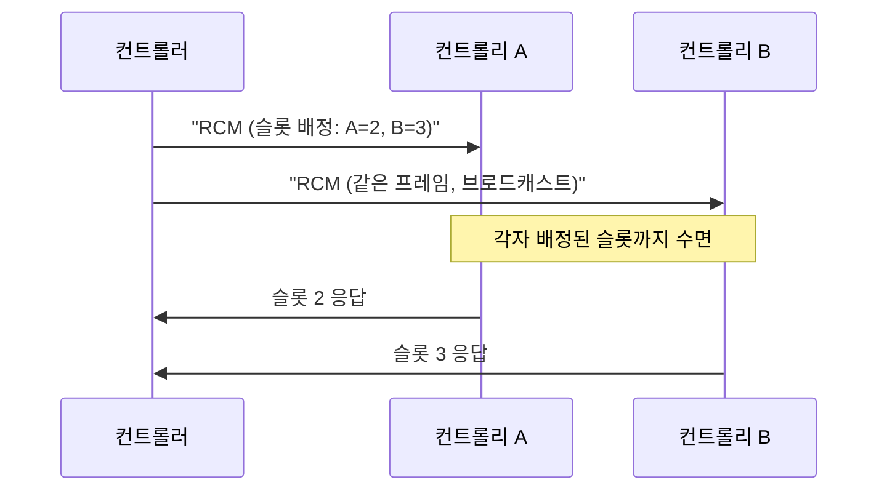

# 채널 접근

!!! spec "규격 · 개정판"
    IEEE 802.15.4-2020 채널 접근 (CSMA-CA, ALOHA, CCA 모드) · 슈퍼프레임 구조와 GTS · TSCH · DSME · 802.15.4z-2020 측거 라운드 스케줄링 (스케줄 기반·경합 기반 측거) · FiRa Consortium MAC 기술 규격 (라운드 호핑) · 802.15.4ab (논의 중: NBA 보조 채널 접근)

!!! basic "한눈에 보기"
    여러 장치가 한 채널을 나눠 쓰려면 "누가 언제 말할지"를 정해야 합니다. 방법은 크게 둘입니다.

    - **눈치 보며 말하기 (경합)** — 먼저 들어 보고 조용하면 말합니다(CSMA-CA). Wi-Fi와 Zigbee의 기본 방식입니다.
    - **순번표 받기 (스케줄)** — 사회자가 발언 순서를 정해 줍니다. TDMA라고도 합니다.

    UWB는 신호가 잡음보다 약해서 "들어 보기"가 잘 되지 않습니다. 그래서 측거는 거의 항상 **순번표 방식**으로, 컨트롤러가 정한 시간 슬롯 안에서 진행됩니다. 슬롯끼리도 겹치지 않도록, 세션마다 라운드 위치를 바꾸는 **호핑**을 더합니다.

## 802.15.4가 제공하는 접근 방식 { .l2 }

| 방식 | 동작 | UWB에서의 쓰임 |
|---|---|---|
| **ALOHA** | 들어 보지 않고 바로 보냄. 충돌하면 재전송 | UWB PHY에서 허용됨. 펄스 듀티가 낮아 트래픽이 적으면 충돌 확률이 낮음. RTLS 블링크 태그가 대표적 |
| **비슬롯 CSMA-CA** | 임의 백오프 후 CCA, 비어 있으면 송신 | UWB에서는 CCA 신뢰도가 낮아 효과 제한 |
| **슬롯 CSMA-CA** (비컨 모드) | 슈퍼프레임의 경합 구간(CAP) 안에서 백오프 슬롯 경계에 맞춰 접근 | 측거 MAC과는 별개로 잘 쓰이지 않음 |
| **GTS** (Guaranteed Time Slot) | 비컨 슈퍼프레임의 비경합 구간(CFP)에서 슬롯 보장 | 개념상 측거 슬롯 스케줄과 비슷 |
| **TSCH·DSME** | 시간 동기 + 채널 호핑 스케줄 | 산업 저전력 네트워크용. UWB 측거와는 별도 |
| **측거 라운드 스케줄** (4z) | 컨트롤러가 라운드·슬롯을 장치에 할당 | **UWB 측거의 기본** |

UWB PHY의 CCA는 에너지 검출 대신 **프리앰블 감지**에 기댑니다. 그런데 다른 장치의 프리앰블을 감지하려면 코드와 채널이 같아야 하고, 수신기를 켜 두는 시간만큼 전력이 듭니다. 무엇보다 측거는 응답 지연이 정해진 값이어야 하는데, 백오프가 끼면 지연이 흔들려 [SS-TWR](../ranging/ss-twr.md) 오차가 커집니다. 이것이 측거에 스케줄 방식을 쓰는 이유입니다.

## 스케줄 기반과 경합 기반 측거 { .l2 }

802.15.4z는 측거 라운드 안의 슬롯을 나누는 방법을 두 가지로 정의합니다.

| 구분 | 스케줄 기반(Scheduling-based) | 경합 기반(Contention-based) |
|---|---|---|
| 슬롯 배정 | 컨트롤러가 장치별로 미리 지정 | 경합 구간의 슬롯 중 장치가 임의 선택 |
| 충돌 | 같은 세션 안에서는 없음 | 같은 슬롯을 고르면 충돌, 다음 라운드 재시도 |
| 장점 | 지연이 결정적, 전력 예측 가능 | 참가 장치를 미리 몰라도 됨 |
| 쓰임 | 디지털 키, 일대다 앵커 측거 | 처음 만나는 다수 장치, 가변 인원 |

## 세션 간 충돌과 라운드 호핑 { .l2 }

한 세션 안의 충돌은 스케줄로 없앨 수 있지만, **서로 모르는 세션**(옆 차의 키, 옆 사람의 휴대폰)은 서로의 일정을 모릅니다. 두 세션의 블록 주기가 비슷하면 같은 라운드가 계속 겹쳐 연속으로 측거가 실패할 수 있습니다.

FiRa는 이를 **라운드 호핑**으로 다룹니다. 각 블록에서 사용할 라운드 번호를 세션 키 등으로부터 유사 난수로 정해, 두 세션이 한 번 겹쳐도 다음 블록에서는 다른 라운드로 갈라지게 합니다. 채널·프리앰블 코드를 세션마다 다르게 잡는 것도 같은 목적입니다([다중 노드 측거](multi-node.md)).

??? expert "전문가 노트 — 충돌 확률과 4ab의 협대역 보조 접근"
    **ALOHA 블링크의 충돌 확률.** 태그 \(N\)개가 각각 길이 \(T_f\)인 프레임을 평균 주기 \(T\)로 무작위 송신하면, 순수 ALOHA의 프레임 성공 확률은 근사적으로

    \[
    P_{\text{succ}} \approx e^{-2 N T_f / T}
    \]

    입니다. 예를 들어 프레임 길이 150 µs, 주기 1 s, 태그 500개면 \(2NT_f/T = 0.15\)로 성공률 약 86 %입니다. UL-TDoA RTLS가 블링크 주기에 무작위 지터를 더하는 이유가 여기 있습니다([TDoA](../ranging/tdoa.md)).

    **라운드 호핑의 효과.** 블록당 라운드 \(M\)개 중 하나를 균등 무작위로 고르는 두 세션이 같은 블록 경계를 공유한다고 가정하면, 한 블록에서 충돌할 확률은 약 \(1/M\), \(k\)블록 연속 충돌 확률은 \(M^{-k}\)입니다. 호핑이 없으면 한 번 겹친 두 세션은 클럭이 서서히 밀릴 때까지 계속 겹칩니다.

    **802.15.4ab (논의 중, 초안 기준).** 협대역(NB) 신호로 채널 상태를 확인하거나 UWB 측거 일정을 조정하는 **NBA(Narrowband-assisted)** 방식이 논의되고 있습니다. UWB 자체로는 어려운 반송파 감지를 협대역으로 보완하려는 시도로 볼 수 있으며, 세부 절차는 승인 전입니다([NBA-MMS](../next/nba-mms.md), [다른 기술과의 공존](../next/coexistence.md)).

    **실무 팁.** 측거 실패율이 갑자기 늘면 먼저 같은 채널·같은 프리앰블 코드를 쓰는 다른 세션이 있는지, 블록 간격이 다른 세션과 정수배 관계인지 확인합니다.
