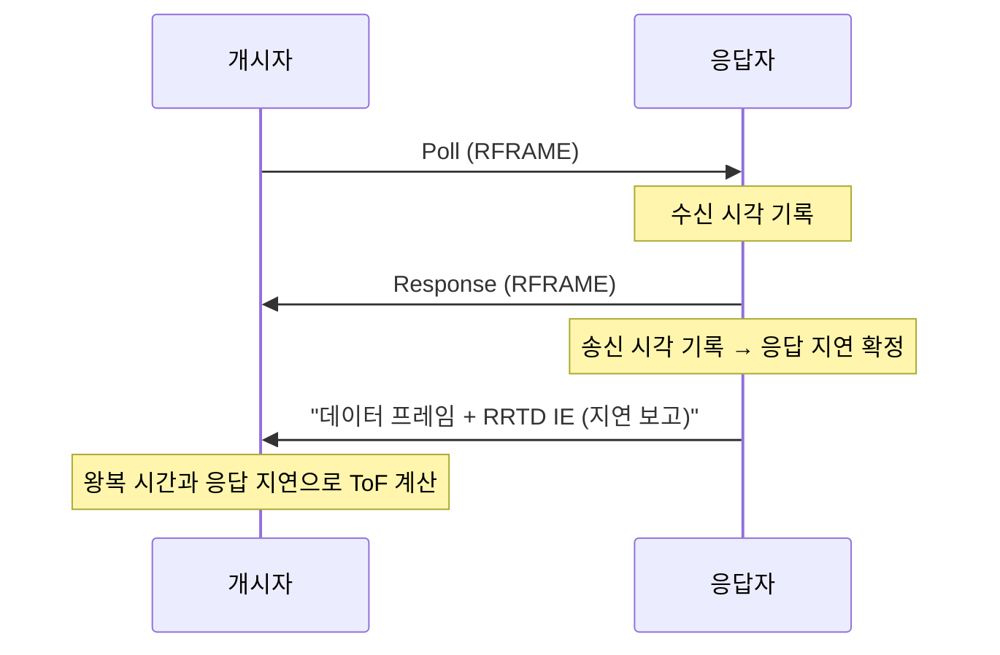

# MAC 프레임과 IE

!!! spec "규격 · 개정판"
    IEEE 802.15.4-2020 MAC 프레임 형식 · 일반 MAC 프레임 형식 · 정보 요소(IE: Header IE, Payload IE) · MAC 보안(보조 보안 헤더, CCM*) · 802.15.4z-2020 측거 관련 IE · FiRa Consortium MAC 기술 규격 (측거 메시지 형식)

!!! basic "한눈에 보기"
    802.15.4 MAC 프레임은 **봉투(헤더) + 내용물(페이로드) + 봉인(FCS)**의 세 부분입니다. 봉투에는 받는 사람·보내는 사람 주소와 일련번호가, 봉인에는 깨졌는지 확인하는 CRC가 들어갑니다.

    2015년 판부터는 봉투와 내용물 사이에 **IE(Information Element)**라는 "꼬리표"를 원하는 만큼 붙일 수 있습니다. 802.15.4z는 측거에 필요한 정보 — 응답 지연 시간, 왕복 시간, 다음 라운드 일정 — 를 모두 이 꼬리표로 실어 보냅니다.

    덕분에 새 프레임 종류를 만들지 않고도, 일반 데이터 프레임에 측거 IE를 붙여 측거 메시지로 쓸 수 있습니다.

## 일반 MAC 프레임 구조 { .l2 }

| 부분 | 필드 | 내용 |
|---|---|---|
| **MHR** (MAC 헤더) | 프레임 제어 | 프레임 종류, 보안 사용 여부, ACK 요청, PAN ID 압축, IE 존재, 주소 모드, 프레임 버전 |
| | 일련번호 | 재전송·중복 판별 (생략 가능 옵션 있음) |
| | 주소 필드 | 목적지·출발지 PAN ID와 주소 (짧은 16비트 또는 확장 64비트) |
| | 보조 보안 헤더 | 보안 수준, 키 식별, 프레임 카운터 |
| | Header IE | 헤더에 붙는 IE 목록 |
| **MAC 페이로드** | Payload IE | 페이로드 앞부분의 IE 목록 |
| | 데이터 | 상위 계층 데이터 |
| **MFR** | FCS | CRC (2바이트 또는 4바이트) |

프레임 종류는 비컨, 데이터, ACK, MAC 명령 외에 다목적(Multipurpose), 분할(Fragment), 확장 종류가 있습니다. 측거 메시지는 주로 **데이터 프레임에 측거 IE를 실은 형태**로 보냅니다. FiRa는 그 위에 다시 자신만의 메시지 형식(측거 제어 메시지, 측정 보고 메시지 등)을 정의해 페이로드 IE로 담습니다.

이 MAC 프레임 전체가 PHY의 **PSDU**가 되고, 앞에 SHR(프리앰블+SFD)과 PHR이 붙습니다([HRP 프레임 구조](../phy/hrp-frame.md)).

## IE의 두 종류 { .l2 }

| 구분 | 위치 | 보안 | 주 용도 |
|---|---|---|---|
| **Header IE** | MHR 안 | 암호화되지 않음 (인증은 됨) | 수신기가 페이로드를 풀기 전에 알아야 할 정보, 짧은 제어 정보 |
| **Payload IE** | MAC 페이로드 앞 | 암호화 가능 | 길거나 보호해야 할 정보, 그룹으로 묶인 관리 정보 |

각 IE는 짧은 **기술자(descriptor)** 뒤에 내용이 붙는 구조입니다. 기술자에는 IE의 종류(ID)와 길이가 들어 있어, 모르는 IE는 길이만큼 건너뛸 수 있습니다. Header IE 목록과 Payload IE 목록의 끝은 **종료(termination) IE**로 표시합니다. Payload IE 중 MLME IE는 안에 다시 여러 개의 **중첩(nested) IE**를 담을 수 있어, 802.15.4z의 측거 IE 상당수가 이 방식으로 들어갑니다.

802.15.4z가 추가한 측거 IE는 역할별로 다음과 같이 묶을 수 있습니다.

| 역할 | 예 (규격의 IE 이름) | 담는 정보 |
|---|---|---|
| 시간 값 전달 | Ranging Reply Time Instantaneous (RRTI), Ranging Reply Time Deferred (RRTD), Ranging Round Trip Measurement (RRTM) | 응답 지연·왕복 시간 측정값 |
| 결과 전달 | Ranging Time-of-Flight (RTOF), 도래각 관련 IE | 계산된 ToF, AoA 결과 |
| 라운드 제어 | Advanced Ranging Control (ARC), 측거 스케줄링 IE, 장치 관리 IE | 측거 방식, 라운드 구조, 슬롯 할당, 역할 |
| 운용 변경 | 측거 간격 갱신·변경 요청 관련 IE | 블록 간격, 다음 라운드 변경 |

정확한 필드 구성과 길이는 규격 본문과 FiRa 프로파일을 확인해야 하며, 이 핸드북은 역할만 설명합니다.

## 즉시 보고와 지연 보고 { .l2 }

응답자는 Response 프레임 안에 자기 응답 지연을 넣고 싶지만, 그 값은 **프레임을 실제로 보낸 뒤에야** 정확히 확정됩니다. 해결책은 두 가지입니다.

| 방식 | 방법 | 장단점 |
|---|---|---|
| **즉시(Instantaneous)** | 송신 시각을 미리 예약해 두고 그 예정값으로 응답 지연을 계산해 같은 프레임에 넣음 | 프레임 수가 적음. 칩이 예약 송신을 정확히 지원해야 함 |
| **지연(Deferred)** | 측정값을 다음 프레임(보고 메시지)에 실어 보냄 | 구현이 단순하고 SP3 프레임과도 함께 쓸 수 있음. 프레임·시간이 늘어남 |

**SP3** STS 패킷 구성은 PHR과 페이로드가 없어 MAC 프레임 자체가 실리지 않습니다. 이때는 측거 IE를 담을 자리가 없으므로, 시간 값은 반드시 별도 데이터 프레임으로 **지연 보고**합니다. FiRa의 보안 측거가 대개 "SP3 측거 프레임 + 별도 제어·보고 메시지" 구조인 이유가 여기에 있습니다([STS](../phy/sts.md)).

??? expert "전문가 노트 — 프레임 버전, 보안, 그리고 타임스탬프의 위치"
    **프레임 버전.** IE는 2015년 이후 프레임 버전에서만 쓸 수 있습니다. 2003·2006 버전 프레임에는 IE 존재 비트가 없으므로, 측거 IE를 쓰는 장치는 새 프레임 버전으로 보내야 합니다.

    **보안.** 802.15.4 MAC 보안은 AES 기반 CCM*로 인증과 암호화를 제공합니다. Header IE는 인증 범위에는 들어가지만 암호화되지 않으므로, 측거 결과처럼 보호가 필요한 값은 Payload IE에 넣는 것이 원칙입니다. 다만 MAC 보안은 **프레임 내용**만 지킬 뿐, 도착 시각 자체의 위조(거리 단축 공격)는 막지 못합니다. 그 역할은 PHY의 STS가 맡습니다([STS와 보안 측거](../security/sts-secure-ranging.md)).

    **타임스탬프의 크기.** 칩의 타임스탬프 단위는 칩 시간의 1/128, 즉 약 15.65 ps(4.69 mm)입니다. 응답 지연 같은 시간 값을 IE에 실을 때 어떤 단위·비트 폭을 쓰는지는 IE마다, FiRa 프로파일마다 다르므로 구현할 때는 규격 표를 직접 확인해야 합니다.

    **ACK와 측거.** 802.15.4 즉시 ACK는 수신 후 정해진 턴어라운드 시간 뒤에 나가므로 SS-TWR의 응답으로 쓸 수도 있지만, 응답 지연이 고정·공개 값이어야 하고 보안 측거와 맞지 않아 4z 측거에서는 명시적인 Response 프레임을 씁니다.
