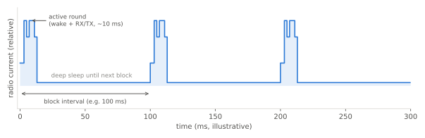
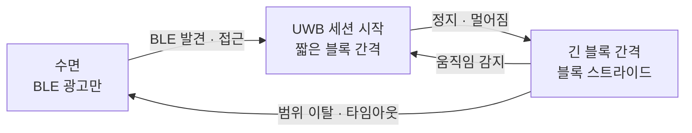

# 저전력 동작

!!! spec "규격 · 개정판"
    IEEE 802.15.4-2020 저전력 기능 (비컨 모드 수면, CSL·RIT, TSCH) · 802.15.4z-2020 측거 블록·라운드 스케줄 · FiRa Consortium MAC 기술 규격 (블록 간격, 블록 스트라이드) · 802.15.4ab (논의 중: 저전력·고속 데이터 관련 개선)

!!! basic "한눈에 보기"
    UWB 칩은 깨어 있을 때 전류가 큽니다. 특히 **수신기**는 펄스를 놓치지 않으려고 상관기를 계속 돌리기 때문에 송신보다 더 많은 전력을 쓰는 경우가 많습니다. 반대로 잠들어 있을 때는 아주 적게 씁니다.

    그래서 저전력의 핵심은 단순합니다. **필요한 순간에만 깨고, 깨어 있는 시간을 최대한 짧게** 하는 것입니다. 측거 블록·라운드·슬롯 구조는 바로 이것을 위해 있습니다. 장치는 자기 라운드, 그 안에서도 자기 슬롯이 언제인지 알기 때문에 나머지 시간에는 잠들 수 있습니다.

    코인 셀 태그가 수년을 버티느냐, 몇 주 만에 꺼지느냐는 대부분 이 "깨어 있는 비율(듀티 사이클)"에서 결정됩니다.

## 듀티 사이클로 보는 전력 { .l2 }

<figure markdown>

<figcaption>블록마다 한 번 깨어 제어 메시지 수신, 송수신을 마치고 다음 블록까지 깊은 수면에 들어갑니다(개념도, 수치는 예시).</figcaption>
</figure>

평균 전류는 상태별 전류와 머무는 시간의 가중 평균입니다. 그래서 MAC이 줄일 수 있는 것은 다음 네 가지입니다.

| 항목 | MAC·설정으로 줄이는 방법 |
|---|---|
| 깨어나는 횟수 | 블록 간격을 늘림, 몇 블록을 건너뜀(블록 스트라이드) |
| 수신 창 길이 | 슬롯 경계를 정확히 맞춰 수신기를 늦게 켜고 빨리 끔 |
| 프레임 길이 | 짧은 프리앰블·짧은 STS, 높은 데이터율 (거리·신뢰도와 교환) |
| 불필요한 수신 | 자기 슬롯이 아닌 응답 구간에서 수면 ([다중 노드 측거](multi-node.md)) |

## 역할별 전략 { .l2 }

| 장치 | 특징 | 전략 |
|---|---|---|
| UL-TDoA 블링크 태그 | 송신만 함 | 수신기를 거의 켜지 않음. 가장 오래가는 구성 ([TDoA](../ranging/tdoa.md)) |
| DL-TDoA 태그 | 수신만 함 | 앵커 송신 일정에 맞춰 수신 창만 염 |
| TWR 컨트롤리 (휴대폰·태그) | 송수신 | 블록 간격 조정, 움직이지 않을 때 간격 늘림 |
| 앵커·차량 모듈 | 상시 전원인 경우가 많음 | 전력보다 응답성 우선. 차량은 BLE로 접근을 감지한 뒤 UWB를 켬 |

실제 시스템에서 가장 큰 절약은 **UWB를 필요할 때만 켜는 것**입니다. 디지털 키와 스마트폰 API는 BLE로 먼저 상대를 발견하고 가까워졌을 때 UWB 세션을 시작합니다. 태그는 가속도 센서로 정지를 감지하면 측거 간격을 크게 늘립니다([스마트폰 API](../ecosystem/smartphone-api.md), [디지털 키와 핸즈프리 출입](../apps/digital-key.md)).

??? expert "전문가 노트 — 평균 전류 계산과 802.15.4 저전력 기법"
    **평균 전류.** 블록 길이 \(T_B\) 동안 상태 \(i\)에 \(t_i\)만큼 머물고 전류가 \(I_i\)라면

    \[
    \bar I = \frac{1}{T_B}\sum_i I_i t_i, \qquad \text{수명} \approx \frac{C_{\text{batt}}}{\bar I}
    \]

    입니다. 수신·송신·대기·깊은 수면 전류는 **칩·규격 버전에 따라 다르므로** 데이터시트 값을 넣어 계산해야 합니다. 경험적으로 깊은 수면 전류가 아주 작으면, 평균 전류는 사실상 "블록당 활성 시간 × 활성 전류"로 결정되고, 수정 발진기 기동·PLL 잠금 같은 **기상 오버헤드**가 무시하지 못할 비중을 차지합니다.

    **수신 창과 클럭 정확도.** 깊은 수면 중 저주파 클럭으로 시간을 재면 정확도가 떨어지므로, 다음 블록의 수신 창을 그만큼 일찍 열어야 합니다. 20 ppm 클럭으로 200 ms를 자면 오차가 최대 4 µs, 수면 클럭이 수백 ppm이면 수십 µs가 됩니다. 수신 창 여유는 듀티 사이클에 직접 더해집니다.

    **802.15.4의 일반 저전력 기법.** 비컨 모드의 비활성 구간 수면, 수신기가 주기적으로 잠깐만 채널을 듣는 **CSL**(Coordinated Sampled Listening), 수신기가 깨어났음을 알리는 **RIT**(Receiver Initiated Transmission), 시간 동기 채널 호핑 **TSCH**가 있습니다. Thread 같은 협대역 802.15.4 네트워크에서는 중요하지만, UWB 측거는 대개 자체 블록 스케줄로 같은 효과를 얻습니다.

    **802.15.4ab (논의 중, 초안 기준).** 협대역 보조로 UWB 수신기를 켜는 시간을 줄이는 방법, 저전력 장치를 위한 구성 등이 논의되고 있으나 확정 전입니다([고속 데이터와 저전력](../next/data-power.md)).
