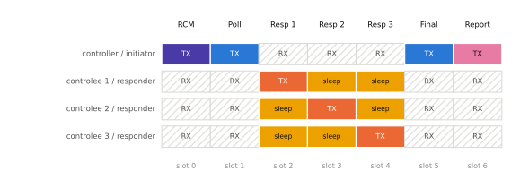
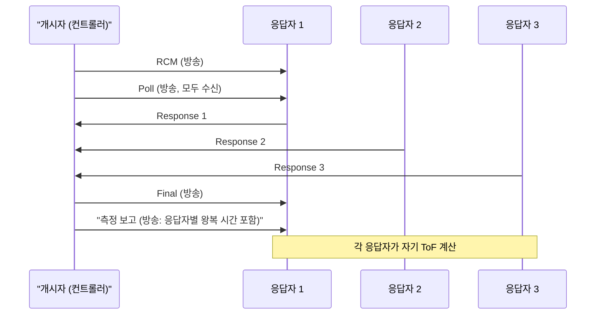

# 다중 노드 측거

!!! spec "규격 · 개정판"
    IEEE 802.15.4z-2020 일대다·다대다 측거, 스케줄 기반·경합 기반 측거 · FiRa Consortium MAC 기술 규격 (유니캐스트·일대다·다대다 세션, 멀티캐스트 목록 갱신, 라운드 호핑) · FiRa UCI 규격 · ISO/IEC 24730-62 (RTLS)

!!! basic "한눈에 보기"
    거리 하나만 알면 "얼마나 가까운가"까지만 알 수 있습니다. **위치**를 알려면 여러 앵커와의 거리가 필요하고, 사무실·공장에서는 태그도 수십–수천 개입니다. 그래서 MAC은 여러 장치가 같은 시간과 채널을 효율적으로 나눠 쓰는 방법을 정해야 합니다.

    핵심 아이디어는 **방송의 재사용**입니다. 앵커가 Poll을 한 번만 방송하면 주변 태그 모두가 그 시각을 기록할 수 있고, 각자 자기 슬롯에서 응답하면 됩니다. 교사가 "출석!"을 한 번 외치고 학생들이 번호 순서대로 답하는 것과 같습니다.

## 세션 구성의 세 가지 { .l2 }

| 구성 | 참가자 | 대표 응용 |
|---|---|---|
| **일대일 (유니캐스트)** | 컨트롤러 1 ↔ 컨트롤리 1 | 휴대폰 ↔ 태그 찾기, 휴대폰 ↔ 휴대폰 |
| **일대다** | 컨트롤러 1 ↔ 컨트롤리 N | 차량(앵커 여러 개) ↔ 휴대폰, 리더 ↔ 여러 태그 |
| **다대다** | 개시자 여럿 ↔ 응답자 여럿 | 그룹 측거, 메시 형태의 상대 위치 |
| 단방향 (TDoA) | 앵커 다수 + 태그 다수, 왕복 없음 | 대규모 RTLS, 내비게이션 ([TDoA](../ranging/tdoa.md)) |

일대다 세션에서 컨트롤리 목록은 세션 중에 바뀔 수 있습니다. FiRa는 이를 **멀티캐스트 목록 갱신**으로 처리해, 세션을 다시 만들지 않고 컨트롤리를 추가·삭제합니다.

## 일대다 DS-TWR의 슬롯 배치 { .l2 }

<figure markdown>

<figcaption>컨트롤러(개시자) 1개와 컨트롤리(응답자) 3개. Poll과 Final은 한 번씩 방송하고, 응답만 각자 슬롯에서 보냅니다. 자기 슬롯이 아닌 응답 구간에서 컨트롤리는 잠들 수 있습니다.</figcaption>
</figure>

메시지 수를 비교하면 이 구조의 이득이 분명합니다(제어·보고 메시지 포함).

| 응답자 수 N | 일대일 세션을 N번 (5메시지 × N) | 일대다 1라운드 (N + 4메시지) | 2 ms 슬롯일 때 일대다 라운드 길이 |
|---|---|---|---|
| 1 | 5 | 5 | 10 ms |
| 4 | 20 | 8 | 16 ms |
| 8 | 40 | 12 | 24 ms |

차량 디지털 키에서 차체의 여러 앵커가 휴대폰 하나와 측거하는 구성도 같은 원리이며, 이때 앵커 간 시간 관계를 알면 거리 여러 개를 동시에 얻어 위치까지 바로 추정할 수 있습니다([위치 추정 알고리즘](../ranging/positioning.md)).

## 확장성과 세션 간 공존 { .l2 }

| 문제 | MAC 수준의 대응 |
|---|---|
| 응답자가 많아 라운드가 너무 길어짐 | 라운드를 나누거나 블록 간격을 늘림. 대규모에는 TDoA로 전환 |
| 응답자를 미리 모름 | 경합 기반 슬롯 사용 ([채널 접근](channel-access.md)) |
| 이웃 세션과 같은 라운드가 겹침 | 라운드 호핑, 세션별 채널·프리앰블 코드 분리 |
| 같은 공간에 세션이 매우 많음 | 블록 간격·라운드 수 설계, 앱 수준의 세션 수 제한 |

??? expert "전문가 노트 — 일대다 DS-TWR의 시간 값과 오차"
    일대다 DS-TWR에서 개시자는 Poll 송신 시각 하나와 Final 송신 시각 하나, 그리고 응답자 \(k\)마다 Response 수신 시각을 가집니다. 따라서 응답자 \(k\)에 대한 첫 왕복 \(R_{a,k}\)와 개시자의 응답 지연 \(D_{a,k}\)가 응답자마다 달라지고, 응답자 쪽 \(D_{b,k}\), \(R_{b,k}\)도 슬롯 위치에 따라 달라집니다. 비대칭 DS-TWR 식

    \[
    \text{ToF}_k = \frac{R_{a,k} R_{b,k} - D_{a,k} D_{b,k}}{R_{a,k} + R_{b,k} + D_{a,k} + D_{b,k}}
    \]

    은 이런 비대칭에 강하므로 일대다 구조와 잘 맞습니다([DS-TWR](../ranging/ds-twr.md)). 측정 보고 메시지에는 응답자별 \(R_{a,k}\)·\(D_{a,k}\)가 들어가야 하므로 N이 커지면 보고 프레임도 길어집니다.

    **다대다.** 개시자가 여럿이면 각 개시자의 Poll이 다른 슬롯을 차지하고, 응답자는 여러 Poll에 대해 하나의 Response로 응답하는 방식이 가능합니다. 슬롯 수와 보고 내용이 빠르게 늘어나므로 실제 제품은 대개 일대다 또는 TDoA로 정리합니다.

    **오차 관점.** 응답 슬롯이 뒤로 갈수록 응답 지연이 길어져 클럭 드리프트 영향이 커집니다. DS-TWR이 1차 오차를 상쇄하더라도, 슬롯 수가 많을 때는 칩의 주파수 오프셋 추정을 함께 쓰는 편이 안정적입니다([오차 요인과 보정](../ranging/errors-calibration.md)).
