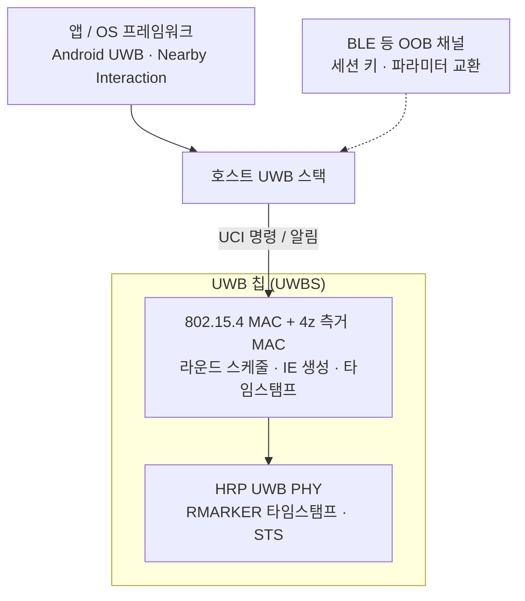

# 802.15.4 MAC 개요

!!! spec "규격 · 개정판"
    IEEE 802.15.4-2020 MAC 기능 설명 · MAC 서비스(MCPS·MLME) · MAC 프레임 형식 · 802.15.4z-2020 측거 관련 MAC 기능 (ERDEV, 측거 IE, 측거 라운드) · FiRa Consortium MAC 기술 규격 · FiRa UCI 규격

!!! basic "한눈에 보기"
    IEEE 802.15.4 MAC은 원래 Zigbee·Thread 같은 **저전력 센서 네트워크**를 위해 만든 계층입니다. 짧은 프레임, 16비트·64비트 주소, 간단한 채널 접근이 특징입니다. UWB는 이 MAC을 그대로 물려받았지만 쓰는 방식이 다릅니다.

    센서 네트워크의 MAC이 "택배를 잃어버리지 않고 배달하는 일"이라면, UWB 측거의 MAC은 **"스톱워치를 든 두 사람이 정해진 순서대로 박수를 치게 하는 일"**에 가깝습니다. 데이터의 양보다, 누가 언제 박수를 치고 그 시각을 어떻게 서로 알려 주느냐가 중요합니다.

    802.15.4z는 여기에 측거 전용 정보 요소(IE), 블록·라운드·슬롯 시간 구조, 컨트롤러·컨트롤리와 개시자·응답자 역할을 더했습니다.

## 계층과 서비스 { .l2 }

802.15.4 MAC은 위로 두 개의 서비스 접점(SAP)을 냅니다.

| 서비스 | 하는 일 | UWB 측거에서의 쓰임 |
|---|---|---|
| **MCPS** (MAC Common Part Sublayer) 데이터 서비스 | 프레임 송수신 요청·확인·지시 | 측거 프레임 송신 요청, 송수신 **타임스탬프**를 확인·지시 프리미티브로 상위에 전달 |
| **MLME** (MAC Sublayer Management Entity) 관리 서비스 | 스캔, 연결(association), 비컨, 파라미터(PIB) 설정 | 측거 관련 PIB 설정, 수신기 켜기 시각 지정 |
| **PIB** (PAN Information Base) | MAC 동작 파라미터 저장소 | 채널, 프리앰블 코드, STS 키 관련 값, 측거 옵션 |

실제 제품에서는 이 프리미티브를 호스트가 직접 부르지 않습니다. MAC은 대부분 **UWB 칩(UWBS) 펌웨어 안**에 있고, 호스트는 FiRa의 [UCI](../ecosystem/uci.md)로 "세션을 만들고, 파라미터를 넣고, 시작하라"고 명령한 뒤 측거 결과 알림만 받습니다.

## 장치 유형과 토폴로지 { .l2 }

| 개념 | 802.15.4 일반 | UWB 측거에서 |
|---|---|---|
| 장치 유형 | FFD(전 기능), RFD(축소 기능) | 측거 역할로 다시 나눔 (아래) |
| 코디네이터 | PAN을 만들고 비컨을 냄 | 대개 **컨트롤러**가 그 역할을 대신함 |
| 토폴로지 | 스타, 피어 투 피어 | 일대일, 일대다, 다대다 측거 ([다중 노드 측거](multi-node.md)) |
| 주소 | PAN ID 16비트, 짧은 주소 16비트, 확장 주소 64비트 | 세션 안에서는 짧은 주소를 주로 사용 |
| 연결(association) | MLME 절차로 PAN 가입 | 거의 쓰지 않음 — OOB로 파라미터를 미리 맞춤 |

802.15.4z가 정의한 역할은 두 축입니다.

| 축 | 역할 | 뜻 |
|---|---|---|
| 제어 | **컨트롤러(Controller)** | 측거 파라미터와 일정을 정해 알리는 장치 |
| | **컨트롤리(Controlee)** | 컨트롤러의 설정을 따르는 장치 |
| 측거 | **개시자(Initiator)** | 라운드에서 첫 측거 프레임(Poll)을 보내는 장치 |
| | **응답자(Responder)** | 첫 측거 프레임을 받고 응답하는 장치 |

두 축은 독립입니다. 차량 키에서는 차량이 컨트롤러이면서 개시자인 경우가 많지만, 컨트롤리가 개시자가 되는 구성도 가능합니다.

## 측거 프레임과 ERDEV { .l2 }

HRP UWB PHY의 PHR에는 **측거 비트**가 있어, 이 비트가 켜진 프레임을 **RFRAME**(측거 프레임)이라 부릅니다. RFRAME의 RMARKER에서 송수신 시각이 기록되고([대역폭과 시간 분해능](../basics/bandwidth-resolution.md)), 이 시각이 [SS-TWR](../ranging/ss-twr.md)·[DS-TWR](../ranging/ds-twr.md) 계산의 재료가 됩니다.

802.15.4z는 측거 기능을 강화한 장치를 **ERDEV**(Enhanced Ranging Capable Device)라고 부르며, STS를 쓰는 보안 측거, 측거 IE, 라운드 스케줄링 같은 기능을 이 장치에 묶어 정의합니다. 앞으로 이 섹션에서 말하는 "측거 MAC"은 ERDEV의 동작을 뜻합니다.

??? expert "전문가 노트 — 개정판별 MAC 변화와 실무 관점"
    **802.15.4a (2007).** UWB PHY와 함께 측거 개념을 처음 넣었습니다. 측거 비트, 타임스탬프 보고, 측거용 프리미티브가 생겼지만 측거 절차 자체는 상위에 맡겼습니다.

    **802.15.4e → 2015 통합본.** IE(Information Element), 새 프레임 버전, TSCH·DSME 같은 저전력·결정적 접근 방식이 들어왔습니다. 4z의 측거 제어는 이 IE 구조 위에 얹혔습니다([MAC 프레임과 IE](frame-ie.md)).

    **802.15.4z (2020).** HRP의 STS(보안 타임스탬프), 측거 IE, 블록·라운드·슬롯 구조, 컨트롤러·컨트롤리 개념, 일대다·다대다 측거, 지연(deferred) 보고를 추가했습니다.

    **802.15.4ab (논의 중, 초안 기준).** 협대역 보조(NBA)와 다중 밀리초 시퀀스(MMS) 측거, 센싱 등을 위한 MAC 확장이 논의되고 있습니다. 승인 전이므로 이름과 필드는 바뀔 수 있습니다([802.15.4ab 개요](../next/4ab-overview.md)).

    **실무 팁.** 802.15.4z는 선택지가 많아, 상호운용은 FiRa MAC 규격이 정한 조합(라운드 사용 방식, 슬롯 길이, 메시지 형식)에서 결정됩니다. 칩 데이터시트에 "802.15.4z 준수"라고 적혀 있어도 FiRa 인증 여부와 지원하는 라운드 사용 방식 목록을 따로 확인해야 합니다.
