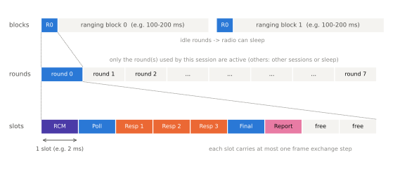
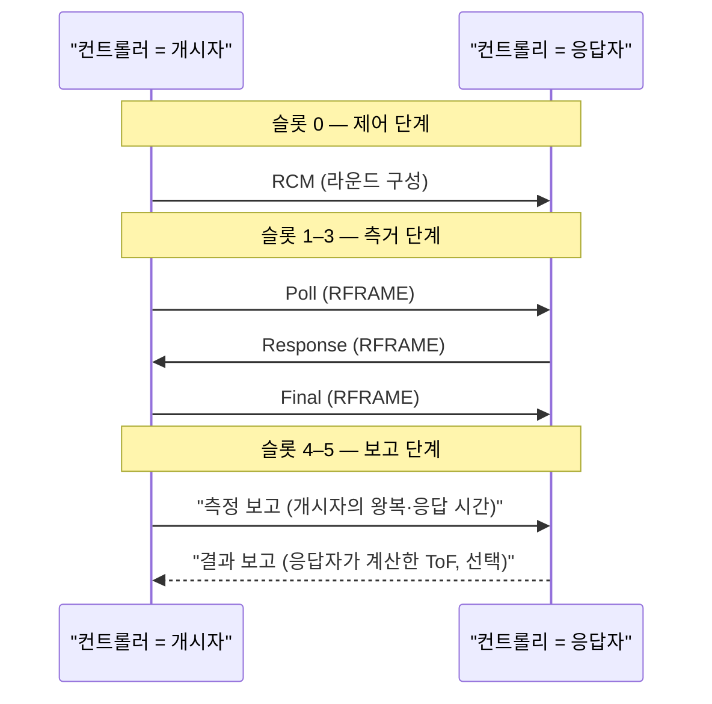

# 측거 라운드 구조

!!! spec "규격 · 개정판"
    IEEE 802.15.4-2020 측거 절차 · 802.15.4z-2020 측거 블록·라운드·슬롯 구조, 측거 단계, 지연·비지연 보고 · FiRa Consortium MAC 기술 규격 (라운드 사용 방식, RSTU, 측거 메시지) · FiRa UCI 규격 (세션 파라미터) · CCC Digital Key Release 3 (UWB 측거 일정)

!!! basic "한눈에 보기"
    UWB 측거 세션의 시간은 **블록 → 라운드 → 슬롯**의 세 단계로 쪼개집니다.

    - **측거 블록(Ranging Block)** — 측거가 반복되는 큰 주기. 블록 길이가 곧 "몇 ms마다 거리를 갱신하나"입니다.
    - **측거 라운드(Ranging Round)** — 블록 안의 칸. 한 번의 완전한 측거(제어·Poll·Response·Final·보고)가 한 라운드 안에서 끝납니다.
    - **측거 슬롯(Ranging Slot)** — 라운드 안의 가장 작은 칸. 슬롯 하나에 프레임 하나가 오갑니다.

    버스 시간표에 비유하면 블록은 "하루", 라운드는 "배차 시각", 슬롯은 "정류장"입니다. 한 세션은 보통 블록마다 라운드 하나만 쓰고 나머지 시간은 잠들거나 다른 세션에 양보합니다.

## 블록·라운드·슬롯 { .l2 }

<figure markdown>

<figcaption>측거 블록은 여러 라운드로, 라운드는 여러 슬롯으로 나뉩니다. 이 세션은 블록마다 라운드 0만 쓰고, 그 안에서 일대다 DS-TWR(제어 → Poll → 응답 3개 → Final → 보고)을 진행합니다.</figcaption>
</figure>

| 단위 | 정하는 것 | 대표 값 (FiRa 기준 예) |
|---|---|---|
| 슬롯 | 프레임 하나 + 처리 여유 | **RSTU** 단위로 지정. 1 RSTU = 416칩 ≈ 833.33 ns, 흔한 기본값 2400 RSTU = **2 ms** |
| 라운드 | 슬롯 수 × 슬롯 길이 | 슬롯 수는 세션 구성에 따라 다름 |
| 블록 | 측거 갱신 주기 | 수십–수백 ms (응용·전력 예산에 따라 결정) |

RSTU(Ranging Scheduling Time Unit)는 FiRa가 슬롯·라운드 길이를 표현하는 단위로, 칩 레이트 499.2 MHz에서 나온 1.2 MHz 클럭의 한 주기입니다. 슬롯이 2 ms면 5개 메시지의 DS-TWR 라운드는 10 ms, 블록이 100 ms면 무선부는 시간의 약 10 %만 깨어 있으면 됩니다([저전력 동작](low-power.md)).

## 라운드 안의 단계 { .l2 }

하나의 라운드는 역할에 따라 몇 개의 **단계(phase)**로 나뉩니다. 이름은 문서마다 조금씩 다르지만 흐름은 같습니다.

| 단계 | 보내는 쪽 | 메시지 | 목적 |
|---|---|---|---|
| 제어 단계 | 컨트롤러 | 측거 제어 메시지 (RCM) | 이번 라운드의 방식·슬롯 배정·역할 알림 |
| 측거 단계 | 개시자 | Poll (측거 개시) | 첫 RFRAME, 시각 기록 시작 |
| | 응답자 | Response | 응답 시각 기록 |
| | 개시자 | Final (DS-TWR일 때) | 두 번째 왕복 완성 |
| 보고 단계 | 개시자·응답자 | 측정 보고 / 결과 보고 | 지연 보고된 시간 값, 계산된 ToF 교환 |

DS-TWR의 거리 계산식 자체는 [DS-TWR](../ranging/ds-twr.md) 페이지를 참고하세요. 이 페이지에서 중요한 것은 **각 시간 값을 누가 재고, 어느 메시지로 상대에게 넘기느냐**입니다.

## 라운드 사용 방식 { .l2 }

FiRa는 라운드 안에서 무엇을 할지를 몇 가지 **라운드 사용 방식(Ranging Round Usage)**으로 정해 둡니다.

| 사용 방식 | 메시지 흐름 | 결과가 계산되는 곳 |
|---|---|---|
| SS-TWR, 지연 보고 | Poll → Response → (보고) | 개시자 ([SS-TWR](../ranging/ss-twr.md)) |
| DS-TWR, 지연 보고 | Poll → Response → Final → 측정 보고 | 응답자(필요하면 결과를 개시자에게 다시 보고) |
| SS/DS-TWR, 비지연 | 시간 값을 측거 프레임 자체에 실음 | 측거 프레임을 받은 쪽 |
| 단방향(OWR) — UL-TDoA, DL-TDoA | 블링크 또는 앵커 송신만 | 서버 또는 태그 ([TDoA](../ranging/tdoa.md)) |
| 단방향(OWR) — AoA | 한쪽이 보내고 다른 쪽이 각도만 측정 | 수신 측 ([AoA와 PDoA](../ranging/aoa-pdoa.md)) |

SP3 같은 보안 패킷 구성에서는 측거 프레임에 페이로드가 없으므로 사실상 지연 보고 방식을 씁니다([MAC 프레임과 IE](frame-ie.md)).

??? expert "전문가 노트 — 시간 예산과 응답 지연 설계"
    **라운드 길이 계산.** 슬롯 길이 \(T_s\), 라운드당 슬롯 수 \(N_s\), 블록 길이 \(T_B\)라면

    \[
    T_{\text{round}} = N_s T_s, \qquad \text{duty} \approx \frac{N_s T_s}{T_B}
    \]

    입니다. \(T_s = 2\) ms, \(N_s = 6\), \(T_B = 200\) ms면 라운드 12 ms, 듀티 약 6 %입니다.

    **응답 지연과 클럭 오차.** DS-TWR에서 \(T_{\text{reply}}\)는 슬롯 길이에 묶여 ms 단위가 됩니다. SS-TWR이라면 1 ms 응답 지연과 20 ppm 상대 오프셋으로 오차가 약 3.0 m까지 커지므로, 슬롯 간격의 SS-TWR은 반드시 주파수 오프셋 보정(반송파 적분기 등)과 함께 써야 합니다([SS-TWR](../ranging/ss-twr.md)). 비대칭 DS-TWR은 \(R_a, R_b, D_a, D_b\)가 서로 달라도 오차가 상쇄되므로 슬롯 구조와 잘 맞습니다.

    **슬롯 길이를 줄이는 한계.** 슬롯에는 프레임 길이(프리앰블 길이와 STS 길이에 좌우), 수신기 준비 시간, 타임스탬프 처리와 다음 프레임 준비 시간이 모두 들어가야 합니다. 긴 프리앰블·긴 STS를 쓰는 원거리 설정일수록 슬롯이 길어져야 합니다.

    **블록 동기 유지.** 컨트롤리는 매 블록의 제어 메시지 수신 시각으로 컨트롤러의 블록 경계를 추정합니다. 블록 간 클럭 드리프트(20 ppm × 200 ms = 4 µs)만큼 수신 창을 넉넉히 열어야 하며, 몇 블록을 놓치면 창을 넓혀 다시 잡습니다.

    **CCC와의 차이.** CCC Digital Key도 블록·라운드·호핑 개념을 쓰지만 세부 메시지 구성과 파라미터는 CCC 규격이 따로 정합니다. 공개 자료 수준의 설명은 [CCC Digital Key 3.0](../ecosystem/ccc-digital-key.md)을 참고하세요.
