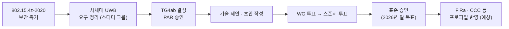

# 802.15.4ab 개요

!!! spec "규격 · 개정판"
    IEEE 802.15.4ab (TG4ab, 차세대 UWB) — **작업 중, 초안 기준**. 표준 승인 전이므로 이 페이지의 내용은 공개된 TG 문서·발표 자료를 바탕으로 한 **논의 방향**이며, 최종 표준과 다를 수 있습니다.

!!! basic "한눈에 보기"
    802.15.4z(2020)로 UWB 보안 측거가 완성되면서 휴대폰·차량·도어락에 UWB가 들어갔습니다. 그런데 실제로 써 보니 아쉬운 점이 보였습니다.

    - **거리** — 송신 전력 규제가 엄격해서, 몸에 가려진 휴대폰이나 넓은 공간에서 도달 거리가 부족
    - **전력** — 측거와 대기에 드는 전력이 건전지 기기에는 부담
    - **기능** — 레이더·센싱, 대용량 데이터 전송처럼 UWB가 할 수 있는 다른 일들이 표준에 없음
    - **공존** — 같은 대역을 쓰는 Wi-Fi 6E/7과의 간섭

    **802.15.4ab**는 이를 해결하기 위한 차세대 UWB 개정판입니다. IEEE 802.15 안의 **TG4ab**(Task Group 4ab)가 만들고 있으며, 2026년 말 승인을 목표로 진행 중입니다. 아직 확정된 표준이 아니므로 이 섹션의 내용은 모두 **"논의 중"**으로 읽어야 합니다.

## 주요 논의 주제 { .l2 }

| 주제 | 목표 | 이 섹션 페이지 |
|---|---|---|
| NBA-MMS | 협대역 신호로 제어·동기를 맡기고 UWB는 측거에 집중 → 전력·효율 개선 | [NBA-MMS (협대역 보조)](nba-mms.md) |
| MMS 측거 | 측거 신호를 여러 ms에 걸친 조각으로 나눠 더 많은 에너지 수집 → 거리·견고성 개선 | [MMS 측거](mms-ranging.md) |
| 센싱 | 측거 칩으로 레이더·재실 감지 등 센싱 기능 표준화 | [센싱과 레이더 표준화](sensing.md) |
| 데이터·저전력 | 더 높은 데이터율, 저전력 동작 모드 | [고속 데이터와 저전력](data-power.md) |
| 공존 | Wi-Fi 등 같은 대역 기술과의 간섭 완화 | [다른 기술과의 공존](coexistence.md) |
| 기존 호환 | 802.15.4z 기기와의 하위 호환, 보안 측거 유지 | 이 페이지 전문가 노트 |

## 표준화 흐름 { .l2 }

IEEE 표준은 초안 → 워킹 그룹 투표 → 스폰서 투표(의견 반영 반복) → 표준 위원회 승인 순서로 확정됩니다. 초안 단계에서는 기능이 추가·삭제·변경될 수 있으므로, 이 섹션에서 다루는 세부 사항은 확정 표준이 나온 뒤 다시 확인해야 합니다([표준 문서 읽는 법](../getting-started/reading-standards.md)).

## 누가 관심을 갖나 { .l2 }

| 분야 | 기대하는 기능 |
|---|---|
| 휴대폰 | 저전력, 더 긴 거리, 센싱(제스처·재실) |
| 차량 | 몸에 가려진 휴대폰의 견고한 측거, 실내 아동 감지 레이더 |
| 출입 통제 | 건전지 도어락의 저전력, 빠른 핸즈프리 |
| 산업·IoT | 저전력 태그, 데이터 전송, 확장성 |

??? expert "전문가 노트 — 하위 호환과 생태계 반영"
    802.15.4ab의 새 기능은 대부분 **새 모드**로 추가되는 방향이며, 기존 802.15.4z HRP 측거는 그대로 유지될 것으로 보입니다. 기존 기기와 새 기기가 섞인 환경에서는 측거 세션을 시작하기 전에 OOB(BLE 등)로 **능력 협상**을 해서 공통 모드를 고르는 방식이 자연스럽습니다.

    생태계 반영 순서는 일반적으로 다음과 같습니다.

    1. IEEE 표준 승인
    2. FiRa가 새 기능 중 무엇을 프로파일에 넣을지 결정, UCI 확장, 인증 시험 개발
    3. CCC·Aliro 등 응용 표준이 새 기능 채택 여부 결정
    4. 칩 출시 → 단말 탑재

    따라서 표준 승인 후에도 실제 제품에서 쓰이기까지는 시간이 걸립니다. 칩 회사들은 표준 승인 전에 초안 기반 기능을 선행 구현하기도 하지만, 상호운용은 프로파일과 인증이 나와야 보장됩니다.

    TG4ab 진행 상황은 IEEE 802.15 공개 문서 서버의 회의록과 기고문으로 추적할 수 있습니다([참고 자료](../reference/resources.md)).
