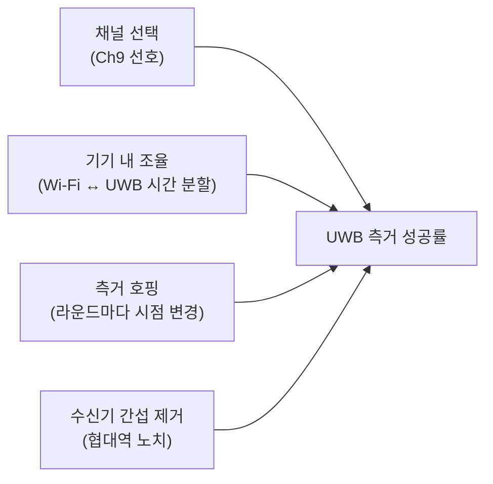

# 다른 기술과의 공존

!!! spec "규격 · 개정판"
    IEEE 802.15.4ab (TG4ab) — 공존·간섭 완화 관련 논의 (**작업 중, 초안 기준 · 논의 중**) · IEEE 802.11ax/be 6 GHz 대역 운용 · FCC·ETSI UWB 규제 (탐지·회피, 저듀티 조건)

!!! basic "한눈에 보기"
    UWB는 규제상 **아주 낮은 전력**으로 넓은 대역에 퍼져 있기 때문에, 다른 무선 기술에는 잡음 수준으로만 보입니다. 이것이 UWB가 면허 없이 넓은 대역을 쓸 수 있는 이유입니다.

    하지만 반대 방향은 다릅니다. **다른 기술의 강한 신호는 UWB에 큰 간섭**이 됩니다. 특히 Wi-Fi가 6 GHz 대역(Wi-Fi 6E, Wi-Fi 7)으로 넓어지면서, UWB 주력 채널인 Ch5(6.5 GHz)와 대역이 겹치게 됐습니다.

    한 휴대폰 안에 Wi-Fi와 UWB가 함께 있으니 문제는 더 가깝습니다. Wi-Fi가 송신하는 순간 같은 기기의 UWB 수신기는 거의 귀가 먹습니다.

## 누가 누구에게 간섭하나 { .l2 }

| 간섭원 → 피해자 | 정도 | 비고 |
|---|---|---|
| UWB → Wi-Fi·셀룰러 | 낮음 | 규제 전력 밀도가 잡음 수준이 되도록 정해짐 |
| Wi-Fi 6 GHz → UWB Ch5 | 높음 | 대역이 겹침. 강한 협대역 신호가 UWB 수신을 방해 |
| Wi-Fi 6 GHz → UWB Ch9 | 중간 | 대역은 거의 안 겹치지만 인접 대역 누설, 수신기 포화 |
| 같은 기기 내 Wi-Fi 송신 → UWB 수신 | 매우 높음 | 안테나 간 격리 부족 시 수신 불가 |
| 다른 UWB 세션 → UWB | 상황에 따라 | 같은 채널·시간이면 충돌. 프리앰블 코드·시간 분할로 완화 |

## 현재의 공존 방법 { .l2 }

| 방법 | 내용 |
|---|---|
| 채널 선택 | 6 GHz Wi-Fi와 덜 겹치는 Ch9를 우선 사용. 지역 규제도 Ch9가 넓게 허용 ([채널 번호와 대역](../phy/channels.md)) |
| 기기 내 조율 | 휴대폰 안에서 Wi-Fi와 UWB가 송신 시점을 신호로 주고받아 겹치지 않게 함 |
| 측거 호핑 | 라운드마다 측거 시점을 바꿔 다른 세션·간섭과 계속 겹치는 것을 방지 |
| 수신기 처리 | 강한 협대역 간섭을 디지털 노치 필터로 제거 |

## 802.15.4ab의 논의 방향 { .l2 }

- 간섭 환경에서도 견고한 측거 신호 (MMS 등으로 에너지·시간 다양성 확보, [MMS 측거](mms-ranging.md))
- 다른 기술의 사용 상황을 고려한 채널·시점 선택 절차
- 밀집 환경(사무실, 공항)에서 많은 UWB 세션이 공존하기 위한 MAC 개선

구체적인 메커니즘은 초안 단계이며 최종 표준에서 확인해야 합니다.

??? expert "전문가 노트 — 규제 조건과 측정"
    일부 지역(예: 유럽 일부 대역)은 UWB에 **탐지·회피(DAA)**나 **저듀티 사이클(LDC)** 조건을 걸어, 다른 서비스를 감지하면 전력을 낮추거나 송신 비율을 제한하게 합니다. 이 조건은 채널과 지역마다 다르므로 제품은 지역별로 허용 채널과 동작 모드를 바꿔야 합니다([주파수 규제](../basics/regulation.md)).

    공존 시험에서는 다음을 측정하는 것이 일반적입니다.

    - Wi-Fi 트래픽 부하(유휴, 스트리밍, 대용량 전송)별 UWB 측거 성공률과 거리 오차
    - 같은 기기 내 Wi-Fi 송신 중 UWB 측거 지연(재시도로 늘어나는 시간)
    - 여러 UWB 세션이 같은 공간에 있을 때의 충돌률 ([다중 노드 측거](../mac/multi-node.md))

    BLE Channel Sounding처럼 2.4 GHz에서 측거하는 기술과는 대역이 달라 직접 간섭은 적지만, 휴대폰 안테나·RF 경로를 공유하는 경우 기기 내 조율 대상이 됩니다. 측위 기술 간 비교는 [UWB vs BLE CS vs Wi-Fi RTT vs 5G](../reference/positioning-comparison.md)에서 다룹니다.
