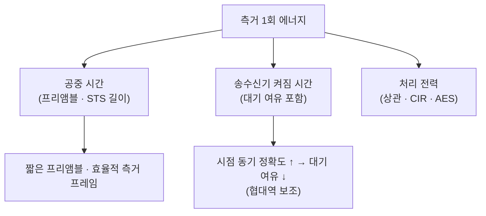

# 고속 데이터와 저전력

!!! spec "규격 · 개정판"
    IEEE 802.15.4ab (TG4ab) — 데이터율 확장, 저전력 동작 관련 논의 · **작업 중, 초안 기준 · 논의 중** · 비교 기준: IEEE 802.15.4z HRP BPRF·HPRF 데이터율

!!! basic "한눈에 보기"
    지금의 UWB는 측거가 주 임무이고, 데이터는 측거에 필요한 만큼만 보냅니다. 802.15.4z HRP의 데이터율은 수–수십 Mbps 수준이고([변조와 부호화](../phy/modulation-coding.md)), 휴대폰은 큰 데이터를 BLE나 Wi-Fi로 보냅니다.

    802.15.4ab에서는 두 방향의 개선이 논의되고 있습니다.

    1. **더 빠른 데이터** — 측거하는 김에 사진·음성·센서 데이터도 UWB로 보내기. 지연이 짧고 간섭에 강한 UWB 특성을 살린 응용(예: 무선 오디오, 저지연 제어)
    2. **더 적은 전력** — 건전지 태그·도어락이 수년 동작하도록 측거 1회당 에너지와 대기 전력 줄이기

    두 목표는 서로 반대처럼 보이지만, "필요한 비트를 **짧게** 보내고 빨리 잠든다"는 점에서 연결됩니다. 데이터율이 높으면 같은 데이터를 더 짧은 시간에 보내고 더 오래 잘 수 있습니다.

## 데이터율 확장 방향 { .l2 }

| 방향 | 내용 | 대가 |
|---|---|---|
| 높은 펄스 반복률 | 같은 대역폭 안에 펄스를 더 촘촘히 | 심볼 간 간섭, 수신기 복잡도 |
| 고차 변조 | 펄스 하나에 더 많은 비트 | 요구 SNR 증가 → 거리 감소 |
| 넓은 대역폭 채널 | 1 GHz 이상 채널 활용 | 규제·칩 RF 대역폭, 공존 |
| 효율적 부호화 | 오류 정정 부호 개선 | 복호 전력 |

UWB는 송신 전력 밀도 한도 때문에 **데이터율과 거리가 강하게 교환**됩니다. 높은 데이터율은 수 m 이내 근거리에서 의미가 큽니다([링크 버짓](../basics/link-budget.md)).

## 저전력 방향 { .l2 }

| 방법 | 효과 |
|---|---|
| 짧은 프레임 | 공중 시간과 수신 시간 감소 |
| 정확한 웨이크업 시점 | 수신 대기 여유(guard) 감소 ([NBA-MMS](nba-mms.md)) |
| 저전력 수신 모드 | 감도를 조금 희생하고 수신기 전력 감소 |
| 측거 횟수 최적화 | 움직임이 없을 때 측거 주기 늘림 (응용 영역) |

??? expert "전문가 노트 — 초안 기준 수치에 대한 주의"
    TG4ab 기고문에는 다양한 데이터율·전력 목표가 제안됐지만, 초안 단계의 수치는 제안별로 다르고 투표 과정에서 바뀔 수 있습니다. 이 핸드북은 확정되지 않은 수치를 싣지 않으며, 표준 승인 후 [채널·PHY 파라미터 표](../reference/parameter-table.md)에 반영할 예정입니다.

    실무에서 저전력 UWB를 설계할 때는 표준의 새 모드보다 **기존 기능을 잘 쓰는 것**이 먼저인 경우가 많습니다.

    - 측거가 꼭 필요할 때만 세션을 열고(BLE 근접 감지 활용), 움직임 센서로 주기를 조절
    - 측거 방식 선택: DS-TWR은 정확하지만 메시지가 많고, SS-TWR은 짧지만 클럭 오차에 민감 ([SS-TWR](../ranging/ss-twr.md), [DS-TWR](../ranging/ds-twr.md))
    - 다중 노드에서 일대다 라운드로 메시지 수 줄이기 ([다중 노드 측거](../mac/multi-node.md))

    저전력 MAC 동작은 [저전력 동작](../mac/low-power.md)에서 다룹니다.
