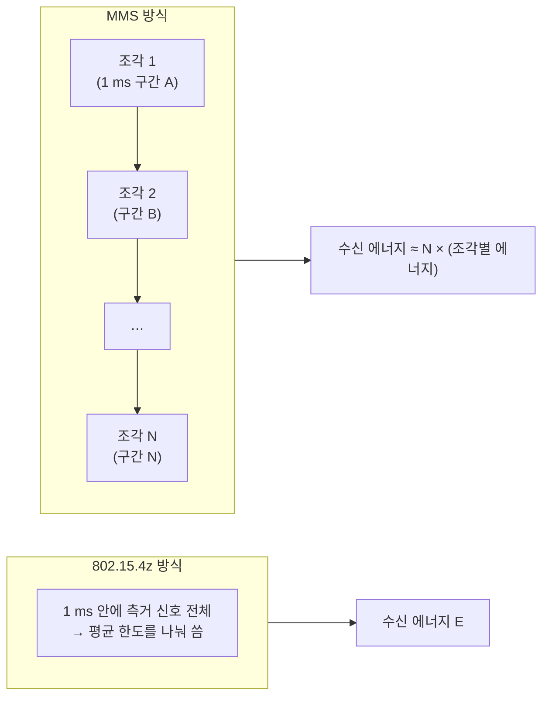

# MMS 측거

!!! spec "규격 · 개정판"
    IEEE 802.15.4ab (TG4ab) — 다중 ms(MMS, Multi-Millisecond) 측거 · **작업 중, 초안 기준 · 논의 중** · 관련 규제: FCC Part 15 Subpart F 평균 전력 측정 조건(1 ms 평균)

!!! basic "한눈에 보기"
    UWB 송신 전력 규제는 "**1 ms 동안 평균**한 전력 밀도"로 정해져 있습니다([주파수 규제](../basics/regulation.md)). 그래서 1 ms 안에 신호를 많이 보내면 순간 전력을 낮춰야 하고, 적게 보내면 높일 수 있습니다.

    **MMS 측거**는 이 규칙을 활용합니다. 측거 신호를 **여러 조각**으로 나눠 각 조각을 서로 다른 1 ms 구간에 보냅니다. 각 조각은 자기 1 ms 구간의 전력 한도를 혼자 쓰므로, 전체적으로 **훨씬 많은 에너지**를 모아 측거할 수 있습니다.

    비유하면 한 잔에 담을 수 있는 물의 양이 정해져 있을 때, 한 잔에 다 담으려 하지 말고 여러 잔에 나눠 담는 것입니다.

## 원리 { .l2 }

수신기는 여러 조각의 상관 결과를 **결합**해 하나의 도착 시각을 추정합니다. 조각 N개에 각각 같은 에너지를 실을 수 있다면, 이상적으로는 수신 에너지가 N배(10·log₁₀N dB)가 됩니다. 조각 4개면 약 6 dB, 16개면 약 12 dB입니다. [링크 버짓](../basics/link-budget.md)에서 감도 6 dB 개선은 자유 공간 거리 약 2배에 해당합니다.

## 얻는 것과 대가 { .l2 }

| 얻는 것 | 대가 |
|---|---|
| 도달 거리 증가, 몸·벽 가림에서 견고성 향상 | 측거 한 번에 걸리는 시간 증가 (여러 ms) |
| 첫 경로 검출 신뢰도 향상 (NLoS) | 조각 사이 클럭 드리프트·움직임 보정 필요 |
| 보안 측거 신호를 더 길게 → 공격 저항성 여지 | 조각 스케줄링, 다른 세션과의 시간 충돌 관리 |

## 조각의 구성 { .l2 }

초안 논의에서는 MMS 측거 신호를 용도에 따라 나눠 다룹니다. 공개 발표 자료에서는 측거용 시퀀스 조각(RSF, Ranging Sequence Fragment)과 무결성·보안 확인용 조각(RIF, Ranging Integrity Fragment) 같은 구분이 등장합니다. 조각의 길이, 개수, 간격, 보안 시퀀스 생성 방법은 초안 단계에서 바뀔 수 있으므로 최종 표준에서 확인해야 합니다.

MMS의 제어(언제 몇 개의 조각을 보낼지)는 UWB 프레임이나 협대역 신호로 할 수 있으며, 후자가 [NBA-MMS](nba-mms.md)입니다.

??? expert "전문가 노트 — 조각 결합의 기술적 쟁점"
    여러 ms에 걸친 조각을 하나의 측거로 결합하려면 다음을 해결해야 합니다.

    - **클럭 드리프트**: 20 ppm 오차의 두 클럭은 10 ms 동안 약 200 ns 어긋납니다. 이는 수십 m에 해당하므로, 조각마다 드리프트를 추정해 정렬해야 합니다. 조각 간격이 정확히 알려져 있으면 첫 조각들로 드리프트를 추정하고 나머지를 보정할 수 있습니다.
    - **움직임**: 수십 ms 동안 사람이 걸으면 수 cm 움직입니다. 측거 결과는 그 구간의 "평균 거리"가 되며, 빠른 움직임에서는 편향이 생길 수 있습니다.
    - **결합 방식**: 조각별 CIR을 위상까지 맞춰 결합하는 코히런트 방식은 이득이 크지만 위상 안정성이 필요하고, 크기만 결합하는 비코히런트 방식은 단순하지만 이득이 작습니다. 구현 선택의 영역입니다.
    - **보안**: 조각마다 다른 비밀 시퀀스를 쓰고, 조각별 도착 시각의 일관성을 검사하면 위조 신호를 걸러 내는 데 도움이 됩니다([공격 연구와 대응](../security/attacks.md)).

    규제 측면에서는 1 ms 평균과 함께 **피크 전력 한도**, 지역별 측정 방식 차이가 있으므로, 조각당 전력을 얼마나 올릴 수 있는지는 지역 규제와 칩 최대 출력에 따라 달라집니다.
