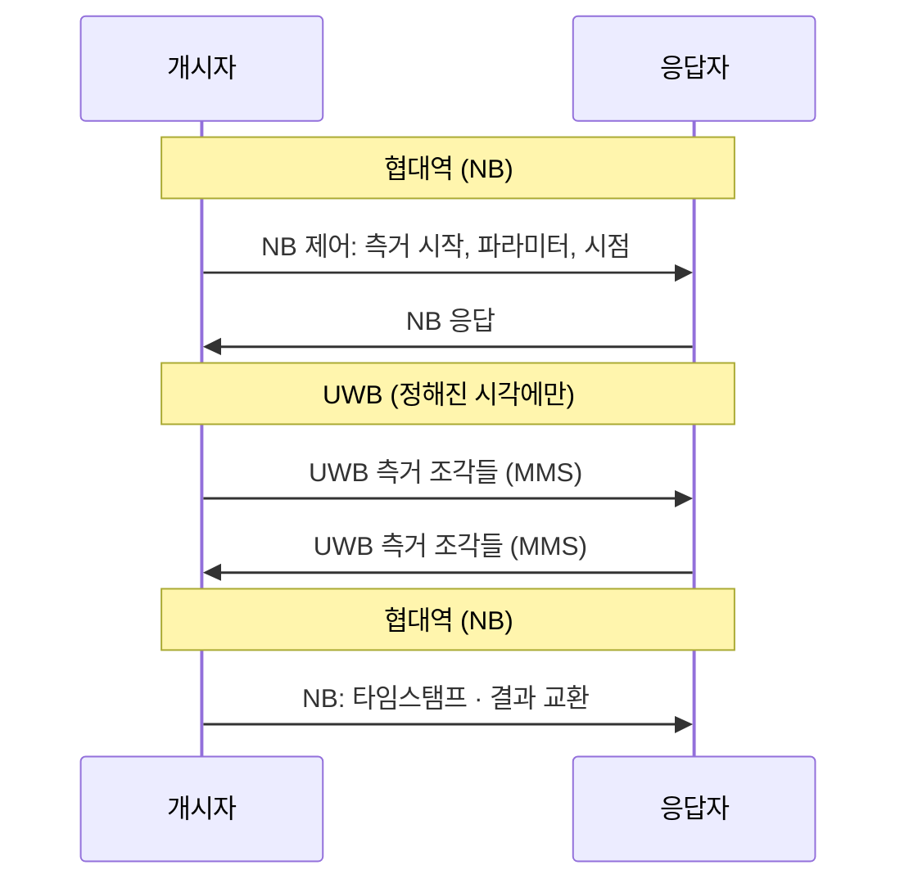

# NBA-MMS (협대역 보조)

!!! spec "규격 · 개정판"
    IEEE 802.15.4ab (TG4ab) — 협대역 보조(NBA, Narrowband Assisted) 다중 ms(MMS) 측거 · **작업 중, 초안 기준 · 논의 중**. 세부 신호 형식과 파라미터는 최종 표준에서 확인해야 합니다.

!!! basic "한눈에 보기"
    지금 UWB 측거에서는 **모든 일**을 UWB로 합니다. 상대를 찾고, 시작 시점을 맞추고, 측거 메시지와 결과를 주고받는 것까지 전부 UWB 프레임입니다.

    그런데 UWB는 **정밀한 시간 측정**에는 최고지만, 단순한 제어 메시지를 보내는 데는 비효율적입니다. 넓은 대역을 쓰는 만큼 수신기가 전력을 많이 쓰고, 규제상 전력이 낮아 데이터 전송 거리도 짧습니다.

    **NBA(협대역 보조)**는 역할을 나눕니다.

    - **협대역 무선** — 발견, 동기, 제어 메시지, 결과 교환 (효율적, 수신 전력 낮음)
    - **UWB** — 오직 정밀 측거 신호만 (짧게, 꼭 필요할 때만)

    비유하면 회의 일정은 문자 메시지(협대역)로 잡고, 실제 측정은 정밀 계측기(UWB)로만 하는 셈입니다.

## 왜 필요한가 { .l2 }

| 문제 | 현재 (802.15.4z) | NBA 방향 |
|---|---|---|
| 수신 대기 전력 | UWB 수신기를 켜고 상대 프레임을 기다림 | 협대역 수신기로 기다리고 UWB는 정해진 시각에만 켬 |
| 제어 메시지 도달 거리 | UWB 전력 한도에 묶임 | 협대역은 상대적으로 긴 거리로 제어 가능 |
| 시간 동기 | UWB 프레임으로 맞춤 | 협대역 교환으로 UWB 측거 시점을 미리 맞춤 |
| 공중 시간 | 제어·측거 프레임 모두 UWB | UWB 공중 시간은 측거 신호에만 |

## 동작 개념 { .l2 }

1. 협대역으로 측거 세션을 열고, UWB 측거 신호를 보낼 **정확한 시점과 형식**을 합의합니다.
2. 정해진 시점에만 UWB 송수신기를 켜서 **측거 신호 조각들**을 주고받습니다([MMS 측거](mms-ranging.md)).
3. 측거 결과 계산에 필요한 타임스탬프 등은 다시 협대역으로 교환합니다.

## 협대역 신호의 위치 { .l2 }

초안 논의에서는 협대역 신호를 UWB 칩이 함께 처리할 수 있는 **비면허 대역**에 두는 방안이 다뤄졌습니다. 같은 칩·안테나 경로에서 두 신호를 처리할 수 있어야 비용이 맞기 때문입니다. 구체적인 대역, 변조, 데이터율은 표준 확정 후 확인해야 합니다.

이미 휴대폰과 차량은 **BLE**로 발견·보안 채널을 처리하고 UWB는 측거만 하는 구조를 씁니다([CCC Digital Key 3.0](../ecosystem/ccc-digital-key.md)). NBA는 이와 비슷한 역할 분담을 **UWB 표준 안에서**, 측거 타이밍과 더 밀접하게 묶어서 하려는 시도로 볼 수 있습니다.

??? expert "전문가 노트 — BLE OOB와의 관계, 설계 쟁점"
    BLE를 OOB로 쓰는 현재 구조와 비교한 NBA의 잠재적 장점은 다음과 같습니다.

    - **타이밍 결합**: BLE와 UWB가 별도 칩이면 측거 시점 동기에 여유를 둬야 해서 UWB 수신 대기 시간이 길어집니다. 같은 칩 안의 협대역이면 시점을 더 정확히 맞출 수 있어 UWB 켜짐 시간을 줄일 수 있습니다.
    - **BLE가 없는 기기**: 산업 태그, 단순 앵커처럼 BLE를 넣기 어려운 기기에서도 효율적 측거 가능.
    - **표준화된 제어**: 측거 제어 메시지가 IEEE 표준 안에서 정의되면 업체 간 상호운용이 쉬워집니다.

    논의 과정의 쟁점은 협대역 신호의 규제 조건(대역별 전력·듀티 사이클), 기존 UWB 칩 구조에 협대역 송수신을 넣는 비용, 협대역 구간의 보안(제어 메시지 위조 방지), 그리고 BLE 기반 생태계(CCC, Aliro)와의 관계입니다. 응용 표준이 NBA를 채택할지는 표준 승인 후의 결정 사항입니다.
