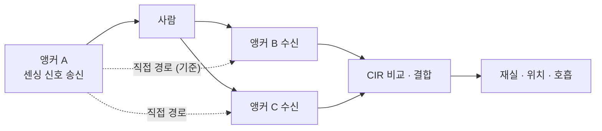

# 센싱과 레이더 표준화

!!! spec "규격 · 개정판"
    IEEE 802.15.4ab (TG4ab) — UWB 센싱 관련 기능 · **작업 중, 초안 기준 · 논의 중** · 참고: IEEE 802.11bf (Wi-Fi 센싱)

!!! basic "한눈에 보기"
    UWB 칩은 이미 레이더처럼 쓸 수 있습니다. 펄스를 보내고 반사파의 CIR을 보면 사람의 움직임과 호흡까지 잡을 수 있습니다([UWB 레이더와 센싱](../apps/radar-sensing.md)). 하지만 지금은 이것이 **각 칩 회사의 독자 기능**입니다. 신호 형식도, 결과 보고 방식도 제각각이라 서로 다른 회사 기기끼리 센싱을 함께 할 수 없습니다.

    802.15.4ab는 센싱을 **표준 기능**으로 넣는 방안을 논의하고 있습니다. 표준이 되면 다음이 가능해집니다.

    - A사 앵커가 쏜 센싱 신호를 B사 앵커가 받아 분석 (바이스태틱 센싱)
    - 센싱 세션을 측거 세션처럼 표준 방식으로 설정
    - 센싱 결과를 표준 형식으로 호스트에 보고

    Wi-Fi도 같은 방향으로 **802.11bf**(Wi-Fi 센싱)를 만들었습니다. UWB는 넓은 대역 덕분에 거리 분해능이 훨씬 좋다는 점이 다릅니다.

## 센싱 구성 { .l2 }

| 구성 | 송신 | 수신 | 특징 |
|---|---|---|---|
| 모노스태틱 | 기기 A | 기기 A | 레이더와 같음. 송수신 격리 필요 |
| 바이스태틱 | 기기 A | 기기 B | 기존 앵커 쌍 활용. 두 기기 간 시각·주파수 동기 필요 |
| 멀티스태틱 | 기기 A | 기기 B, C, D… | 넓은 영역, 위치 추정 정확도 ↑. 조율 복잡 |

바이스태틱에서는 송신 앵커에서 수신 앵커로 바로 오는 **직접 경로**가 시간 기준이 됩니다. 사람에게 반사된 경로는 그보다 늦게 오며, 그 지연 차로 반사점이 있는 타원을 구할 수 있습니다.

## 표준화 후보 항목 { .l2 }

공개 논의에서 다뤄진 항목은 대략 다음과 같습니다. 최종 표준에 무엇이 들어갈지는 확정되지 않았습니다.

| 항목 | 내용 |
|---|---|
| 센싱 신호 형식 | 센싱에 적합한 펄스열·반복 주기 (측거 프레임 재사용 포함) |
| 센싱 세션 설정 | 역할(송신·수신), 주기, 채널 등을 측거 세션처럼 협상 |
| 측정 보고 | CIR 또는 가공된 결과를 어떤 형식으로 보고할지 |
| 측거와의 공존 | 같은 칩에서 측거와 센싱을 시간 분할로 운용 |

??? expert "전문가 노트 — 표준화의 범위와 한계"
    센싱 표준화에서 핵심 질문은 **"어디까지 표준으로 정할 것인가"**입니다.

    - **신호와 절차**(무엇을 언제 보내고, 누가 받나)는 상호운용을 위해 표준화가 필요합니다.
    - **보고 형식**은 원시 CIR을 그대로 넘길지, 칩이 가공한 결과를 넘길지에 따라 호스트 부담과 유연성이 달라집니다.
    - **센싱 알고리즘**(재실 판정, 호흡 추정)은 제품 경쟁력이라 표준 밖에 남을 가능성이 큽니다. Wi-Fi 802.11bf도 측정 절차와 보고까지만 정하고 알고리즘은 정하지 않았습니다.

    프라이버시 측면에서도 고려가 필요합니다. 기기가 없는 사람까지 감지할 수 있으므로, 센싱 기능의 사용 동의와 데이터 처리 방식은 응용·플랫폼 수준에서 따로 다뤄야 합니다([프라이버시](../security/privacy.md)).

    규제 측면에서는 센싱 신호의 반복률·듀티 사이클이 측거와 달라 지역별 규정 해석이 필요할 수 있습니다([주파수 규제](../basics/regulation.md)).
