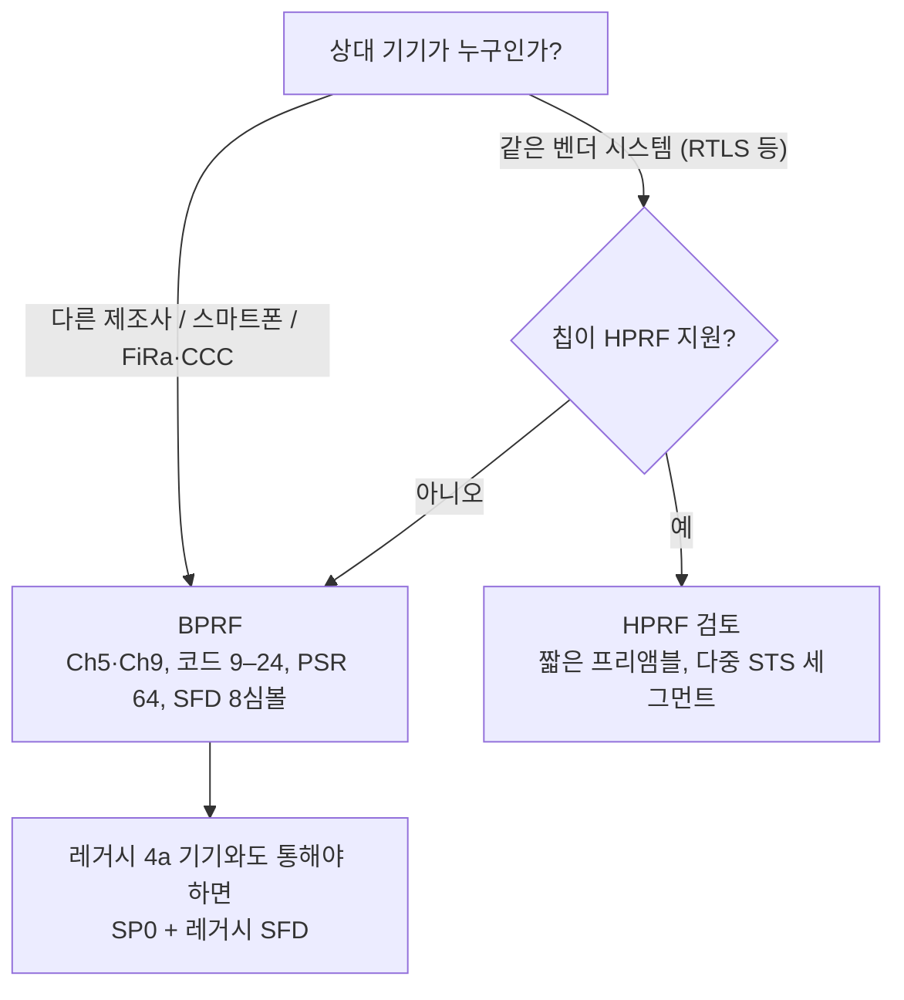

# BPRF와 HPRF

!!! spec "규격 · 개정판"
    IEEE 802.15.4z-2020 HRP UWB PHY 확장 (HRP-ERDEV, BPRF 모드, HPRF 모드, 모드별 데이터율·프리앰블·SFD·STS 파라미터) · IEEE 802.15.4-2020 HRP UWB PHY (레거시 모드) · FiRa PHY 적합성 규격 (공개 자료 기준 BPRF 필수, HPRF 선택)

!!! basic "한눈에 보기"
    802.15.4z는 보안 측거를 위해 HRP를 다시 정리하면서 두 가지 모드를 만들었습니다.

    - **BPRF(Base Pulse Repetition Frequency)**: 평균 PRF **62.4 MHz**. 레거시 HRP의 62.4 MHz 모드와 거의 같은 신호에 STS를 얹은 모드입니다. FiRa·CCC·스마트폰이 상호 운용의 기준으로 씁니다.
    - **HPRF(Higher Pulse Repetition Frequency)**: 평균 PRF **124.8 MHz 또는 249.6 MHz**. 같은 시간에 펄스를 2–4배 많이 보내고, 프리앰블·SFD·STS 선택지가 훨씬 넓습니다.

    BPRF가 "모두가 말할 줄 아는 표준어"라면, HPRF는 "더 크고 빠르게 말할 수 있지만 아는 사람끼리만 통하는 방언"입니다. 오늘날 상용 기기는 대부분 BPRF만 쓰고, HPRF는 선택 기능입니다.

## 두 모드 비교 { .l2 }

| 항목 | BPRF | HPRF |
|---|---|---|
| 평균 PRF (PSDU) | 62.4 MHz | 124.8 / 249.6 MHz |
| 데이터 변조 | BPM-BPSK | BPSK (버스트 위치 없음) |
| 프리앰블 코드 | 길이 127 (인덱스 9–24) | 길이 91 (인덱스 25–32) |
| 프리앰블 길이 (PSR) | 16, 64, 1024, 4096 | 16, 24, 32, 48, 64, 96, 128, 256 |
| SFD | 8심볼 (레거시 또는 4z 신형) | 4z SFD 전부 (4·8·16·32심볼) |
| 페이로드 데이터율 | 6.81 Mb/s | 6.81, 7.8, 27.24, 31.2 Mb/s |
| PHR 데이터율 | 0.85 또는 6.81 Mb/s | 페이로드 설정에 연동 |
| 길쌈 부호 | 구속장 3 | 구속장 3 또는 7 |
| STS 세그먼트 | 1개, 길이 64 (512칩 단위) | 1–4개, 길이 16–256 (512칩 단위) |
| 최대 PSDU | 127옥텟 | 더 김 (확장 PHR) |
| 레거시 HRP와 호환 | 일부 설정에서 가능 | 불가 |

평균 PRF는 펄스가 실제로 놓인 자리 수를 시간으로 나눈 값이라, 레거시 4a의 "16 MHz·64 MHz" 같은 공칭 PRF와 구분해서 씁니다. BPRF의 62.4 MHz는 4a의 64 MHz 공칭 PRF 모드에서 데이터 부분의 평균 PRF와 같은 값입니다.

## 왜 HPRF가 필요했나 { .l2 }

FCC·ETSI 규제는 **평균 PSD**(1 ms 평균, MHz당 −41.3 dBm)를 제한합니다. 같은 프레임 길이 안에서 펄스를 더 많이 보낼 수 있으면, 펄스 하나의 진폭을 키우지 않고도 프레임에 담는 총에너지를 늘릴 수 있습니다. HPRF의 동기는 세 가지입니다.

1. **짧은 프레임, 같은 에너지** — 프리앰블·STS를 짧게 해도 검출에 필요한 에너지를 모아 공중 시간과 전력을 줄입니다.
2. **보안 측거의 강건성** — STS에 펄스가 많고 세그먼트를 여러 개 둘 수 있으면, 일부 펄스를 미리 흉내 내는 거리 단축 공격이 통계적으로 더 어려워집니다([공격 연구와 대응](../security/attacks.md)).
3. **데이터율** — 27.24·31.2 Mb/s로 페이로드 시간을 줄입니다.

대가는 생태계입니다. HPRF는 선택 사항이라 지원하지 않는 칩이 있고, 길이 91 코드도 BPRF·레거시 기기와 통하지 않습니다. 그래서 실제 시장은 "BPRF로 상호 운용, HPRF는 같은 벤더·같은 제품군 안에서" 쓰는 구도입니다.

??? expert "전문가 노트 — 모드 선택의 세부 사항"
    - **BPRF와 레거시의 경계**: BPRF SP0 프레임에 레거시 8심볼 SFD를 쓰면 4a 62.4 MHz 모드 6.81 Mb/s 수신기가 읽을 수 있는 신호가 됩니다. 4z 신형 SFD나 STS가 들어가면 레거시 수신기는 프레임을 놓치거나 PHR을 잘못 해석합니다.
    - **HPRF의 249.6 MHz와 124.8 MHz**: 펄스 밀도가 두 배 차이 나며, 부호 비트 하나를 몇 개의 펄스로 나르는지(매핑)가 다릅니다. 펄스가 많을수록 비트당 에너지가 커져 감도가 좋아지는 대신, 데이터율과의 교환 관계가 생깁니다. 펄스가 촘촘하면 수신기 ADC·상관기 처리량이 늘어나는 점이 칩 구현 부담입니다.
    - **STS 길이 단위**: 두 모드 모두 STS 세그먼트 길이를 512칩(약 1.026 µs) 단위로 셉니다. BPRF의 64단위는 약 65.6 µs이고, HPRF는 16단위(약 16.4 µs)부터 256단위(약 262.6 µs)까지 고를 수 있습니다.
    - **802.15.4ab**: 초안 논의에서는 BPRF·HPRF 계열을 바탕으로 한 새 측거 방식(MMS 등)과 협대역 보조가 검토되고 있습니다. 확정 전이므로 BPRF·HPRF 파라미터가 어떻게 재사용될지는 [802.15.4ab 개요](../next/4ab-overview.md)에서 최신 상태를 확인하세요.

    모드별 수치를 한 표로 보려면 [PHY 파라미터 표](parameters.md)를 보세요.
