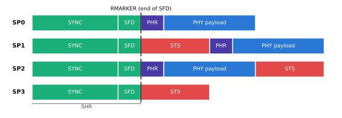
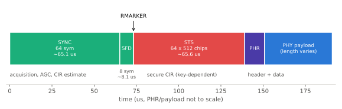

# HRP 프레임 구조

!!! spec "규격 · 개정판"
    IEEE 802.15.4-2020 HRP UWB PHY 절 (PPDU 형식: SHR·PHR·PHY 페이로드, PHR 필드, RMARKER 정의) · 802.15.4z-2020 (STS 필드, STS 패킷 구성 SP0–SP3, HRP-ERDEV용 SFD·PHR)

!!! basic "한눈에 보기"
    HRP 프레임(PPDU)은 앞에서부터 **동기 → 경계 → (보안) → 머리말 → 본문** 순서로 놓입니다.

    - **SYNC(프리앰블)**: 같은 코드 심볼을 수십–수천 번 반복합니다. 수신기는 여기서 "신호가 왔다"를 알아채고, 세기를 맞추고, 채널의 반사 구조(CIR)를 측정합니다.
    - **SFD(Start of Frame Delimiter)**: "여기서 프리앰블이 끝난다"는 표지입니다. SFD가 끝나는 순간이 바로 측거의 기준점 **RMARKER**입니다.
    - **STS**: 802.15.4z가 추가한, 키를 아는 사람만 예측할 수 있는 펄스열입니다.
    - **PHR(PHY Header)**: 페이로드 길이와 데이터율 등을 알려 줍니다.
    - **PHY 페이로드(PSDU)**: MAC 프레임이 실립니다.

    기차에 비유하면 SYNC는 멀리서 들리는 기적 소리, SFD는 "지금 정차" 신호, PHR은 화물 목록, 페이로드는 화물입니다. 측거에서는 화물보다 **정차 시각**이 중요합니다.

## 패킷 구성 SP0–SP3 { .l2 }

802.15.4z는 STS를 어디에 넣느냐에 따라 네 가지 **STS 패킷 구성(STS Packet Configuration)**을 정의합니다.

<figure markdown>

<figcaption>STS 패킷 구성. 초록은 동기 필드(SHR), 빨강은 STS, 보라는 PHR, 파랑은 페이로드입니다. 세로선은 모든 구성에서 공통인 RMARKER(SFD 끝)입니다. 필드 사이 간격(gap)은 생략했습니다.</figcaption>
</figure>

| 구성 | 필드 순서 | 용도 |
|---|---|---|
| SP0 | SHR · PHR · 페이로드 | STS 없음. 레거시 HRP와 같은 모양 (데이터, 비보안 측거) |
| SP1 | SHR · **STS** · PHR · 페이로드 | 보안 측거와 데이터를 한 프레임에 |
| SP2 | SHR · PHR · 페이로드 · **STS** | 데이터 뒤에 STS. 페이로드 복조 후 STS 처리 |
| SP3 | SHR · **STS** | PHR·페이로드 없음. 가장 짧은 보안 측거 프레임 |

FiRa·CCC 측거에서는 측거 메시지 자체는 SP3으로, 제어·결과 같은 데이터 교환은 SP0나 SP1로 보내는 식으로 구성을 섞어 쓰는 경우가 많습니다. SP3 프레임에는 MAC 헤더가 없으므로 "누가 보냈나"는 [측거 라운드 구조](../mac/ranging-rounds.md)의 시간 슬롯과 사전 협상으로 알아냅니다.

## 필드별 역할과 시간 { .l2 }

<figure markdown>

<figcaption>BPRF SP1 프레임 예: 길이 127 코드로 64심볼 프리앰블, 8심볼 SFD, 64×512칩 STS 한 세그먼트. PHR·페이로드 길이는 데이터율과 MAC 프레임 크기에 따라 달라 축척을 맞추지 않았습니다.</figcaption>
</figure>

| 필드 | 수신기가 하는 일 | 길이를 정하는 파라미터 |
|---|---|---|
| SYNC | 검출, AGC, 주파수 오프셋 추정, 프리앰블 CIR 누적 | 프리앰블 심볼 반복 수(PSR), 코드 길이 |
| SFD | 프레임 경계 확정, RMARKER 시점 결정 | SFD 종류 (4z에서 4–32 심볼 선택지) |
| STS | 키 기반 상관으로 보안 CIR 추정 | 세그먼트 길이·개수 ([STS](sts.md)) |
| PHR | 길이·데이터율·측거 표시 복호 | PHR 데이터율 |
| PSDU | MAC 프레임 복조 | 데이터율, 프레임 길이 |

레거시·BPRF의 PHR은 **19비트**로, 데이터율, 프레임 길이(7비트 → 최대 127옥텟), 측거 프레임 표시(레인징 비트), 헤더 확장, 프리앰블 길이 표시, 그리고 오류 검출·정정용 **SECDED**(단일 오류 정정·이중 오류 검출) 6비트로 구성됩니다. HPRF는 PHR 형식이 달라 더 긴 페이로드 길이를 표시할 수 있습니다.

??? expert "전문가 노트 — RMARKER와 필드 길이 계산"
    **RMARKER**는 SFD가 끝난 직후 첫 칩(레거시 정의로는 PHR 첫 칩)의 첫 펄스 피크 시각입니다. SP3처럼 PHR이 없는 프레임에서도 같은 위치(SFD 끝)로 정의되므로, 모든 패킷 구성에서 송신·수신 타임스탬프가 같은 기준을 가리킵니다. 측거 계산은 이 시각 차이만 쓰고, 프레임 길이는 결과에 들어가지 않습니다([ToF 측거](../ranging/tof.md)).

    필드 길이는 칩 시간 \(T_c = 1/499.2\ \text{MHz} \approx 2.003\) ns로 계산합니다. 길이 127 코드에 확산 계수 \(L = 4\)를 쓰면 프리앰블 심볼 하나는 \(127 \times 4 = 508\) 칩입니다.

    \[
    T_{\text{SYNC}} = N_{\text{PSR}} \times 508\,T_c \approx 64 \times 1.0176\ \mu\text{s} \approx 65.1\ \mu\text{s}, \qquad
    T_{\text{STS}} = 64 \times 512\,T_c \approx 65.6\ \mu\text{s}
    \]

    - **SFD 선택지**: 레거시는 8심볼(일반)과 64심볼(110 kb/s용) 3진 SFD를 씁니다. 802.15.4z HRP-ERDEV는 64심볼 SFD를 빼고 길이 4·8·16·32의 2진 SFD를 추가했습니다. BPRF는 레거시 8심볼 SFD 또는 새 8심볼 SFD만, HPRF는 4z SFD 전부를 쓸 수 있습니다. 레거시 기기와 상호 운용하려면 레거시 8심볼 SFD를 써야 합니다.
    - **PHR 데이터율**: 레거시는 페이로드가 110 kb/s일 때 PHR도 110 kb/s, 그 외에는 850 kb/s로 보냅니다. BPRF는 PHR을 850 kb/s 또는 6.81 Mb/s로 보낼 수 있어 짧은 프레임의 공중 시간을 줄입니다.
    - **SP2·SP3의 간격**: STS 앞뒤에는 무신호 간격(gap)이 들어가 다중 경로 꼬리가 STS 상관에 섞이지 않게 합니다. HPRF SP2에는 추가 간격 옵션도 있습니다. 정확한 간격 길이는 규격 표를 따르세요.
