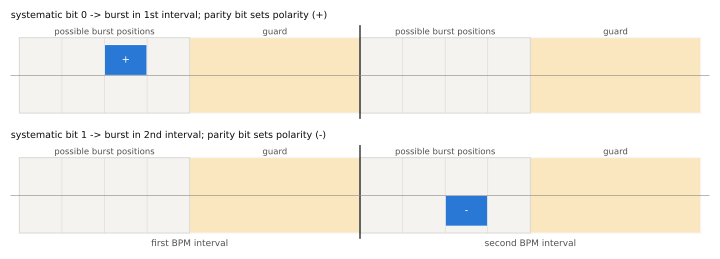
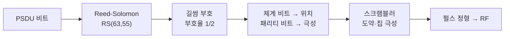

# 변조와 부호화

!!! spec "규격 · 개정판"
    IEEE 802.15.4-2020 HRP UWB PHY 절 (BPM-BPSK 변조, 버스트·시간 도약, 스크램블러, Reed-Solomon 부호, 길쌈 부호, PHR SECDED) · 802.15.4z-2020 (BPRF 심볼 구조, HPRF BPSK 매핑과 구속장 7 길쌈 부호 옵션)

!!! basic "한눈에 보기"
    HRP UWB의 데이터 심볼은 펄스 몇 개를 몰아 보낸 **버스트(burst)** 하나입니다. 비트는 두 가지 방법으로 실립니다.

    - **어디에 보내나 (위치)**: 심볼을 앞뒤 두 칸으로 나누고, 버스트를 앞칸에 두면 0, 뒤칸에 두면 1입니다. → **BPM(Burst Position Modulation)**
    - **어떤 극성으로 보내나 (위상)**: 버스트 펄스의 부호를 +/−로 뒤집어 비트 하나를 더 싣습니다. → **BPSK**

    둘을 합친 것이 **BPM-BPSK**입니다. 위치 정보는 위상을 몰라도 에너지만 보고 판별할 수 있어 단순한 비동기 수신기도 읽을 수 있고, 위상까지 보는 수신기는 두 비트를 모두 써서 더 좋은 감도를 얻습니다.

    여기에 **두 겹의 오류 정정 부호**(바깥쪽 Reed-Solomon, 안쪽 길쌈 부호)를 입혀, 잡음보다 약한 신호에서도 데이터를 살려 냅니다.

## BPM-BPSK 심볼 { .l2 }

<figure markdown>

<figcaption>BPM-BPSK 심볼 개념도. 심볼은 두 BPM 구간으로 나뉘고, 각 구간의 앞쪽 절반에만 버스트가 놓일 수 있습니다(뒤쪽 절반은 다중 경로 가드). 체계 비트가 구간을, 패리티 비트가 극성을 정하고, 구간 안의 정확한 위치는 스크램블러 수열이 고릅니다.</figcaption>
</figure>

| 요소 | 의미 | BPRF 값 (6.81 Mb/s) |
|---|---|---|
| \(N_{cpb}\) | 버스트 하나의 칩(펄스) 수 | 8 |
| \(N_{hop}\) | 한 구간 안에서 버스트가 놓일 수 있는 위치 수 | 4 |
| 시간 도약 | 스크램블러 수열이 매 심볼 버스트 위치를 바꿈 | 다중 사용자 간섭을 평균화 |
| 가드 | 각 BPM 구간의 뒤쪽 절반은 비움 | 반사파 꼬리가 다음 위치로 번지는 것을 막음 |

같은 스크램블러 수열이 버스트 안 칩들의 극성 패턴도 정해, 스펙트럼에 선 성분이 생기지 않게 합니다. 레거시 HRP는 PRF와 데이터율에 따라 \(N_{cpb}\)가 1부터 수천까지 바뀌고, 데이터율이 낮을수록 버스트가 길어져(펄스를 더 많이 모아) 감도가 좋아집니다.

**HPRF**는 버스트 위치를 쓰지 않고 **BPSK만으로** 비트를 싣는 새 심볼 매핑을 씁니다. 위치 대신 펄스를 더 촘촘하게 채워 같은 시간에 더 많은 에너지를 보내는 방향입니다([BPRF와 HPRF](bprf-hprf.md)).

## 부호화 사슬 { .l2 }

| 단계 | 내용 | 비고 |
|---|---|---|
| 바깥 부호 | 체계형 Reed-Solomon RS(63,55), 부호율 약 0.87 | 페이로드에 적용 |
| 안쪽 부호 | 부호율 1/2 길쌈 부호, 구속장 3 | HPRF는 구속장 7 옵션 추가. 레거시 일부 최고속 모드는 생략 (규격 표 참고) |
| PHR 보호 | SECDED(해밍 계열) 6비트 + 길쌈 부호 | RS는 쓰지 않음 |

레거시·BPRF에서 길쌈 부호의 출력 두 비트 중 하나는 입력 비트 그대로인 **체계 비트**라 버스트 위치에 실리고, 나머지 **패리티 비트**는 극성에 실립니다. 그래서 위치만 보는 비동기 수신기는 체계 비트만, 위상까지 보는 수신기는 두 비트 모두를 복호에 씁니다.

??? expert "전문가 노트 — 6.81 Mb/s의 산수"
    BPRF 6.81 Mb/s에서 데이터 심볼 하나는 64칩입니다.

    \[
    T_{dsym} = 64\,T_c \approx 128.2\ \text{ns}, \qquad
    \frac{1}{T_{dsym}} = 7.8\ \text{Msym/s}
    \]

    심볼 하나는 길쌈 부호 입력 1비트(출력 2비트)를 나르고, RS 부호율 55/63을 곱하면 정보 데이터율이 나옵니다.

    \[
    7.8\ \text{Mb/s} \times \frac{55}{63} \approx 6.81\ \text{Mb/s}
    \]

    평균 PRF도 맞아떨어집니다. 심볼마다 8칩 버스트 하나이므로 \(8 / 128.2\ \text{ns} \approx 62.4\) MHz, 즉 BPRF의 평균 PRF입니다.

    - HPRF 데이터율 목록에 6.81·27.24 Mb/s와 함께 **7.8·31.2 Mb/s**가 있는데, 뒤의 둘은 앞의 둘을 RS 부호율(55/63)로 나눈 값과 같습니다. 어떤 부호 조합이 어떤 데이터율에 대응하는지는 802.15.4z HPRF 데이터율 표로 확인하세요.
    - 길쌈 부호 구속장 7은 구속장 3보다 큰 부호 이득을 주지만 복호기(비터비)가 커집니다. HPRF에서 구속장 7을 쓰면 PHR 데이터율도 달라집니다.
    - RS 부호는 버스트 오류(긴 간섭)에 강하고, 길쌈 부호는 랜덤 잡음에 강합니다. 측거 전용 프레임(SP3)은 페이로드가 없어 이 사슬을 전혀 거치지 않습니다.
