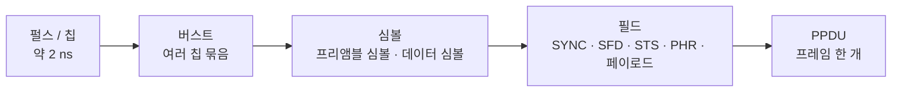

# UWB PHY 개요 (HRP·LRP)

!!! spec "규격 · 개정판"
    IEEE 802.15.4-2020 HRP UWB PHY 절 · LRP UWB PHY 절 · 802.15.4a-2007 (UWB PHY 최초 도입) · 802.15.4z-2020 (HRP-ERDEV: BPRF·HPRF·STS, LRP 측거 보강) · 802.15.4ab (차세대, 초안 논의 중)

!!! basic "한눈에 보기"
    IEEE 802.15.4 표준 안에는 UWB PHY가 두 가지 있습니다. **HRP(High Rate Pulse repetition frequency)**는 펄스를 촘촘하게(평균 수십–수백 MHz) 보내고 상관으로 모아 쓰는 방식이고, **LRP(Low Rate Pulse repetition frequency)**는 펄스를 드문드문(수 MHz 이하) 보내되 펄스 하나하나에 에너지를 크게 싣는 방식입니다.

    비유하면 HRP는 "작은 목소리로 같은 문장을 수백 번 빠르게 반복해 듣는 사람이 평균을 내게 하는" 방식이고, LRP는 "가끔씩 크게 박수를 치는" 방식입니다. 둘 다 짧은 펄스로 도착 시각을 재지만, 수신기 구조와 칩 생태계가 완전히 다릅니다.

    스마트폰, 디지털 키, FiRa 기기 등 오늘날 시장의 거의 전부는 **HRP**를 씁니다. 이 핸드북의 PHY 섹션도 HRP를 중심으로 설명하고, LRP는 [별도 페이지](lrp.md)에서 다룹니다.

## 두 PHY 비교 { .l2 }

| 항목 | HRP UWB PHY | LRP UWB PHY |
|---|---|---|
| 펄스 반복 | 평균 PRF 수 MHz–249.6 MHz (모드별) | 평균 PRF 수 MHz 이하 |
| 수신 원리 | 긴 코드 수열과 상관 → 처리 이득 | 펄스당 에너지 검출 (비동기·저복잡도 수신 가능) |
| 변조 | BPM-BPSK (레거시·BPRF), BPSK (HPRF) | OOK, PPM, 2주파 FSK 계열 |
| 동기 필드 | 3진 프리앰블 코드 반복 + SFD | 펄스열 프리앰블 + SFD |
| 보안 측거 | STS (802.15.4z) | 802.15.4z에서 측거 기능 보강 |
| 대표 생태계 | FiRa, CCC Digital Key, Android·iOS, 대부분의 칩 | 일부 칩 벤더 중심 |

HRP 안에서도 세대가 나뉩니다. 802.15.4a에서 시작한 **레거시 HRP**(평균 PRF 약 3.9/15.6/62.4 MHz), 802.15.4z가 정의한 **HRP-ERDEV**(Enhanced Ranging capable DEVice)의 **BPRF**(Base PRF, 62.4 MHz)와 **HPRF**(Higher PRF, 124.8/249.6 MHz)입니다. FiRa와 CCC가 상호 운용의 기준으로 삼는 것은 BPRF입니다([BPRF와 HPRF](bprf-hprf.md)).

## HRP 신호의 층 구조 { .l2 }

HRP 신호는 아래처럼 시간 단위가 층을 이룹니다. 모든 시간은 **칩(chip, 499.2 MHz → 약 2.003 ns)**의 정수배입니다.

| 층 | 역할 | 자세히 |
|---|---|---|
| 채널 | 중심 주파수와 대역폭 (499.2 MHz가 기본 단위) | [채널 번호와 대역](channels.md) |
| 프리앰블 | 신호 검출, 이득 조절, 채널 임펄스 응답(CIR) 추정 | [프리앰블 코드](preamble-codes.md) |
| SFD | 프레임 시작 경계, 타임스탬프 기준점(RMARKER) | [HRP 프레임 구조](hrp-frame.md) |
| STS | 키로 만든 비반복 펄스열, 위조 어려운 CIR | [STS](sts.md) |
| PHR·페이로드 | 길이·데이터율 정보와 MAC 프레임 | [변조와 부호화](modulation-coding.md) |

PHY의 출력은 데이터만이 아닙니다. 측거 관점에서 가장 중요한 산출물은 **RMARKER의 송수신 타임스탬프**와 **CIR**이고, 이는 [ToF 측거](../ranging/tof.md)와 [AoA·PDoA](../ranging/aoa-pdoa.md)의 입력이 됩니다.

??? expert "전문가 노트 — 개정판으로 본 PHY의 변화"
    - **802.15.4a-2007**: HRP UWB PHY와 측거 기능(레인징 비트, 타임스탬프 정의)을 처음 도입했습니다. 펄스 반복은 평균 약 3.9/15.6/62.4 MHz, 데이터율 110 kb/s–27.24 Mb/s, 프리앰블 코드 길이 31·127입니다.
    - **802.15.4-2015/2020 통합본**: 4a 내용이 본문으로 흡수되고 LRP UWB PHY도 같은 표준 안에 정리되었습니다. 현재 기준 문서는 802.15.4-2020입니다.
    - **802.15.4z-2020**: 보안 측거를 위해 HRP-ERDEV(BPRF·HPRF), STS와 패킷 구성 SP0–SP3, 새 SFD, 길이 91 프리앰블 코드(HPRF), 측거 관련 MAC 기능을 추가했습니다. 레거시 HRP 기기와의 상호 운용은 BPRF의 일부 설정(길이 127 코드, 기존 8심볼 SFD 등)으로만 보장됩니다.
    - **802.15.4ab (TG4ab, 초안 기준)**: 협대역 보조(NBA-MMS), 다중 밀리초 측거(MMS), 센싱, 고속 데이터 등이 논의 중입니다. 승인 전이므로 이 섹션의 표와 수치는 802.15.4ab를 반영하지 않습니다. 진행 상황은 [802.15.4ab 개요](../next/4ab-overview.md)를 보세요.

    표준 문서를 읽을 때 절 번호는 판마다 바뀌므로, "HRP UWB PHY", "LRP UWB PHY" 같은 **절 이름**으로 찾는 편이 안전합니다.
