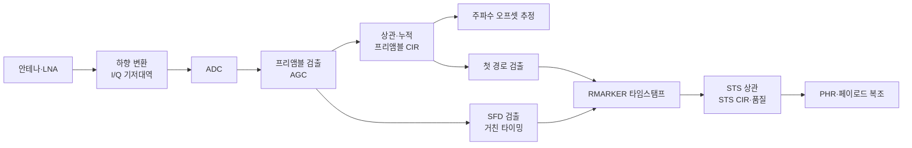
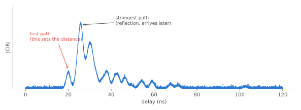

# 수신기 구조와 첫 경로 검출

!!! spec "규격 · 개정판"
    IEEE 802.15.4-2020 HRP UWB PHY 절 (RMARKER, 측거 타임스탬프·카운터 정밀도, 수신기 성능 요구) · 802.15.4z-2020 (STS 수신, 측거 품질 관련 보고) · 칩 제조사 앱 노트 (CIR 진단, 첫 경로 검출, NLoS 판정) · FiRa UCI (측거 결과의 품질 지표)

!!! basic "한눈에 보기"
    UWB 수신기의 목표는 "데이터를 읽는 것"보다 **"신호가 몇 시 몇 분 몇 피코초에 도착했나"**를 아는 것입니다. 그 과정은 크게 네 단계입니다.

    1. **찾기** — 잡음 속에서 프리앰블이 오고 있는지 알아챕니다.
    2. **그리기** — 프리앰블을 계속 상관·누적해 채널 임펄스 응답(CIR), 즉 "반사파 지도"를 그립니다.
    3. **고르기** — 그 지도에서 가장 센 봉우리가 아니라 **가장 먼저 온 봉우리(첫 경로)**를 고릅니다.
    4. **찍기** — SFD로 프레임 경계를 확정하고, 첫 경로 위치로 미세 보정한 RMARKER 시각을 타임스탬프로 기록합니다.

    비유하면, 메아리가 가득한 동굴에서 친구의 첫 외침이 언제 들렸는지를 메아리들 사이에서 골라내는 일입니다.

## 수신 처리 흐름 { .l2 }

| 블록 | 하는 일 | 측거에 주는 영향 |
|---|---|---|
| AGC | 수신 세기에 맞춰 이득 조정 | 포화되면 CIR 모양이 일그러져 첫 경로 오판 |
| 프리앰블 상관·누적 | 심볼마다 주기 상관해 CIR을 평균 | 누적 심볼이 많을수록 잡음 바닥이 낮아짐 |
| 주파수 오프셋 추정 | 누적 중 위상 회전으로 상대 클럭 오차 추정 | [SS-TWR](../ranging/ss-twr.md) 클럭 오차 보정에 재사용 |
| SFD 검출 | 프레임 경계, 칩 단위 거친 시각 | 심볼 단위 오류가 나면 수백 m 오차 |
| 첫 경로 검출 | CIR에서 첫 봉우리 위치를 칩 이하로 추정 | 측거 정확도의 핵심 |
| 안테나 지연 보정 | 칩·안테나 내부 지연 빼기 | 보정하지 않으면 수십 cm 일정 편향 ([안테나와 그룹 지연](../basics/antenna-delay.md)) |

## 첫 경로 검출 { .l2 }

<figure markdown>

<figcaption>NLoS에 가까운 CIR. 첫 경로가 가장 센 경로가 아니므로, 최대값을 고르면 거리가 길게 나옵니다.</figcaption>
</figure>

가장 단순한 방법은 "CIR 최대값 위치"를 쓰는 것이지만, 위 그림처럼 반사파가 더 센 경우 거리가 늘어납니다. 그래서 실제 칩은 **선행 에지(leading edge) 검출**을 씁니다.

| 방법 | 원리 | 장단점 |
|---|---|---|
| 잡음 기반 임계값 | 잡음 바닥 추정치의 몇 배를 처음 넘는 지점 | 단순, 잡음 추정이 틀리면 거짓 경보·누락 |
| 피크 기반 역탐색 | 최강 봉우리에서 앞쪽으로 일정 창 안을 거슬러 찾음 | 약한 첫 경로에 강함, 창 길이 선택이 관건 |
| 보간·모델 적합 | 표본 사이를 보간하거나 펄스 모양을 맞춤 | 칩 이하 정밀도, 계산량 증가 |
| STS·프리앰블 일관성 | 두 CIR의 첫 경로 위치 비교 | 보안·신뢰도 판단, 불일치 시 결과 폐기 |

임계값을 낮추면 약한 첫 경로를 더 잘 잡지만 잡음이나 곁가지를 첫 경로로 오인할 위험이 커집니다. 이 균형은 표준이 아니라 **칩 구현**이 정하며, 같은 환경에서도 칩마다 NLoS 성능이 다른 이유입니다([전파 지연과 LoS/NLoS](../basics/los-nlos.md)).

??? expert "전문가 노트 — 타임스탬프 조립과 진단 지표"
    수신 타임스탬프는 대략 다음처럼 조립됩니다.

    \[
    T_{RX} = T_{\text{SFD}} + \hat{\tau}_{FP} - D_{\text{ant,RX}}
    \]

    \(T_{\text{SFD}}\)는 SFD 검출로 얻은 칩 단위 기준 시각, \(\hat{\tau}_{FP}\)는 CIR 창 안 첫 경로의 미세 위치(칩 이하), \(D_{\text{ant,RX}}\)는 수신 안테나 지연 보정값입니다. 802.15.4는 타임스탬프 단위로 칩/128 ≈ **15.65 ps(4.69 mm)**를 쓰므로 양자화 오차는 무시할 수 있고, 실제 오차는 \(\hat{\tau}_{FP}\) 추정에서 나옵니다.

    칩들이 보고하는 진단 값은 대체로 다음 계열입니다(이름과 정의는 칩마다 다름).

    - **첫 경로 세기 vs 전체 수신 세기**: 두 값의 차이가 크면 첫 경로가 약하다는 뜻이라 NLoS를 의심합니다. 앱 노트들은 수 dB 이상 차이를 경계 신호로 쓰는 경험칙을 소개합니다.
    - **CIR 잡음 바닥·첫 경로 신뢰도**: 임계값을 얼마나 여유 있게 넘었는지.
    - **STS 품질**: STS CIR과 프리앰블 CIR의 일관성. 보안 측거에서 결과 채택 여부를 정합니다.
    - **클럭 오프셋**: 반송파 위상 추적에서 얻은 상대 주파수 오차(ppm).

    **함정 몇 가지**: 근거리에서 수신기가 포화되면 펄스가 넓어져 첫 경로가 앞당겨지거나 늦어지는 **거리 의존 편향**이 생깁니다. 또 수신 세기에 따라 첫 경로 검출 위치가 미세하게 바뀌는 **레인지 바이어스**가 있어, 많은 칩이 세기별 보정표를 둡니다. 이런 편향 보정은 [오차 요인과 보정](../ranging/errors-calibration.md)에서 다룹니다.
