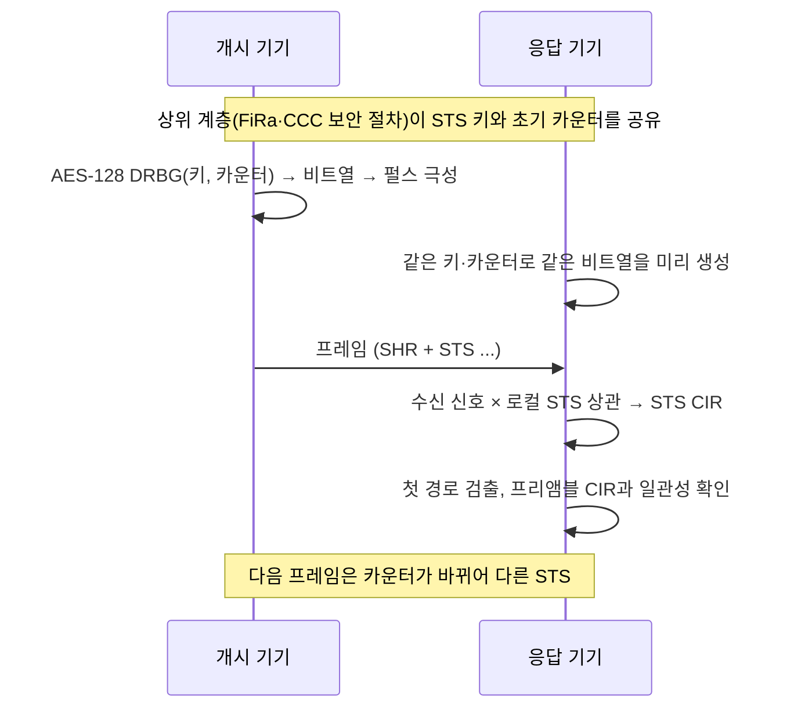

# STS (Scrambled Timestamp Sequence)

!!! spec "규격 · 개정판"
    IEEE 802.15.4z-2020 HRP UWB PHY 확장 (STS 필드, STS 세그먼트·간격, AES-128 기반 결정적 난수 비트 생성기(DRBG)로 STS 생성, STS 패킷 구성) · 802.15.4z MAC (STS 키·카운터 관련 PIB) · FiRa UWB MAC 기술 규격 (공개 자료 기준 정적·동적 STS 모드)

!!! basic "한눈에 보기"
    프리앰블은 공개된 코드를 반복하기 때문에, 누구나 미리 흉내 내서 보낼 수 있습니다. 공격자가 진짜 신호보다 **조금 일찍** 가짜 프리앰블을 보내면 수신기는 거리가 실제보다 가깝다고 착각할 수 있습니다. 문 앞에 없는 차 키가 "바로 옆에 있다"고 속는 것이죠.

    **STS(Scrambled Timestamp Sequence)**는 이 문제를 PHY에서 막기 위한 필드입니다. 송신기와 수신기만 아는 **비밀 키로 만든, 한 번도 반복되지 않는 펄스열**을 보냅니다. 수신기는 같은 키로 똑같은 펄스열을 만들어 상관시키고, 그 결과로 얻은 CIR에서 첫 경로를 찾습니다. 키를 모르는 공격자는 펄스 극성을 맞힐 수 없으니 그럴듯한 "이른 봉우리"를 만들기 어렵습니다.

    비유하면 프리앰블은 누구나 아는 노크 소리, STS는 매번 바뀌는 일회용 암호 노크입니다.

## 생성과 구조 { .l2 }

| 요소 | 내용 |
|---|---|
| 생성기 | AES-128을 쓰는 결정적 난수 비트 생성기(DRBG). 128비트 키와 128비트 카운터(논스)를 넣고, 블록마다 카운터를 증가 |
| 비트 → 펄스 | 비트 0은 + 극성, 1은 − 극성 펄스 |
| 세그먼트 | STS는 하나 이상의 활성 세그먼트로 구성. 길이는 512칩(약 1.026 µs) 단위 |
| 간격(gap) | 세그먼트 앞·사이에 무신호 구간을 두어 앞 신호의 다중 경로 꼬리를 격리 |
| BPRF | 세그먼트 1개, 길이 64단위 (약 65.6 µs) |
| HPRF | 세그먼트 1–4개, 길이 16·32·64·128·256단위 |
| 위치 | SP1은 SFD 뒤, SP2는 페이로드 뒤, SP3은 SFD 뒤 단독 ([HRP 프레임 구조](hrp-frame.md)) |

키를 어떻게 나누는지는 PHY의 범위가 아닙니다. FiRa는 보안 채널로 세션 키를 유도하는 **동적 STS**와, 미리 정한 고정 값으로 STS를 만드는 **정적 STS**(값을 아는 쪽이면 누구나 같은 STS를 만들 수 있어 보안 수준이 낮음)를 구분합니다. 자세한 절차는 [STS와 보안 측거](../security/sts-secure-ranging.md)와 [FiRa 보안 구조](../security/fira-security.md)를 보세요.

## 수신기에서의 STS 처리 { .l2 }

| 비교 항목 | 프리앰블 CIR | STS CIR |
|---|---|---|
| 상관 방식 | 주기 상관 (반복 수열) | 비주기 상관 (한 번뿐인 수열) |
| 곁가지 | 이론상 없음 | 수열 길이에 반비례해 작지만 0은 아님 |
| 예측 가능성 | 공개 코드 → 누구나 생성 | 키 없이는 극성 예측 불가 |
| 측거에서의 역할 | 동기·주파수 보정·기본 첫 경로 | 보안 측거의 첫 경로 판단 근거 |

STS CIR은 곁가지가 남기 때문에, 강한 경로 앞쪽에 생긴 작은 곁가지를 첫 경로로 착각하지 않도록 임계값을 신중히 정해야 합니다. 많은 칩은 STS CIR과 프리앰블 CIR의 첫 경로 위치·세기를 비교해 **STS 품질 지표**를 내고, 상위 계층은 이 값이 나쁘면 측거 결과를 버립니다([수신기 구조와 첫 경로 검출](receiver.md)).

??? expert "전문가 노트 — 비주기 상관 곁가지와 공격 표면"
    길이 \(N\)인 무작위 ±1 수열의 비주기 자기상관 곁가지는 평균적으로 피크 대비 약 \(1/\sqrt{N}\) 크기입니다. 펄스 수가 4배가 되면 곁가지 수준은 상대적으로 약 6 dB 내려갑니다. HPRF에서 펄스 밀도와 세그먼트 수를 늘릴 수 있는 이유 중 하나가 이것입니다.

    - **거리 단축 공격**: 공격자는 키를 모르지만, 수신기가 첫 경로를 "약한 봉우리라도 임계값만 넘으면" 채택하는 점을 노려 무작위 펄스나 지연된 재전송을 섞습니다. 실험 연구들은 칩 구현의 첫 경로 판정 로직이 실제 취약점이 될 수 있음을 보였습니다([공격 연구와 대응](../security/attacks.md)). 표준은 STS 생성까지만 정의하고, 수신 판정 알고리즘은 구현에 맡깁니다.
    - **카운터 관리**: 같은 키·카운터로 STS를 재사용하면 이전 프레임을 녹음해 재생할 수 있습니다. 상위 계층은 프레임·라운드마다 카운터를 갱신해야 합니다.
    - **SP2의 의미**: STS를 페이로드 뒤에 두면 페이로드 복호 결과(예: 어떤 키를 쓸지)를 보고 STS를 처리할 수 있지만, RMARKER와 STS 사이 시간이 길어져 그 사이 클럭 드리프트를 감안해야 합니다.
    - **802.15.4ab**: 초안 논의에서 MMS 측거는 STS 계열 신호를 여러 조각으로 나눠 보내는 방향이 검토되고 있습니다. 확정 전 내용이므로 [MMS 측거](../next/mms-ranging.md)를 참고하세요.
