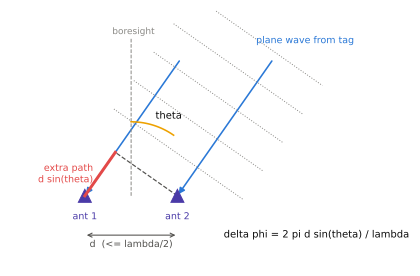

# AoA와 PDoA

!!! spec "규격 · 개정판"
    IEEE 802.15.4z-2020 향상된 측거 기능 (측거 결과와 함께 AoA 정보를 보고하는 IE) · FiRa UWB MAC Technical Requirements · FiRa UCI Generic Technical Specification (측거 결과 알림의 방위각·고도각) · Android `androidx.core.uwb` (`RangingPosition`의 azimuth·elevation) · Apple Nearby Interaction (`NINearbyObject`의 `direction`)

!!! basic "한눈에 보기"
    **AoA(Angle of Arrival)**는 신호가 어느 방향에서 왔는지, 즉 **도래각**입니다. UWB 기기는 대개 이를 **PDoA(Phase Difference of Arrival)**, 곧 가까이 붙은 두 안테나에 도착한 신호의 **위상 차**로 구합니다.

    비스듬히 들어오는 파도를 생각해 보세요. 왼쪽 말뚝과 오른쪽 말뚝에 파도가 닿는 순간이 조금 다릅니다. 그 차이가 클수록 파도는 옆에서 온 것이고, 차이가 없으면 정면에서 온 것입니다. 시간 차가 너무 작아(ps 단위) 직접 재기 어려우므로, 대신 반송파의 **위상**이 얼마나 어긋났는지를 잽니다.

    거리(TWR)와 방향(AoA)을 함께 알면 **앵커 하나만으로** 상대 위치가 나옵니다. 스마트폰의 "물건 찾기" 화살표가 이 원리입니다.

## 두 안테나 기하 { .l2 }

<figure markdown>

<figcaption>안테나 간격 d, 도래각 θ인 평면파. 안테나 1은 d·sinθ만큼 더 먼 경로를 거치므로 위상이 그만큼 늦습니다.</figcaption>
</figure>

\[
\Delta\varphi = \frac{2\pi\, d \sin\theta}{\lambda}, \qquad
\theta = \arcsin\!\left(\frac{\lambda\, \Delta\varphi}{2\pi d}\right)
\]

| 채널 | 파장 \(\lambda\) | \(\lambda/2\) |
|---|---|---|
| Ch5 (6489.6 MHz) | 4.62 cm | 2.31 cm |
| Ch9 (7987.2 MHz) | 3.75 cm | 1.88 cm |

간격 \(d = \lambda/2\)일 때 정면(θ = 0°)은 Δφ = 0°, θ = 30°는 Δφ = 90°, 옆(θ = 90°)은 Δφ = 180°입니다. 안테나 간격을 채널 파장에 맞춰야 하므로, **같은 안테나 배열로 Ch5와 Ch9의 각도 특성이 다릅니다.**

## 실제 구성과 한계 { .l2 }

| 구성 | 얻는 것 | 비고 |
|---|---|---|
| 안테나 2개 (한 축) | 방위각 1개 | 앞·뒤 구분 불가 (같은 Δφ) |
| 안테나 3개 (L자) | 방위각 + 고도각 | 스마트폰·앵커에서 흔함 |
| 측거 + 각도 | 단일 앵커 2D·3D 상대 위치 | 디지털 키 근접 판단, 물건 찾기 |

- **시야각(FoV)** — 측면으로 갈수록 \(\cos\theta\)가 작아져 위상 오차가 각도 오차로 크게 번지고, 안테나 패턴·기구물 영향도 커집니다. 그래서 신뢰할 수 있는 범위는 정면 중심의 일부(칩·안테나에 따라 다름)로 제한하고 바깥은 신뢰도를 낮춰 보고합니다.
- **앞·뒤 모호성** — 두 안테나는 \(\theta\)와 \(180^\circ - \theta\)를 구분하지 못합니다. 기기의 방향 센서, 몸 가림에 따른 세기 변화, 세 번째 안테나로 구분합니다.
- **다중 경로·NLoS** — 반사파가 섞이면 위상이 왜곡되어 각도가 틀립니다. 거리보다 각도가 다중 경로에 더 민감한 경우가 많습니다.

??? expert "전문가 노트 — λ/2 조건, 오차 전파, 보정"
    **모호성 조건.** 측정 위상은 \((-\pi, \pi]\)로 접혀 나옵니다. \(\theta \in [-90^\circ, 90^\circ]\) 전체에서 \(|\Delta\varphi| = 2\pi d|\sin\theta|/\lambda \le \pi\)이려면

    \[
    d \le \frac{\lambda}{2}
    \]

    이어야 합니다. \(d > \lambda/2\)이면 큰 각도에서 위상이 \(2\pi\)를 넘어 접혀 다른 각도와 구분되지 않습니다(격자 로브와 같은 현상). 반대로 \(d\)를 너무 작게 하면 같은 위상 잡음에 대한 각도 오차가 커지고 안테나 간 결합도 심해집니다.

    **오차 전파.** 미분하면 \(\delta\theta = \dfrac{\lambda}{2\pi d \cos\theta}\,\delta\varphi\)이고, \(d = \lambda/2\)이면 \(\delta\theta = \delta\varphi / (\pi\cos\theta)\)입니다. 위상 오차 10°일 때 각도 오차는 θ = 0°에서 3.2°, 30°에서 3.7°, 60°에서 6.4°로 측면에서 빠르게 커집니다. 거리 5 m에서 3.2°는 옆 방향 약 28 cm입니다.

    **위상 오프셋 보정.** 두 수신 경로(RF 체인, 케이블, 안테나 급전)의 고정 위상 차가 그대로 Δφ에 더해집니다. 제조 공정에서 알려진 방향(보통 정면)의 신호로 오프셋을 재고, 회전대에서 여러 각도를 측정해 **Δφ → 각도 표(LUT)**나 보정 곡선을 만듭니다. 기구물(케이스, 디스플레이, 차체)이 바뀌면 다시 보정해야 합니다.

    **어떤 신호로 재나.** 위상 차는 수신 신호의 첫 경로 부근 CIR 위상으로 구합니다. 보안 측거에서는 STS 구간에서 구한 CIR을 쓰는 구현도 있는데, 어느 구간을 쓰는지는 칩에 따라 다릅니다. 802.15.4z는 AoA 결과를 측거 보고에 실어 보낼 수 있게 했고, FiRa UCI는 측거 결과 알림에 방위각·고도각과 그 신뢰도 값을 담아 호스트에 전달합니다.
