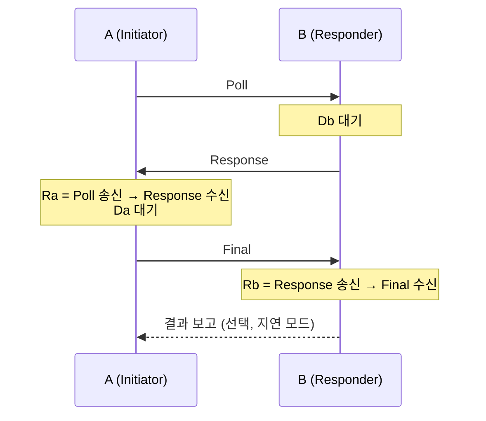

# DS-TWR

!!! spec "규격 · 개정판"
    IEEE 802.15.4-2020 MAC 측거 지원 기능 (DS-TWR) · 802.15.4z-2020 향상된 측거 기능 (DS-TWR, 측거 결과 보고 IE) · FiRa UWB MAC Technical Requirements (DS-TWR 지연·비지연 모드, 일대다) · CCC Digital Key Release 3 (UWB 측거) · 계산: `tools/uwb_numbers.py` (`ds_twr_tof`)

!!! basic "한눈에 보기"
    **DS-TWR(Double-Sided Two-Way Ranging)**은 왕복을 **양쪽에서 한 번씩** 합니다. A → B(Poll), B → A(Response), A → B(Final) 세 메시지로, A도 한 번 왕복을 재고 B도 한 번 왕복을 잽니다.

    SS-TWR에서는 "상대가 기다린 시간"을 상대 시계로 재서 오차가 생겼습니다. DS-TWR에서는 같은 일이 양쪽에서 **반대 방향으로** 일어나므로, 두 결과를 잘 섞으면 시계 오차가 서로 상쇄됩니다. 빠른 시계와 느린 시계를 둘 다 써서 평균을 내면 오차가 줄어드는 것과 비슷합니다.

    그 대가로 메시지가 하나 더 들고, 계산에 필요한 네 시간 값을 한 기기로 모으기 위한 결과 전달이 필요합니다. 그래도 클럭 보정 없이 cm 수준 측거가 가능해서 **스마트폰·디지털 키·FiRa 기기**가 주로 DS-TWR을 씁니다.

## 메시지 흐름과 네 개의 시간 { .l2 }

<figure markdown>

<figcaption>아래: DS-TWR의 네 시간. A는 Ra·Da를, B는 Rb·Db를 자기 시계로 잽니다. 위는 비교용 SS-TWR.</figcaption>
</figure>

| 기호 | 뜻 | 재는 기기 |
|---|---|---|
| \(R_a\) | Poll 송신 → Response 수신 (A의 왕복) | A |
| \(D_b\) | Poll 수신 → Response 송신 (B의 응답) | B |
| \(R_b\) | Response 송신 → Final 수신 (B의 왕복) | B |
| \(D_a\) | Response 수신 → Final 송신 (A의 응답) | A |

\[
\widehat{\text{ToF}} = \frac{R_a R_b - D_a D_b}{R_a + R_b + D_a + D_b}
\]

계산은 네 값을 모두 가진 쪽에서 합니다. A가 Final 안에 \(R_a\), \(D_a\)를 실으면 B가 계산하고(비지연), Final을 정확한 예정 시각에 보낼 수 없거나 A도 결과가 필요하면 별도의 결과 메시지로 주고받습니다(지연 모드). FiRa는 두 방식을 모두 정의하며, 한 Initiator가 여러 Responder와 동시에 DS-TWR을 하는 일대다 구성도 지원합니다.

## 대칭식과 비대칭식 { .l2 }

초기 DS-TWR은 두 응답 시간을 같게 맞추는 **대칭식** \((R_a - D_a + R_b - D_b)/4\)를 썼습니다. 응답 시간이 다르면 오차가 남습니다. 지금 널리 쓰는 위 식은 **비대칭식**으로, 응답 시간이 달라도 오차가 거의 없습니다.

| 예 (10 m, 상대 오프셋 20 ppm) | \(D_a\) = \(D_b\) = 1 ms | \(D_a\) = 1.0 ms, \(D_b\) = 1.2 ms |
|---|---|---|
| SS-TWR (A 측, \(T_{reply} = D_b\)) | 3.00 m | 3.60 m |
| DS-TWR 대칭식 | 0.03 mm | **0.30 m** |
| DS-TWR 비대칭식 | ≈ 0 | **≈ 0** |

응답 시간을 µs 단위로 똑같이 맞추기는 어렵기 때문에(특히 일대다에서 응답 슬롯마다 지연이 다름), 비대칭식이 사실상 표준이 되었습니다.

??? expert "전문가 노트 — 대칭·비대칭 DS-TWR 유도"
    실제 비행 시간 \(\tau\), 실제 응답 시간 \(D_a, D_b\)라 하면 \(R_a = 2\tau + D_b\), \(R_b = 2\tau + D_a\)입니다.

    **비대칭식이 정확한 이유 (클럭 오차 없음).**

    \[
    R_a R_b - D_a D_b = 4\tau^2 + 2\tau(D_a + D_b) = 2\tau\,(2\tau + D_a + D_b)
    \]
    \[
    R_a + R_b + D_a + D_b = 2\,(2\tau + D_a + D_b)
    \]

    나누면 정확히 \(\tau\)입니다. 응답 시간이 같을 필요가 없습니다.

    **클럭 오차를 넣으면.** A가 재는 \(R_a, D_a\)는 \((1+e_A)\)배, B가 재는 \(R_b, D_b\)는 \((1+e_B)\)배가 됩니다. 분자는 \((1+e_A)(1+e_B)\)배, 분모는 \(R_a + D_a = R_b + D_b = 2\tau + D_a + D_b\)이므로 약 \(1 + (e_A+e_B)/2\)배가 되어

    \[
    \widehat{\text{ToF}} \approx \tau\left(1 + \frac{e_A + e_B}{2}\right)
    \]

    오차가 **비행 시간 자체에 비례**합니다. 10 m에서 20 ppm이면 0.2 mm로, 응답 시간과 무관합니다.

    **대칭식의 잔여 오차.**

    \[
    \frac{\hat R_a - \hat D_a + \hat R_b - \hat D_b}{4} \approx \tau\left(1 + \frac{e_A+e_B}{2}\right) + \frac{(e_A - e_B)(D_b - D_a)}{4}
    \]

    응답 시간 차 200 µs, 상대 오프셋 20 ppm이면 \(200\ \mu s \times 20 \times 10^{-6} / 4 = 1\) ns → **0.30 m**입니다. 대칭식은 \(D_a = D_b\)일 때만 SS-TWR의 \(\tfrac12 T_{reply}(e_A-e_B)\) 항이 상쇄됩니다.

    **실무 주의.** 비대칭식도 안테나 지연 같은 **고정 지연**은 지우지 못합니다(양쪽 기기의 지연 합의 절반이 그대로 거리에 더해짐, [오차 요인과 보정](errors-calibration.md)). 또 세 메시지 사이에 기기가 움직이면 \(R_a\)와 \(R_b\)가 서로 다른 거리에서 측정되어, 추정값은 라운드 동안의 평균 거리에 가까워집니다. 라운드가 수 ms이고 걷는 속도가 1–2 m/s라면 그 사이 이동 거리는 수 mm–1 cm 수준입니다. 측거 라운드 안에서 메시지를 어떤 슬롯에 두는지는 [측거 라운드 구조](../mac/ranging-rounds.md)를 참고하세요.
