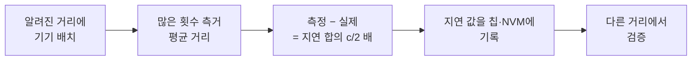

# 오차 요인과 보정

!!! spec "규격 · 개정판"
    IEEE 802.15.4-2020 HRP UWB PHY (기준 주파수 허용 오차, 측거 타임스탬프 정밀도) · 802.15.4z-2020 (측거 보고, 측거 품질 정보) · FiRa UCI Generic Technical Specification (측거 결과 알림의 품질·신뢰도 값) · 칩 제조사 안테나 지연·PDoA 보정 앱 노트 · 계산: `tools/uwb_numbers.py`

!!! basic "한눈에 보기"
    UWB 측거 오차는 크게 세 종류입니다.

    1. **늘 같은 크기로 틀리는 오차(편향)** — 칩·안테나 안의 지연처럼 매번 똑같이 더해지는 값입니다. 한 번 재서 빼 주면 됩니다(보정).
    2. **매번 조금씩 흔들리는 오차(잡음)** — 신호가 약할수록 커집니다. 여러 번 재서 평균하거나 필터로 줄입니다.
    3. **상황 따라 갑자기 커지는 오차** — 몸·벽에 가려진 NLoS, 강한 반사. 보정이 아니라 **감지하고 걸러내야** 합니다.

    체중계에 비유하면, 아무것도 안 올렸는데 0.5 kg을 가리키는 것이 1번(영점 조정), 숫자가 깜빡이며 흔들리는 것이 2번, 누가 몰래 발을 올려놓은 것이 3번입니다.

## 오차 예산 { .l2 }

| 요인 | 종류 | 크기 감 | 대책 |
|---|---|---|---|
| 클럭 주파수 오프셋 | 편향 (응답 시간 비례) | SS-TWR 1 ms·20 ppm에서 3.0 m | DS-TWR 비대칭식, CFO 보정 ([SS-TWR](ss-twr.md), [DS-TWR](ds-twr.md)) |
| 안테나·RF 지연 | 고정 편향 | ToF에 남은 지연 1 ns → 0.30 m | 기기별·모델별 안테나 지연 보정 |
| 수신 레벨 의존 편향 | 편향 (세기 함수) | 칩에 따라 수–십수 cm | 제조사 보정 표 (수신 전력 → 거리 보정) |
| 온도·전압 | 서서히 변하는 편향 | 칩·보드에 따라 다름 | 온도 보상, 주기적 재보정 |
| 타임스탬프 양자화 | 잡음 | 4.69 mm 단위 → 무시 가능 | — |
| 열잡음 (낮은 SNR) | 잡음 | 거리·가림에 따라 cm 이상 | 긴 프리앰블, 평균·필터 |
| 다중 경로 (첫 경로 근처 반사) | 편향 + 잡음 | 경로 차 0.6 m 이내에서 수 cm | 넓은 대역 채널, 첫 경로 검출 |
| NLoS·몸 가림 | 큰 양(+) 편향 | 수십 cm–수 m | NLoS 판정, 이상치 제거, 앵커 추가 ([LoS/NLoS](../basics/los-nlos.md)) |
| 앵커 위치 측량 오차 | 위치 편향 | 측량 오차 그대로 | 정밀 측량, 자동 앵커 위치 추정 |
| 기하 (GDOP) | 오차 증폭 | 영역 밖에서 2배 이상 | 앵커 배치 ([위치 추정 알고리즘](positioning.md)) |
| PDoA 위상 오프셋 | 각도 편향 | 보정 없으면 수–수십 도 | 회전대 보정, LUT ([AoA와 PDoA](aoa-pdoa.md)) |

## 안테나 지연 보정 절차 { .l2 }

안테나 지연은 칩 단독이 아니라 **보드·안테나·케이스까지 포함한 값**이므로 제품 단위로 정합니다. 대량 생산에서는 기준(골든) 기기와 짝지어 재거나, 모델별 대표값을 쓰고 표본 검사로 확인합니다. 보정은 LoS, 충분히 높은 SNR, 다중 경로가 적은 환경(전파 암실이나 넓은 실외)에서 해야 다른 편향이 섞이지 않습니다.

??? expert "전문가 노트 — 지연 분리, 수신 레벨 편향, 런타임 보정"
    **지연이 거리에 들어가는 방식.** 기기 \(X\)의 송신 지연 \(\delta^{tx}_X\), 수신 지연 \(\delta^{rx}_X\)를 합쳐 \(\delta_X = \delta^{tx}_X + \delta^{rx}_X\)라 하면, TWR(SS·DS 모두)의 추정값은

    \[
    \widehat{\text{ToF}} = \tau + \frac{\delta_A + \delta_B}{2}
    \]

    입니다. 두 기기를 한 쌍으로만 재면 합 \(\delta_A + \delta_B\)만 알 수 있습니다. **세 기기 방법**: A–B, B–C, C–A 세 쌍을 알려진 거리에서 재면 세 개의 합이 나오고, 이를 풀어 각자의 \(\delta\)를 분리합니다. 기기가 더 많으면 최소제곱으로 풉니다. 송신·수신 지연을 따로 나누는 것은 TDoA(송신만 또는 수신만 하는 구조)에서 필요하며, 대개 칩 제조사 권장대로 둘을 같은 비율로 나눕니다.

    **수신 레벨 의존 편향.** 수신 전력이 매우 크거나 작으면 수신기 이득·포화와 첫 경로 검출 임계값의 상대 위치가 달라져, 측정 거리가 수신 세기에 따라 체계적으로 바뀌는 칩이 있습니다. 제조사가 수신 전력 → 보정량 표를 제공하는 경우 그것을 쓰고, 보정 시에는 실제 사용 거리와 비슷한 세기에서 재는 것이 좋습니다. 구체적 크기는 칩·채널·PRF에 따라 다릅니다.

    **런타임 품질 정보.** 칩은 측거 결과와 함께 수신 세기, 첫 경로 세기, NLoS 지표, 각도 신뢰도 등을 보고합니다(이름과 형식은 칩·UCI 버전에 따라 다름). 상위 계층은 이를 가중 최소제곱의 가중치, 칼만 필터의 측정 분산, 이상치 기각 기준으로 씁니다.

    **잘 놓치는 것.** (1) 펌웨어나 채널을 바꾸면 안테나 지연이 달라질 수 있습니다. (2) 케이스·차량 범퍼 같은 기구물은 지연과 PDoA 위상을 모두 바꿉니다. (3) DS-TWR이 클럭 오차를 지운다고 해서 CFO가 무의미한 것은 아닙니다. 큰 CFO는 수신 성능 자체를 떨어뜨립니다.
