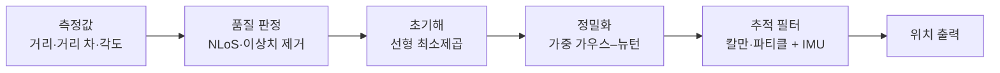

# 위치 추정 알고리즘

!!! spec "규격 · 개정판"
    표준 범위 밖 (IEEE 802.15.4z·FiRa는 측정값과 보고 형식까지 정의하고 위치 계산 방법은 구현에 맡김) · FiRa UCI (거리·각도 보고) · omlox (위치 데이터 교환) · Android `androidx.core.uwb`, Apple Nearby Interaction (거리·방향 제공)

!!! basic "한눈에 보기"
    측거는 "앵커 A까지 4.2 m"라는 숫자를 줍니다. 측위는 이런 숫자 여러 개를 모아 **"그래서 지금 어디인가"**를 계산합니다.

    - **거리 여러 개 (TWR)** — 앵커마다 원을 그리면 원들이 만나는 점이 위치입니다(삼변 측량).
    - **거리 차 여러 개 (TDoA)** — 원 대신 쌍곡선이 만나는 점입니다.
    - **거리 + 각도 (AoA)** — 앵커 하나만으로 "이 방향으로 이만큼"이 정해집니다.

    현실의 측정에는 잡음과 NLoS 편향이 있어서 원들이 한 점에서 딱 만나지 않습니다. 그래서 "모든 측정과 가장 덜 어긋나는 점"을 찾고(최소제곱), 시간에 따른 움직임으로 다듬습니다(필터). 또 **앵커를 어디에 두느냐**가 같은 측거 정확도를 좋은 위치 정확도로 바꿀지 결정합니다.

## 측정 종류별 계산 { .l2 }

| 측정 | 기하 | 최소 앵커 수 (2D / 3D) | 대표 알고리즘 |
|---|---|---|---|
| TWR 거리 | 원(구)의 교점 | 3 / 4 | 선형 최소제곱 → 가우스–뉴턴 (가중) |
| TDoA 거리 차 | 쌍곡선(쌍곡면)의 교점 | 3 / 4 | Chan, 테일러 급수 반복 ([TDoA](tdoa.md)) |
| 거리 + AoA | 극좌표 → 직교좌표 | 1 / 1 | \(x = r\cos\phi\cos\theta,\ \dots\) |
| 혼합 | 모든 측정을 한 비용 함수로 | 상황별 | 가중 비선형 최소제곱, 필터 |

## 앵커 배치와 GDOP { .l2 }

같은 거리 오차라도 앵커가 태그를 **고르게 둘러쌀 때** 위치 오차가 가장 작습니다. 이 기하 효과를 숫자로 나타낸 것이 **GDOP(Geometric Dilution of Precision)**입니다. 대략 위치 오차 ≈ GDOP × 측거 오차입니다.

| 예: 10 m × 10 m 네 모서리 앵커, 2D TWR | GDOP |
|---|---|
| 태그가 중앙 (5, 5) | 1.00 |
| 안쪽 모서리 근처 (2, 2) | 1.04 |
| 한 변 바로 밖 (15, 5) | 1.09 |
| 멀리 바깥 (25, 5) | 1.97 |
| 앵커 3개 일직선 (0,0)·(10,0)·(20,0), 태그 (10, 1) | 1.22 |

**배치 원칙**은 다음과 같습니다. 서비스 영역을 앵커가 둘러싸게 두고, 영역 밖으로 나가는 구간을 줄입니다. 높이(z)도 구해야 하면 앵커 높이를 서로 다르게 둡니다(모두 천장 같은 높이면 z 정확도가 크게 나빠짐). 그리고 최소 개수보다 여유 있게 두어 하나가 NLoS여도 버릴 수 있게 합니다.

??? expert "전문가 노트 — 선형화, 가중 최소제곱, GDOP 정의"
    **선형 초기해 (TWR).** \(d_i^2 = \lVert \mathbf p - \mathbf a_i \rVert^2\)에서 기준 앵커 식을 빼면 \(\lVert\mathbf p\rVert^2\)가 사라집니다.

    \[
    2(\mathbf a_i - \mathbf a_0)^\top \mathbf p = d_0^2 - d_i^2 + \lVert \mathbf a_i \rVert^2 - \lVert \mathbf a_0 \rVert^2
    \]

    \(\mathbf A\mathbf p = \mathbf b\) 꼴이므로 \(\hat{\mathbf p} = (\mathbf A^\top \mathbf A)^{-1}\mathbf A^\top \mathbf b\)로 바로 풉니다. 다만 거리 제곱을 빼면서 잡음이 왜곡되므로 초기값으로만 씁니다.

    **가중 가우스–뉴턴.** 잔차 \(r_i(\mathbf p) = \hat d_i - \lVert \mathbf p - \mathbf a_i \rVert\)를 줄이도록 \(\mathbf p \leftarrow \mathbf p + (\mathbf H^\top \mathbf W \mathbf H)^{-1}\mathbf H^\top \mathbf W \mathbf r\)를 반복합니다. \(\mathbf H\)의 \(i\)번째 행은 앵커 → 태그 단위 벡터 \((\mathbf p - \mathbf a_i)^\top / \lVert \mathbf p - \mathbf a_i \rVert\), \(\mathbf W\)는 측정 분산의 역수(칩의 품질 지표·NLoS 판정으로 조정)입니다. NLoS 편향은 항상 양수이므로 잔차가 크게 양수인 측정을 버리거나(RANSAC 등) 가중치를 낮춥니다.

    **GDOP.** 모든 측거 오차가 독립이고 분산이 \(\sigma_r^2\)이면 위치 공분산은 \(\sigma_r^2 (\mathbf H^\top \mathbf H)^{-1}\)입니다.

    \[
    \text{GDOP} = \sqrt{\operatorname{tr}\big((\mathbf H^\top \mathbf H)^{-1}\big)}, \qquad \sigma_{pos} \approx \text{GDOP}\cdot \sigma_r
    \]

    정사각형 네 모서리의 중앙에서는 \(\mathbf H^\top\mathbf H = 2\mathbf I\)라 GDOP = 1.00이고, 축마다 \(\sigma_r/\sqrt2\)의 오차가 납니다. 위 표의 값은 이 정의(2D, TWR)로 계산한 것입니다. TDoA의 \(\mathbf H\)는 단위 벡터의 **차**로 이루어져 같은 배치에서도 GDOP가 더 크고, 영역 밖에서 더 빠르게 나빠집니다. GPS 용어처럼 수평 성분만 보면 HDOP, 수직 성분만 보면 VDOP라고 부릅니다.

    **추적 필터.** 등속 모델 칼만 필터가 기본이며, 비선형 측정은 확장·무향 칼만 필터로 처리합니다. 스마트폰은 IMU(가속도·자이로)와 융합해 측거 갱신 사이를 메우고, 실내 지도가 있으면 파티클 필터로 벽을 통과하는 궤적을 배제합니다.
