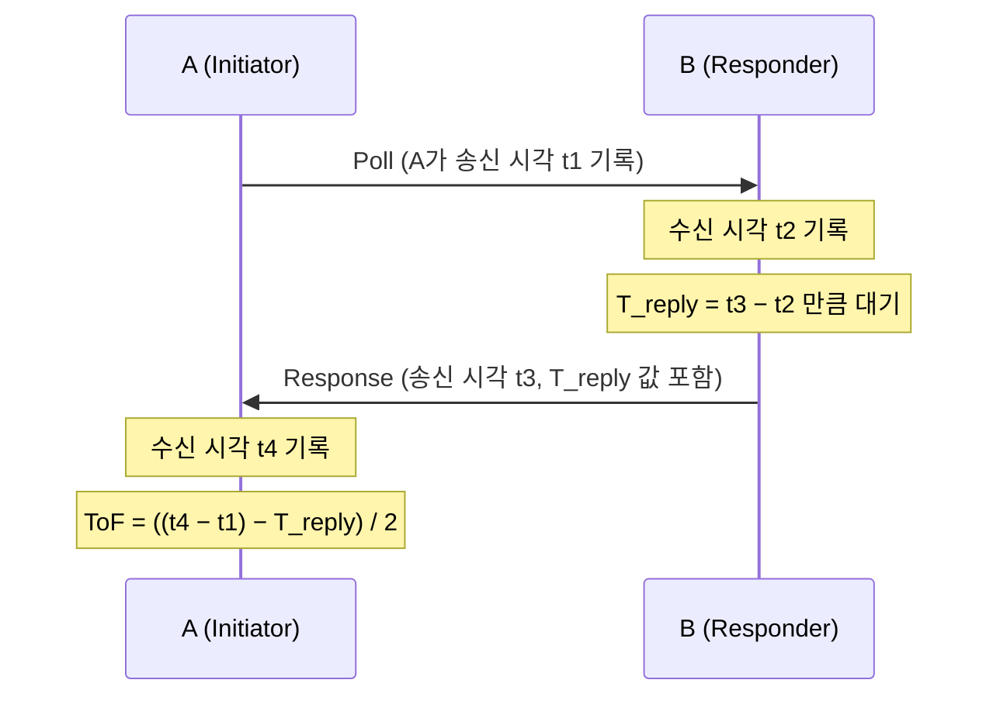
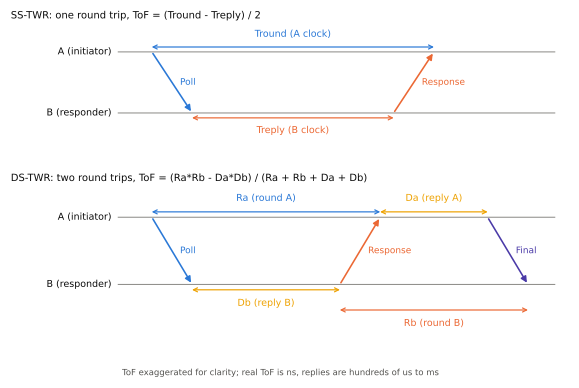

# SS-TWR

!!! spec "규격 · 개정판"
    IEEE 802.15.4-2020 MAC 측거 지원 기능 (SS-TWR) · 802.15.4z-2020 향상된 측거 기능 (SS-TWR, 측거 결과 보고 IE) · FiRa UWB MAC Technical Requirements (SS-TWR 지연·비지연 모드) · 계산: `tools/uwb_numbers.py` (`ss_twr_error_m`)

!!! basic "한눈에 보기"
    **SS-TWR(Single-Sided Two-Way Ranging)**은 가장 단순한 측거입니다. A가 **Poll**을 보내고, B가 정해진 시간만큼 기다렸다가 **Response**를 돌려보냅니다. A는 "보내고 돌아올 때까지 걸린 시간"에서 "B가 기다린 시간"을 빼고 반으로 나눕니다.

    공을 벽에 던져 돌아오는 시간을 재는데, 벽 앞에 선 친구가 공을 잠깐 들고 있다가 던져 준다고 생각해 보세요. 친구가 "2초 들고 있었어"라고 알려 주면 그만큼 빼면 됩니다.

    문제는 **친구의 시계가 조금 빠르거나 느리면** "2초"가 실제로는 2.00004초일 수 있다는 점입니다. 기다린 시간이 길수록 이 오차가 커집니다. 그래서 SS-TWR은 **응답을 아주 빨리 하거나, 상대 시계의 빠르기를 따로 알아내 보정**해야 합니다.

## 메시지 흐름 { .l2 }

<figure markdown>

<figcaption>위: SS-TWR. A는 Tround를 자기 시계로, B는 Treply를 자기 시계로 잽니다. 아래: 비교를 위한 DS-TWR(다음 페이지).</figcaption>
</figure>

\[
\widehat{\text{ToF}} = \frac{T_{round} - T_{reply}}{2}, \qquad d = c \cdot \widehat{\text{ToF}}
\]

B가 Response 안에 \(T_{reply}\)를 실으려면, **송신하기 전에 송신 시각을 알아야** 합니다. 그래서 칩은 "지정한 시각에 송신"(지연 송신) 기능을 쓰고, 그 예정 시각으로 \(T_{reply}\)를 계산해 넣습니다. 이렇게 할 수 없으면 값을 다음 메시지로 따로 보내는데, FiRa는 이를 **지연(deferred) 모드**라고 부릅니다.

## 클럭 오차가 만드는 거리 오차 { .l2 }

A와 B의 수정 발진기 주파수가 조금씩 다르면, 두 기기가 잰 시간 간격의 "1초 길이"가 다릅니다. 오차는 대략 다음과 같습니다.

\[
\Delta d \approx \tfrac{1}{2}\, c\, T_{reply}\,(e_A - e_B)
\]

| \(T_{reply}\) | 상대 오프셋 20 ppm | 2 ppm | 0.1 ppm (CFO 보정 후 예) |
|---|---|---|---|
| 1 ms | **3.00 m** | 0.30 m | 1.5 cm |
| 300 µs | 0.90 m | 9.0 cm | 0.45 cm |
| 200 µs | 0.60 m | 6.0 cm | 0.30 cm |

보정하지 않은 SS-TWR은 응답 시간이 수백 µs만 되어도 수십 cm–m 단위로 틀립니다. 응답 시간은 B가 Poll을 받아 처리하고 Response를 준비하는 데 드는 시간이라 마음대로 줄이기 어렵습니다. 그래서 실무 SS-TWR은 거의 항상 **CFO(반송파 주파수 오프셋) 보정**과 함께 씁니다.

| 장점 | 단점 |
|---|---|
| 메시지 2개 → 측거 시간·전력·공중 시간 최소 | 클럭 오프셋에 민감 (보정 필수) |
| 다수 응답자에게 한 번에 Poll 가능 (일대다) | 응답 시간이 길면 잔여 오차도 커짐 |
| 구현이 단순 | 결과가 Initiator에만 생김 (상대가 알려면 추가 메시지) |

??? expert "전문가 노트 — 드리프트 오차 유도와 CFO 보정"
    **유도.** 실제 비행 시간을 \(\tau\), B의 실제 대기 시간을 \(T_r\)이라 하면 실제 왕복 시간은 \(2\tau + T_r\)입니다. 각자의 시계로 재면

    \[
    \hat T_{round} = (1+e_A)(2\tau + T_r), \qquad \hat T_{reply} = (1+e_B)\,T_r
    \]

    \[
    \widehat{\text{ToF}} = \frac{\hat T_{round} - \hat T_{reply}}{2} = (1+e_A)\,\tau + \tfrac{1}{2}T_r\,(e_A - e_B)
    \]

    첫 항의 \(e_A \tau\)는 10 m·20 ppm에서 0.2 mm로 무시할 수 있고, 둘째 항이 지배적인 오차입니다. 1 ms·20 ppm이면 \(\tfrac12 \times 10^{-3} \times 20\times10^{-6}\) s = 10 ns → **3.0 m**입니다. 부호는 두 시계 중 어느 쪽이 빠른지에 따라 달라지고, 크기는 응답 시간에 비례합니다.

    **CFO 보정.** UWB 칩은 반송파와 타임스탬프 시계를 **같은 수정 발진기**에서 만듭니다. 따라서 A가 Response를 받으며 추정한 반송파 주파수 오프셋 \(\Delta f = f_B - f_A\)가 곧 시계 비율입니다.

    \[
    \frac{1+e_B}{1+e_A} \approx 1 + \frac{\Delta f}{f_c}, \qquad
    \widehat{\text{ToF}} \approx \frac{\hat T_{round} - \hat T_{reply}\,(1 - \Delta f / f_c)}{2}
    \]

    Ch9(\(f_c\) = 7987.2 MHz)에서 20 ppm 오프셋은 약 160 kHz로, 수신기가 프리앰블 동기 과정에서 이미 추정하는 크기입니다. 보정 후 잔여 오프셋이 얼마나 남는지는 칩·SNR에 따라 다르며, 위 표의 0.1 ppm은 계산 예시일 뿐 보장 값이 아닙니다. 보정 방향(누가 누구의 오프셋을 재는지)과 부호를 틀리면 오차가 두 배가 되므로 칩 제조사의 공식 예제를 따르는 것이 안전합니다.

    **일대다 SS-TWR.** 한 Initiator가 Poll을 한 번 보내고 여러 Responder가 시간 슬롯을 나눠 응답하면, 메시지 \(N+1\)개로 \(N\)개 거리를 얻습니다. 뒤 슬롯일수록 \(T_{reply}\)가 길어져 드리프트 오차가 커지므로 CFO 보정이 더 중요해집니다([다중 노드 측거](../mac/multi-node.md)).
