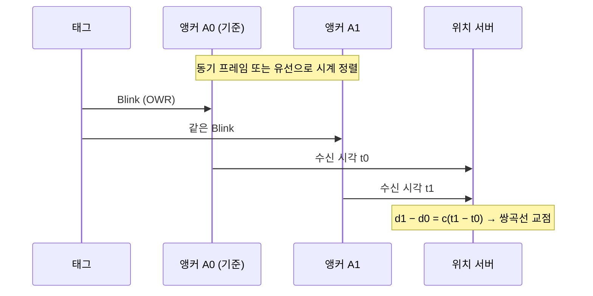
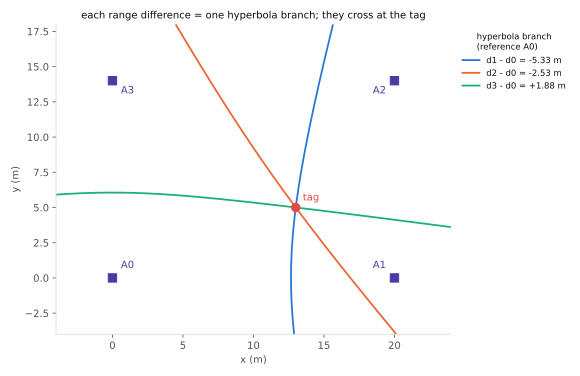

# TDoA (UL·DL)

!!! spec "규격 · 개정판"
    IEEE 802.15.4z-2020 향상된 측거 기능 (OWR: One-Way Ranging, 블링크 프레임) · FiRa UWB MAC Technical Requirements (OWR 기반 UL-TDoA, 후속 버전의 DL-TDoA) · ISO/IEC 24730-62 (802.15.4 UWB RTLS 공중 인터페이스) · omlox · 계산: `tools/uwb_numbers.py`

!!! basic "한눈에 보기"
    **TDoA(Time Difference of Arrival)**는 "언제 도착했나"의 **차이**로 위치를 구합니다. 태그와 앵커가 서로 주고받지 않고, 한쪽만 송신합니다.

    - **UL-TDoA (상향)** — 태그가 짧은 **블링크**를 한 번 보내면, 시계가 맞춰진 여러 앵커가 각자 수신 시각을 기록하고 서버가 위치를 계산합니다. 천둥소리를 여러 마을에서 들은 시각 차이로 번개 위치를 찾는 것과 같습니다.
    - **DL-TDoA (하향)** — 앵커들이 차례로 송신하고, 태그는 **듣기만 하면서** 자기 위치를 계산합니다. GPS와 같은 방식입니다.

    한 번 송신(또는 수신만)으로 끝나므로 태그 전력이 아주 작고, 수천 개 태그를 한 공간에 둘 수 있습니다. 대신 **앵커들의 시계를 ns 수준으로 맞추는 일**이 시스템의 핵심 과제가 됩니다.

## UL-TDoA와 DL-TDoA 비교 { .l2 }

| 항목 | UL-TDoA | DL-TDoA |
|---|---|---|
| 송신자 | 태그 | 앵커 |
| 위치 계산 위치 | 서버 (인프라) | 태그 (단말) |
| 태그 전력 | 매우 낮음 (짧은 송신만) | 수신 구간을 켜야 해서 송신보다 큼 |
| 태그 수 확장성 | 공중 시간이 태그 수에 비례 | **무제한** (태그는 송신하지 않음) |
| 프라이버시 | 인프라가 모든 태그 위치를 앎 | 태그만 자기 위치를 앎 |
| 대표 용도 | 공장·물류 자산 추적, 작업자 안전 ([산업 RTLS](../apps/industrial-rtls.md)) | 실내 내비게이션 ([실내 내비게이션](../apps/indoor-navigation.md)) |

FiRa는 UL-TDoA를 OWR 기반 세션으로 정의했고, DL-TDoA는 공개 자료 기준으로 후속 MAC 규격 버전에서 추가되었습니다. 산업 RTLS 쪽에서는 omlox와 ISO/IEC 24730-62가 TDoA 블링크 기반 상호운용을 다룹니다([omlox와 RTLS](../ecosystem/omlox.md)).

## 쌍곡선 측위 { .l2 }

태그–앵커 \(i\) 거리를 \(d_i\)라 하면, 수신 시각 차는 거리 차 하나를 줍니다. 거리 차가 일정한 점들의 모임은 두 앵커를 초점으로 하는 **쌍곡선**(3차원에서는 쌍곡면)입니다.

<figure markdown>

<figcaption>앵커 4개(A0–A3)와 태그. A0를 기준으로 한 거리 차 세 개가 각각 쌍곡선 한 갈래를 만들고, 그 교점이 태그 위치입니다.</figcaption>
</figure>

| 차원 | 필요한 거리 차 | 필요한 앵커 수 (최소) |
|---|---|---|
| 2D | 2개 | 3 |
| 3D | 3개 | 4 |

실무에서는 잡음과 NLoS 때문에 최소보다 1–2개 많은 앵커를 두고, 최소제곱으로 풉니다([위치 추정 알고리즘](positioning.md)). TDoA는 시각 차 오차 1 ns가 거리 차 오차 30 cm가 되므로, **앵커 간 동기 오차가 곧 위치 오차**입니다.

??? expert "전문가 노트 — 쌍곡선 식, 선형화, 동기 요구"
    **쌍곡선 식.** 태그 위치 \(\mathbf p\), 앵커 \(\mathbf a_i\), 기준 앵커 \(\mathbf a_0\)에 대해

    \[
    r_{i0} = c\,(t_i - t_0) = \lVert \mathbf p - \mathbf a_i \rVert - \lVert \mathbf p - \mathbf a_0 \rVert, \qquad i = 1, \dots, N-1
    \]

    **선형화 (Chan 방식의 출발점).** \(d_0 = \lVert \mathbf p - \mathbf a_0 \rVert\)를 보조 미지수로 두고 \((r_{i0} + d_0)^2 = \lVert \mathbf p - \mathbf a_i \rVert^2\)에서 \(d_0^2\) 식을 빼면

    \[
    2(\mathbf a_i - \mathbf a_0)^\top \mathbf p + 2\,r_{i0}\,d_0 = \lVert \mathbf a_i \rVert^2 - \lVert \mathbf a_0 \rVert^2 - r_{i0}^2
    \]

    \((\mathbf p, d_0)\)에 대해 선형이므로 가중 최소제곱으로 한 번에 풀고, \(d_0\)와 \(\mathbf p\)의 관계를 이용해 한 번 더 다듬습니다. 이 해를 초기값으로 가우스–뉴턴(테일러 급수) 반복을 돌리는 것이 일반적입니다.

    **UL-TDoA 동기.** 앵커 시계의 시각 오프셋과 주파수 오프셋을 모두 추적해야 합니다. 기준 앵커가 주기적으로 동기 프레임을 보내고, 다른 앵커는 (알려진 앵커 간 거리로 비행 시간을 뺀 뒤) 자기 시계와 기준 시계의 관계를 선형 모델로 추정해 블링크 수신 시각을 기준 시계로 환산합니다. 동기 프레임 사이 간격 동안의 드리프트가 문제인데, 상대 오프셋 1 ppm이면 100 ms 동안 100 ns(**30 m**), 0.1 ppm이어도 10 ns(**3.0 m**)가 쌓입니다. 그래서 오프셋을 그대로 쓰지 않고 연속된 동기 프레임 사이를 보간하며, 유선 클럭 분배를 쓰는 시스템도 있습니다.

    **DL-TDoA의 클럭 보상.** 공개 자료 기준으로 FiRa의 DL-TDoA는 앵커들이 서로 측거 메시지를 주고받고 각 메시지에 타임스탬프 정보를 실으며, 태그가 이를 엿들어 앵커 간 시계 관계를 보상하는 구조입니다. 메시지 형식과 필드는 회원 문서이므로 여기서는 다루지 않습니다.

    **보안.** UL-TDoA 블링크는 응답이 없으므로 리플레이·위조에 대한 방어가 TWR과 다릅니다. 802.15.4z의 STS를 블링크에 넣으면 앵커가 진짜 태그 신호인지 확인할 수 있습니다([STS와 보안 측거](../security/sts-secure-ranging.md)).
