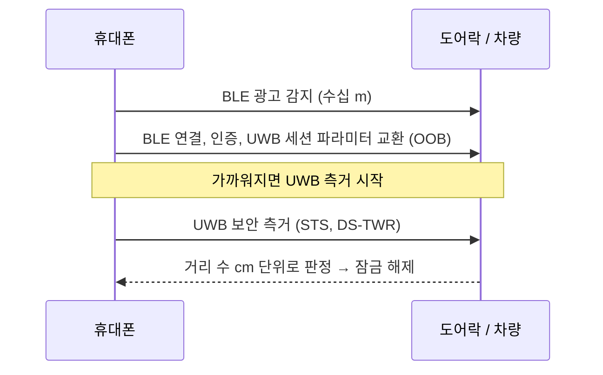

# UWB vs BLE CS vs Wi-Fi RTT vs 5G

!!! spec "규격 · 개정판"
    IEEE 802.15.4z-2020 (UWB 보안 측거) · Bluetooth Core Specification 6.0 (Channel Sounding) · IEEE 802.11mc(FTM)·802.11az-2022 (Wi-Fi 측위) · 3GPP Rel-16/17/18 NR Positioning (TS 38.305 등)

!!! basic "한눈에 보기"
    거리와 위치를 재는 무선 기술은 UWB만 있는 것이 아닙니다. 휴대폰에 이미 들어 있는 Bluetooth, Wi-Fi, 5G도 정밀 측거 기능을 계속 키우고 있습니다.

    - **UWB**: 넓은 대역으로 도착 시각을 직접 재는 방식이라 **정확도와 보안**이 가장 앞섬. 대신 별도 칩·안테나가 필요
    - **BLE Channel Sounding**: 이미 있는 Bluetooth 칩으로 **위상과 왕복 시간**을 함께 써서 정밀도를 끌어올림. 저전력, 넓은 보급이 강점
    - **Wi-Fi RTT**: 있는 AP를 그대로 앵커로 씀. 건물 단위 측위에 유리
    - **5G 포지셔닝**: 기지국 기반, 실외·넓은 범위와 산업용 사설망에 유리

    실제 제품은 하나만 쓰기보다 **BLE로 찾고 UWB로 정밀 측거**하는 식으로 조합합니다.

## 한눈에 비교 { .l2 }

| 항목 | UWB (802.15.4z) | BLE Channel Sounding | Wi-Fi RTT (11mc/az) | 5G NR Positioning |
|---|---|---|---|---|
| 측정 원리 | 펄스 도착 시각 (ToF), PDoA | 반송파 위상(PBR) + 왕복 시간(RTT) | 왕복 시간 (FTM, NDP 교환) | DL/UL-TDoA, Multi-RTT, AoA/AoD |
| 대역폭 | 499.2 MHz 이상 | 2.4 GHz 대역의 여러 채널을 순차 사용 | 20–160 MHz 이상 | FR1 수십–100 MHz, FR2 수백 MHz |
| 거리 정확도 (대략) | 수–10 cm (LoS) | 수십 cm 수준을 목표 (환경 의존) | 1–2 m, 11az는 서브미터 목표 | 실내 수 m (Rel-16), 산업용 서브미터 목표 (Rel-17 이후) |
| 방향(각도) | PDoA로 AoA (다중 안테나) | 별도 기능(AoA/AoD)과 결합 가능 | 11az에서 MIMO 정보 활용 | 기지국 빔 기반 AoD·AoA |
| 측거 보안 | **STS** — 물리 계층 보안 측거 | 무작위화·위상 일관성 검사 등 보안 기능 포함 | 11az 보안 LTF + PASN | 네트워크가 측정을 통제 |
| 전력 | 낮음–중간 (측거 시에만 동작) | 매우 낮음 | 중간 | 단말 모뎀 사용 |
| 인프라 | UWB 앵커·태그 또는 기기 간 | 기기 간 (BLE) | 기존 AP | 기지국·LMF |
| 대표 용도 | 디지털 키, 분실물 정밀 찾기, RTLS | 근접 출입, 분실물 찾기, 저가 태그 | 실내 내비게이션 | 실외·산업 IoT·긴급 위치 |

정확도 숫자는 표준이 보장하는 값이 아니라 **문헌·제품 자료에서 흔히 제시되는 범위**입니다. 같은 기술이라도 환경(LoS/NLoS), 안테나, 알고리즘에 따라 몇 배씩 달라집니다.

## 왜 UWB가 가장 정확한가 { .l2 }

| 요인 | UWB | 협대역 방식 (BLE·Wi-Fi) |
|---|---|---|
| 순간 대역폭 | 500 MHz 이상 → 경로 구분 약 0.6 m | 수–수십 MHz → 경로가 겹침 |
| 다중 경로 대응 | 첫 경로를 시간 축에서 직접 분리 | 여러 채널의 위상을 모아 넓은 대역을 흉내 (주파수 도약 합성) |
| 위상 기반의 약점 | 해당 없음 (시각 기반) | 위상 모호성, 다중 경로에서 위상 왜곡 |
| 공격 저항 | STS로 신호 자체를 예측 불가하게 | 프로토콜 수준 대책 중심 |

BLE Channel Sounding은 여러 채널에서 잰 위상을 합쳐 사실상 넓은 대역의 효과를 얻는 방식이라, 채널을 도는 동안 기기가 움직이거나 다중 경로가 심하면 오차가 커집니다. UWB는 한 번의 넓은 대역 펄스로 같은 정보를 얻습니다.

## 조합해서 쓰는 방식 { .l2 }

CCC Digital Key, CSA Aliro, 스마트폰 분실물 찾기 모두 이 구조입니다. BLE가 **발견·인증·저전력 대기**를, UWB가 **정밀·보안 측거**를 맡습니다([CCC Digital Key 3.0](../ecosystem/ccc-digital-key.md)).

??? expert "전문가 노트 — 자매 핸드북에서 더 보기"
    - Wi-Fi 측위(FTM, 802.11az의 보안 LTF와 PASN, 트리거 기반 측거)는 [Wi-Fi Handbook — 802.11az 측위](https://goodhosup.github.io/wifi/next/positioning/)에 있습니다.
    - 5G NR 포지셔닝(PRS, SRS for positioning, LMF, Multi-RTT, 캐리어 위상 측위)은 [Cellular Handbook — 포지셔닝](https://goodhosup.github.io/cellular/nr/advanced/positioning/)에 있습니다.

    세 기술 모두 **RTT의 시계 오프셋 상쇄**라는 같은 원리를 씁니다. 차이는 (1) 순간 대역폭, (2) 타임스탬프를 어디서 찍느냐(프레임 단위 vs 펄스 단위), (3) 측거 신호를 공격자가 예측할 수 있느냐입니다. UWB의 [SS-TWR](../ranging/ss-twr.md)·[DS-TWR](../ranging/ds-twr.md) 페이지에서 쓰는 클럭 드리프트 분석은 Wi-Fi FTM이나 5G Multi-RTT에도 그대로 적용됩니다.

    BLE Channel Sounding은 Bluetooth Core 6.0(2024)에 들어간 기능으로, 위상 기반 측거(PBR)와 RTT를 함께 정의하고 여러 보안 수준을 둡니다. UWB 칩이 없는 저가 기기에서 "충분히 정밀한" 측거를 노리는 기술이라, 앞으로 UWB와 경쟁·보완 관계가 계속될 것으로 보입니다.
