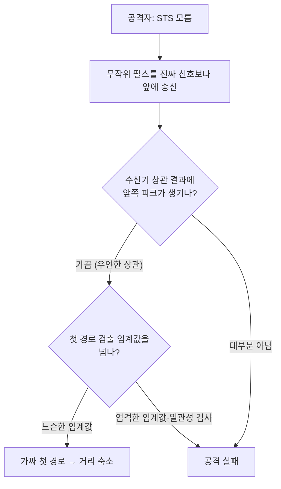

# 공격 연구와 대응

!!! spec "규격 · 개정판"
    IEEE 802.15.4a (보안 기능 없는 측거) · IEEE 802.15.4z-2020 (STS, LRP) · 학계 공개 연구 (ED/LC, Cicada, UWB-ED, Ghost Peak 등)

!!! basic "한눈에 보기"
    UWB 보안 측거의 약속은 "공격자가 거리를 **줄일 수 없다**"입니다. 하지만 이 약속은 표준만으로 지켜지지 않고 **수신기 구현**에 크게 기댑니다. 그래서 연구자들은 "수신기가 첫 경로를 어떻게 고르는가"를 집중적으로 공격해 왔습니다.

    공격의 공통 아이디어는 단순합니다. 진짜 신호보다 **조금 앞에** 가짜 에너지를 넣어, 수신기가 그것을 첫 경로로 착각하게 만드는 것입니다. 진짜 신호의 내용을 몰라도, 수신기의 판단 기준이 느슨하면 성공할 수 있습니다.

## 대표 공격 유형 { .l2 }

| 공격 | 대상 | 원리 | 효과 |
|---|---|---|---|
| ED/LC (Early Detect / Late Commit) | 긴 심볼, 예측 가능한 신호 | 심볼 앞부분만 보고 값을 추측해 일찍 응답, 뒷부분에서 확정 | 거리 축소 |
| Cicada | 802.15.4a 에너지 검출 수신기 | 진짜 신호보다 앞에 펄스를 계속 뿌려 첫 경로를 앞당김 | 거리 축소 |
| 프리앰블 재전송·위조 | 공개 프리앰블로 시각을 재는 시스템 | 공개 코드라 미리 만들어 앞당겨 송신 | 거리 축소 |
| Ghost Peak (2022) | HRP + STS 수신기 | STS를 모른 채 무작위 펄스를 겹쳐 앞쪽 가짜 상관 피크 유도 | 낮은 확률로 거리 축소 |
| 오버섀도잉·재머 | 모든 수신기 | 강한 신호로 진짜 첫 경로를 가리거나 지연 | 거리 확대, 서비스 거부 |

공개 연구는 대부분 실험실 조건에서 이뤄졌고, 성공 확률·필요 장비·거리 조건이 논문마다 다릅니다. 실무에서는 "가능하다"는 사실보다 **우리 시스템의 수신기 설정에서 확률이 얼마인지**를 따지는 것이 중요합니다.

## 왜 STS만으로는 부족한가 { .l2 }

STS는 공격자가 **정확히 같은** 펄스열을 만들지 못하게 하지만, 무작위 펄스도 수신기의 상관 출력에 작은 피크를 만들 수 있습니다. 첫 경로 검출은 원래 **약한 앞쪽 피크를 찾도록** 설계돼 있으므로(NLoS에서 첫 경로가 약하기 때문), 감도를 높일수록 공격에도 취약해지는 긴장 관계가 있습니다([수신기 구조와 첫 경로 검출](../phy/receiver.md)).

## 대응 방법 { .l2 }

| 계층 | 대응 |
|---|---|
| 수신기 | 첫 경로 임계값을 잡음·간섭 통계에 맞춰 설정, 프리앰블·STS 도착 시각 일관성 검사, STS 세그먼트 간 비교, 이상 에너지 탐지 |
| PHY 설정 | 긴 STS, 다중 세그먼트, 높은 PRF (가짜 피크가 우연히 생길 확률을 낮춤) |
| 프로토콜 | 여러 번 측거해 통계 판정, 여러 앵커 결과의 기하학적 일관성 검사 (차량 앵커 여러 개) |
| 응용 | 거리 하나로 즉시 결정하지 않고 접근 궤적·자세 센서와 결합, 민감한 동작(시동)은 추가 확인 |

??? expert "전문가 노트 — 거리 확대 공격과 LRP"
    **거리 확대**는 공격자가 진짜 첫 경로를 지우거나(상쇄 신호) 늦은 경로를 강하게 만들어 거리를 늘리는 공격입니다. 진짜 첫 경로를 정밀하게 상쇄하려면 채널을 알아야 하므로 어렵지만, 강한 신호로 수신기를 포화시키는 것은 쉽습니다. 응용이 "멀리 있으면 잠금"처럼 **거리 확대가 곧 안전 쪽 실패**인 경우가 많아 보통 우선순위가 낮지만, 측위·충돌 회피처럼 거리가 안전과 직결되는 응용에서는 별도로 따져야 합니다.

    **LRP**는 낮은 PRF와 짧고 강한 펄스, 비트 단위 교환에 가까운 구조로 ED/LC형 공격에 강한 설계를 목표로 했습니다. 학계에서 제안된 **UWB-PR(펄스 재배열)** 같은 방식도 비슷한 문제의식에서 나왔습니다. 다만 스마트폰·차량 생태계는 HRP + STS가 표준으로 자리 잡았기 때문에, 실무 대응은 주로 HRP 수신기 강화 방향입니다.

    평가 시에는 공격 성공률을 **세션 단위**로 보는 것이 맞습니다. 프레임 하나의 성공 확률이 낮아도 공격자가 무한히 시도할 수 있다면, 응용이 실패 측거를 어떻게 처리하는지(재시도 제한, 이상 감지 시 세션 종료)가 실제 위험을 결정합니다.
