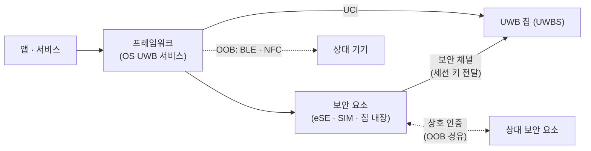

# FiRa 보안 구조

!!! spec "규격 · 개정판"
    FiRa Consortium 공개 자료 — Secure UWB Service, Secure Component, UCI 세션 설정(STS 설정) · GlobalPlatform 보안 요소(SE) · IEEE 802.15.4z STS

!!! basic "한눈에 보기"
    UWB 칩은 측거를 잘하지만, "이 상대가 믿을 만한가"를 판단하고 비밀 키를 안전하게 나누는 일은 맡지 않습니다. FiRa는 이 역할을 **보안 요소(Secure Element, SE)**에 맡기고, 휴대폰 앱이나 운영체제는 키를 직접 만지지 못하게 설계했습니다.

    흐름을 한 줄로 쓰면 이렇습니다.

    > 두 기기의 **보안 요소**가 서로 인증하고 세션 키를 합의 → 그 키가 **UWB 칩**으로 직접 전달 → UWB 칩이 STS를 만들어 측거

    앱은 "측거 시작"만 요청할 뿐, STS 키는 보지 못합니다. 앱이 해킹당해도 측거 보안은 유지되는 구조입니다.

## 구성 요소 { .l2 }

| 구성 요소 | 역할 |
|---|---|
| 앱·서비스 | 측거 요청, 결과 사용. 키 접근 불가 |
| 프레임워크 | 세션 관리, UCI로 UWB 칩 제어, OOB 채널 관리 |
| UWB 칩 (UWBS) | PHY·MAC, STS 생성, 타임스탬프 |
| 보안 요소 | 자격 증명 저장, 상대와 상호 인증, 세션 키 유도 |
| OOB 채널 | 측거 전 발견·파라미터 교환·보안 메시지 운반 (주로 BLE) |

## 세션이 열리는 순서 { .l2 }

1. **발견**: BLE 광고 등으로 상대를 찾습니다.
2. **보안 채널 수립**: 두 보안 요소가 OOB 채널 위에서 상호 인증하고 세션 키를 합의합니다. 자격 증명과 접근 권한(누가 어떤 서비스에 측거할 수 있나)도 이때 확인합니다.
3. **세션 키 전달**: 보안 요소가 UWB 칩과의 보안 연결로 세션 키를 넘깁니다. 프레임워크는 키 값을 보지 않습니다.
4. **측거 파라미터 설정**: 채널, 슬롯, 라운드 구조, STS 설정 등을 UCI로 UWB 칩에 설정합니다([UCI](../ecosystem/uci.md)).
5. **보안 측거**: UWB 칩이 세션 키에서 STS 키 등을 유도해 측거합니다.

STS 설정의 종류(정적·동적·프로비저닝)는 [STS와 보안 측거](sts-secure-ranging.md)에 정리했습니다. 비보안 응용(예: 시험, 단순 근접 표시)은 보안 요소 없이 정적 STS로 동작할 수 있습니다.

## 세션 키에서 유도하는 것 { .l2 }

세션 키 하나에서 용도별 키를 따로 유도해, 한 키가 여러 목적에 섞이지 않게 합니다.

| 유도 대상 | 용도 |
|---|---|
| STS 생성 키·IV | 측거 프레임의 STS |
| 데이터 보호 키 | 측거 제어 메시지(결과 보고 등)의 무결성·기밀성 |
| 프라이버시 키 | 주소·식별자 노출 최소화 ([프라이버시](privacy.md)) |

정확한 유도 함수와 입력 필드는 FiRa 규격 본문에 있으며, 여기서는 구조만 다룹니다.

??? expert "전문가 노트 — 보안 요소를 두는 이유와 대안"
    **보안 요소를 두는 이유**: 휴대폰 OS는 공격 표면이 넓습니다. 키를 SE 안에서 생성·보관하고 UWB 칩과 직접 연결하면, OS가 탈취돼도 키를 빼낼 수 없습니다. 결제(NFC 카드 에뮬레이션)와 같은 사고방식이며, 디지털 키처럼 **물리적 접근 권한**이 걸린 응용에서 특히 중요합니다.

    **대안 구성**:

    - **칩 내장 보안 영역**: UWB 칩 안에 키 저장소와 암호 엔진을 두는 방식. 부품 수가 줄지만 인증 범위가 칩에 묶입니다.
    - **프로비저닝 STS**: 서버나 상위 프로토콜(예: CCC Digital Key의 BLE 보안 채널)이 키를 정하고 호스트가 UWB 칩에 넣어 주는 방식. 보안은 키 전달 경로에 달려 있습니다.
    - **애플 생태계**: Nearby Interaction은 FiRa 보안 요소 구조 대신 자체 키 관리를 씁니다. 액세서리 연동에서는 FiRa 호환 설정을 쓸 수 있습니다([스마트폰 API](../ecosystem/smartphone-api.md)).

    인증 시험 관점에서 FiRa 인증은 **상호운용성**(PHY·MAC 적합성)이 중심이고, 보안 측거의 "공격 저항성"은 칩 구현 품질에 크게 좌우된다는 점을 구분해 두는 것이 좋습니다.
