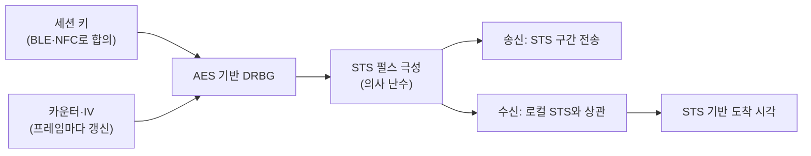

# STS와 보안 측거

!!! spec "규격 · 개정판"
    IEEE 802.15.4z-2020 HRP UWB PHY — STS (Scrambled Timestamp Sequence), STS 패킷 구성, STS 생성용 AES 기반 DRBG · FiRa STS 설정 (정적·동적·프로비저닝)

!!! basic "한눈에 보기"
    측거는 "펄스가 언제 도착했나"를 재는 일입니다. 802.15.4a까지는 이 시각을 **프리앰블**로 쟀는데, 프리앰블은 표준에 정해진 공개 코드라 공격자도 똑같이 만들 수 있었습니다.

    **STS**는 비밀 키로 만든 **의사 난수 펄스열**입니다. 송신기와 수신기만 같은 키를 갖고 있어서 둘만 같은 펄스열을 만들 수 있습니다. 수신기는 STS 구간에서 도착 시각을 다시 재고, 프리앰블로 잰 값과 맞는지 확인합니다.

    비유하면 프리앰블은 누구나 아는 노래, STS는 둘만 아는 암호 노래입니다. 공격자는 누구나 아는 노래는 먼저 부를 수 있지만, 암호 노래는 박자를 앞당겨 부를 수 없습니다.

## STS 패킷 구성 { .l2 }

802.15.4z는 STS가 프레임의 어디에 들어가는지에 따라 네 가지 구성을 둡니다.

| 구성 | 프레임 구조 | 쓰임 |
|---|---|---|
| SP0 | SHR → PHR → 페이로드 (STS 없음) | 일반 데이터, 보안 없는 측거 |
| SP1 | SHR → **STS** → PHR → 페이로드 | 측거 + 데이터를 한 프레임에 |
| SP2 | SHR → PHR → 페이로드 → **STS** | 측거 + 데이터, STS를 뒤에 |
| SP3 | SHR → **STS** (PHR·페이로드 없음) | 순수 측거 프레임. 공중 시간 최소, 스마트폰·차량에서 많이 씀 |

SP3는 데이터를 실을 수 없으므로 측거 제어 정보(타임스탬프 교환 등)는 별도 데이터 프레임이나 BLE 같은 다른 채널로 보냅니다. CCC Digital Key와 FiRa 프로파일이 SP3를 기본으로 쓰는 이유가 여기에 있습니다.

## STS 생성 원리 { .l2 }

- STS는 **AES-128 기반 결정적 난수 생성기(DRBG)**의 출력 비트로 펄스의 극성(+/−)을 정합니다.
- 입력은 세션마다 정해지는 **키**와, 프레임마다 바뀌는 **카운터(IV의 일부)**입니다. 같은 STS가 다시 쓰이지 않도록 카운터는 계속 증가합니다.
- STS는 여러 **세그먼트**로 나뉘며, 세그먼트 사이에 짧은 **갭**(무신호)이 있습니다. 세그먼트 수와 길이는 설정으로 정합니다.
- STS는 펄스 단위로 의사 난수라 자기 상관의 부엽이 프리앰블보다 높습니다. 그래서 수신기는 STS를 **충분히 길게** 모아야 정확한 첫 경로를 얻습니다.

## 키는 어디서 오나 { .l2 }

STS 키는 UWB 자체가 아니라 **상위 계층**이 정합니다. FiRa는 STS 설정을 다음처럼 구분합니다.

| STS 설정 | 키 출처 | 보안 수준 |
|---|---|---|
| 정적 STS (static) | 공개된 고정 값(공급사 ID 등)에서 유도 | 낮음. 시험·비보안 응용용 |
| 동적 STS (dynamic) | 보안 요소(SE)의 보안 채널로 합의한 세션 키 | 높음 |
| 동적 STS + 응답자별 서브 세션 키 | 세션 키 + 기기별 키 | 높음. 일대다에서 기기 간 분리 |
| 프로비저닝 STS (provisioned) | 호스트가 미리 넣어 준 세션 키 | 키 전달 경로의 보안에 의존 |

CCC Digital Key는 BLE 보안 채널에서 측거용 비밀 키를 미리 유도해 두고 세션마다 씁니다([CCC Digital Key 3.0](../ecosystem/ccc-digital-key.md)). 어느 경우든 **STS 키가 새면 보안 측거도 끝**이므로, 키는 보안 요소나 UWB 칩 내부에서만 다루는 것이 원칙입니다([FiRa 보안 구조](fira-security.md)).

??? expert "전문가 노트 — STS 수신기가 확인하는 것"
    표준은 STS의 생성 방법과 프레임 구성을 정하지만, **수신기가 STS로 무엇을 검증할지는 규정하지 않습니다**. 실제 칩은 대체로 다음을 봅니다.

    - **STS 상관 품질**: 로컬 STS와의 상관 피크가 충분히 크고 깨끗한가. 키가 틀리면 상관이 거의 나오지 않습니다.
    - **프리앰블 vs STS 도착 시각 일치**: 둘의 차이가 크면 프리앰블 위조나 강한 간섭을 의심합니다.
    - **첫 경로 앞쪽의 이상 에너지**: 주 피크보다 앞에 작은 피크가 갑자기 나타나면 위조 펄스일 수 있습니다.

    공개된 공격 연구(예: 2022년 iPhone 대상 "Ghost Peak")는 공격자가 STS를 모른 채 **무작위 펄스를 겹쳐** 첫 경로 검출이 앞쪽 가짜 피크를 고르도록 유도할 수 있음을 보였습니다. 성공 확률은 낮지만 0이 아니었고, 대응은 수신기의 판정 임계값과 일관성 검사를 강화하는 쪽으로 이뤄졌습니다. 자세한 내용은 [공격 연구와 대응](attacks.md)에 있습니다.

    STS 세그먼트를 여러 개 쓰면 세그먼트별 도착 시각을 서로 비교할 수 있어 위조를 걸러 내기 쉬워집니다. 대신 공중 시간과 전력이 늘어납니다.
