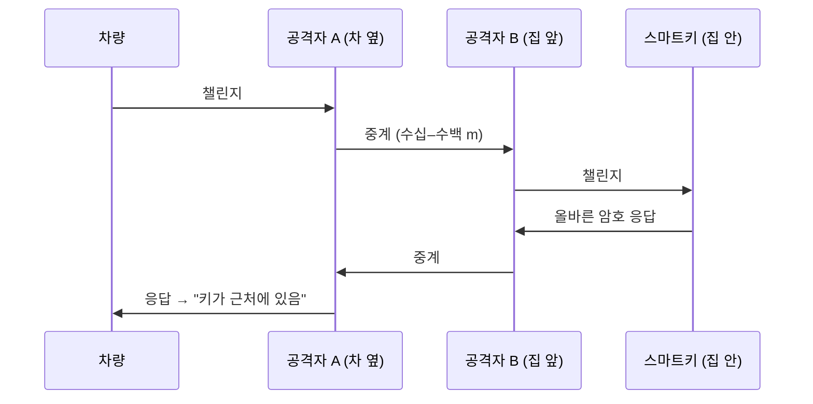

# 왜 보안 측거인가

!!! spec "규격 · 개정판"
    IEEE 802.15.4z-2020 (HRP STS, LRP 측거 보안 기능) · 거리 경계(distance bounding) 연구 (Brands–Chaum) · CCC Digital Key 3.0 · FiRa Secure Ranging

!!! basic "한눈에 보기"
    스마트키를 주머니에 넣고 차에 다가가면 문이 열립니다. 이때 차가 확인해야 하는 것은 두 가지입니다.

    1. **누구인가** — 등록된 키인가? (암호 인증)
    2. **어디 있나** — 정말 문 앞에 있는가? (거리)

    기존 저주파·RF 스마트키는 1번은 잘 했지만 2번은 "신호가 들리면 가깝다"는 가정에 기댔습니다. 공격자가 신호를 멀리서 받아 차 옆으로 **중계**하면, 키는 집 안에 있는데 차는 "키가 옆에 있다"고 믿습니다. 이것이 **릴레이 공격**입니다.

    보안 측거는 2번을 **물리 법칙**으로 확인합니다. 전파는 빛보다 빨리 갈 수 없으므로, 응답이 돌아온 시간이 짧으면 상대는 정말 가까이 있습니다. 공격자는 중계로 시간을 늘릴 수는 있어도 **줄일 수는 없어야** 합니다. UWB 보안 측거의 목표가 바로 이 "줄일 수 없음"을 보장하는 것입니다.

## 릴레이 공격 { .l2 }

암호 응답 자체는 진짜이므로 암호만으로는 막을 수 없습니다. 막으려면 차량이 **응답이 돌아오는 시간**을 재서 거리 상한을 계산해야 합니다. 신호 세기(RSSI)로 거리를 추정하는 방식은 공격자가 증폭기로 세기를 키우면 무력화됩니다.

| 근접 판단 방식 | 공격자가 할 수 있는 것 | 결과 |
|---|---|---|
| 신호가 들리면 근처 (LF/RF 키) | 중계 | 원거리에서 문 열림 |
| RSSI 거리 추정 (BLE) | 증폭·중계 | 거리 축소 가능 |
| 시간 기반 측거, 보호 없음 (802.15.4a) | 프리앰블 위조, 조기 응답 | 거리 축소 가능 |
| 시간 기반 보안 측거 (802.15.4z STS) | 중계 → 시간만 늘어남 | 거리 **확대**만 가능 |

## 거리 축소와 거리 확대 { .l2 }

보안 측거에서 공격은 방향에 따라 의미가 다릅니다.

- **거리 축소(distance reduction)** — 실제보다 가깝게 보이게 하는 공격. 문 열림·결제 승인 같은 **권한 상승**으로 이어지므로 반드시 막아야 합니다.
- **거리 확대(distance enlargement)** — 실제보다 멀게 보이게 하는 공격. 서비스 거부(문이 안 열림)나 측위 교란으로 이어집니다. 응용에 따라 위험도가 다르며, 막기가 더 어렵습니다.

UWB가 측거 보안에 유리한 이유는 펄스가 **수 ns 폭으로 짧기** 때문입니다. 1 ns는 빛이 약 30 cm 가는 시간이므로, 공격자가 응답을 "미리" 보내려 해도 수십 cm 이상 앞당기기 어렵습니다. 협대역 신호는 심볼 하나가 µs 단위라 같은 공격에서 수십–수백 m를 앞당길 여지가 생깁니다.

## 보안 측거의 세 요소 { .l2 }

| 요소 | 역할 | UWB에서의 구현 |
|---|---|---|
| 예측 불가능한 신호 | 공격자가 미리 만들 수 없게 함 | STS: 세션 키로 생성한 의사 난수 펄스열 ([STS와 보안 측거](sts-secure-ranging.md)) |
| 타임스탬프와 신호의 결합 | 시간 측정이 바로 그 신호에서 나오게 함 | STS 수신 구간에서 도착 시각 추정 |
| 견고한 수신기 | 위조·간섭 펄스에 첫 경로가 속지 않게 함 | 칩 구현 (STS 품질 지표, 이상 탐지) |

세 가지 중 하나라도 빠지면 보안이 깨집니다. 특히 세 번째는 표준이 수신기 알고리즘을 규정하지 않으므로 **칩마다 다르며**, 실제 공격 연구도 대부분 이 부분을 겨냥했습니다([공격 연구와 대응](attacks.md)).

??? expert "전문가 노트 — 거리 경계 프로토콜과 UWB"
    거리 경계(distance bounding)는 1993년 Brands–Chaum 논문에서 시작된 개념으로, 검증자가 **빠른 비트 교환**의 왕복 시간으로 증명자 거리의 **상한**을 구합니다. 이상적인 거리 경계는 다음을 요구합니다.

    - 증명자의 응답이 챌린지에 **즉시** 의존해야 함 (처리 시간 무시 가능)
    - 응답 비트가 예측 불가능해야 함
    - 물리 계층에서 비트 하나를 판단하는 시간이 짧아야 함 (조기 감지 방지)

    802.15.4z HRP의 STS 방식은 엄밀한 의미의 비트 단위 거리 경계가 아니라, **양쪽이 공유한 비밀로 만든 긴 의사 난수 시퀀스를 타임스탬프의 기준으로 삼는** 방식입니다. 응답 지연(수백 µs–ms)은 TWR 계산으로 상쇄합니다. 그래서 보안성은 "공격자가 STS를 모른 채 수신기의 상관 결과를 앞당길 수 있는가"라는 수신기 문제로 귀결됩니다.

    802.15.4z의 **LRP** PHY에는 짧은 펄스와 비트 단위 교환에 가까운 거리 경계 지향 모드가 들어 있어, 학계 거리 경계 설계와 더 가깝습니다([LRP PHY](../phy/lrp.md)). 스마트폰·차량 생태계는 HRP + STS가 주류입니다.
